# GPU architecture

This is the architecture guide for the **current SystemVerilog GPU** in this
repository. Read [GPU_CONTROL.md](GPU_CONTROL.md) for the CPU-facing bus,
registers, binary commands, data structures and generic host-code examples.

The current command/data profile is **`N20K-SYS-0.2`**, a provisional wire ABI
implemented in the RTL, board image and MPC-2350 host. Older M0 design documents
describe the original requirements. This guide describes the current implementation.

**Current status:** rendering and CPU control execute functional RTL under
Verilator, with an independent software reference renderer (SRR) checking the
results. The board target now includes clocks/reset, bidirectional host pads,
registered SDRAM pads, video serialization and exact Tang Nano 20K constraints.
The complete board implementation report, rather than the earlier logical-core
probe, is the authority for board resource and timing results. Hardware
qualification remains incomplete. The MPC-2350 firmware drives the GPU with
one PIO state machine and shares its GPU client between the terminal and the
focused NARM application. Its rendering regression uses the software oracle.
The board image runs a **50.4 MHz GPU core/SDRAM clock** with **25.2 MHz
pixels** and 126 MHz DDR serialization. The GPU's rendered output drives HDMI;
the user reported the terminal running on an earlier image. The previous
image added the SKIP load flag to the pipelined SDRAM controller, word-wide
display FIFO and tile clearing during stores; the user reported
`demo_3d_engine6` running on it with the RP2350 at a stable 60 fps. The
current image adds **GPU triangle setup** for kind-4 vertex triangles
(section 6). It is built with
Gowin EDA; `AGENTS.md` records why, and which gate that flow cannot meet. Its
source-matched build verifies every package pin and meets every required
clock, with the core at 54.97 MHz Fmax. It uses **18,058/20,736 logic
(Gowin count)**, **7,395 registers**, **46/46 BSRAM**, 63% DSP and one PLL.

Version 0.2 replaces raw heap uploads with one lossless encoded upload engine.
It shares the existing packet-word register, counters, 64-byte staging RAM and
SDRAM-write backend; its only additional decoder storage is an eight-bit group
descriptor. All resource types use this engine, with literal words inside the
same encoding. There is no legacy 0.1 packet path or uncompressed fallback.
Decoded primitive records are 320 bytes, except the 64-byte kind-4 vertex
triangle, whose setup the GPU computes (capability feature bit 8).
The [earlier standalone decoder experiment](../docs/hardware/upload-codec.md)
was a different probe with additional measurement registers; its failed
co-residency result is historical, not an integrated fit measurement. The
historical unified-engine logical-core probe routed with **159 physical LUT
sites remaining**. That count excluded the production board wrapper and must
not be treated as board headroom. Both historical probe reports below retain
their original source hashes; they do not qualify the changed board RTL.

Whenever the architecture or CPU control changes, update **both files in
`GPU_DOCUMENTATION/`** in the same change and push them with the implementation.
Describe implemented behavior as implemented, and label proposals as planned.

**Hardware compatibility policy:** backward compatibility must never consume
additional hardware resources. Retain no legacy decoder, compatibility mode
or duplicate datapath solely to support an older interface at a resource cost.
Break the ABI and update host software, tests and both guides together when
necessary. Compatibility with zero additional hardware cost is allowed. This
policy does not remove required current functionality or input validation;
the currently implemented profile remains unchanged.

## 1. Target hardware and selected operating profile

The target board is the **Sipeed Tang Nano 20K**, fitted with the Gowin
**`GW2AR-LV18QN88C8/I7`**. The open-source implementation tools select the
**`GW2A-18C`** device database and that exact package/part. On the received
board, the open-flow GPU image's host address latch failed while the same RTL
built by the vendor Gowin EDA worked (section 14). Board images now use Gowin
EDA V1.9.8.11 Education under the temporary exception in `AGENTS.md`.

| Physical resource | Device limit |
| --- | ---: |
| LUT4 resources | 20,736 |
| Flip-flops | 15,552 |
| Native BSRAM blocks | 46, each 18,432 physical bits |
| Native 18×18 multiplier equivalents | 48 |
| PLLs available in QN88 | 2 |
| In-package SDR SDRAM | 8 MiB, 32-bit data interface |

The default logical-core simulation profile assumes a **100.8 MHz core/SDRAM clock** and
**25.2 MHz host and pixel clocks**. These are nominal design assumptions, not
achieved whole-GPU FPGA frequencies. The host link has its own clock domain;
the RP2350 supplies `host_clk`. The integrated demo drives it at one quarter of
the core clock, and separate link tests exercise other clock ratios/phases.

The **fixed `N20K-PIN-0.1` wiring reservation** connects a Waveshare Core2350B
(16 MiB flash, 8 MiB PSRAM) to Tang Nano 20K hardware 3921 using **16 signal
GPIOs plus common ground**. It reuses VGA GP16/GP17 for HCLK/WR_N and VGA
GP18–GP25 for the bidirectional data byte. The user's 2026-11-06 RP-side wiring
revision replaces unavailable GP10–GP15 with **GP35–GP40 on P4**: GP35 ABORT,
GP36 GPU_RESET_N, GP37 ALE_N, GP38 RD_N, GP39 WREADY and GP40 RVALID.
The `N20K-PIN-0.1` Tang package-pin allocation is unchanged; no RTL or FPGA
constraint change is needed for this host-side remap. GP39 shares the Core's
active-high red LED and must be an RP input, with the LED load driven by Tang
WREADY rather than an independent RP LED output. All selected FPGA banks run
at 3.3 V.
The [control guide's exact wiring table](GPU_CONTROL.md#fixed-wiring-layout-core2350b-to-tang-nano-20k)
and [printable board layouts](../docs/images/core2350b-tang-nano20k-wiring.pdf)
identify manufacturer header contacts and package pins.

[`tang20k_top.sv`](../rtl/board/tang20k_top.sv) implements that wiring:
seven-bit address latching on ALE_N writes, active-low read/write controls,
shared-data output enable, WREADY/RVALID gating and GPU_RESET_N logic reset.
[`tang20k.cst`](../rtl/board/tang20k.cst) fixes the external package pins.
[`tang20k-sip.json`](../rtl/board/tang20k-sip.json) records the expected fixed
SDRAM terminals. The current Gowin build's encrypted netlist prevents that
connection check. Font upload, copies and scanout exercise the SDRAM on the
board.

The MPC-2350 bus driver claims one **PIO2** state machine with GPIO base
**16** to reach both control groups and the contiguous data pins. PIO drives
HCLK, write/address/read strobes and data direction, and samples WREADY and
RVALID. The CPU owns packet construction, FIFO deadlines and GPU reset.
Each retry takes **12 PIO cycles per HCLK period**. The firmware derives
the PIO divider from the system clock and one requested HCLK burst rate,
`kHostClockHz`, which defaults to **250 kHz** in the published firmware; the
user's local build uses 18.75 MHz (2026-11-10). HCLK pauses between byte
transactions, so a data write takes about 27 PIO cycles, about 8 MB/s at
18.75 MHz. A local MPC-2350 firmware change (2026-11-10, run on the board)
feeds packet bytes to the unchanged PIO program by DMA: two channels stream
write commands from SRAM and drain the per-byte completions while the CPU
prepares the next packet. PIO still samples WREADY before every write edge.
Address-select writes and reads remain one transaction at a time. The earlier
GPIO driver first ran on the board at 50 µs phases. The user reported that
25 MHz failed on their wired setup, and that 21 MHz and 18.75 MHz HCLK work.

The board image uses a **50.4 MHz core/SDRAM clock**, **25.2 MHz pixel clock**
and **126 MHz DDR serializer clock**. One rPLL derives 252 MHz from 27 MHz
(divide 3, multiply 28), with a divided 126 MHz output. Two CLKDIV5 blocks
produce the core and pixel clocks, giving exactly two core clocks per pixel. A
pixel-domain toggle crosses through two core-domain synchronizer stages and an
event detector, and that event advances core scanout. Pixel payloads
therefore change after a physical pixel edge and settle before a later
encoder capture, independent of GPU-reset release phase. The board-wrapper
regression checks capture spacing and exactly one pixel per physical pixel
clock across eight reset-release offsets. The core's rendered pixels drive the
TMDS encoders and HDMI.

From 2026-11-06 to 2026-11-07, a 6.3 MHz bus-test image with a constant-black
raster replaced this profile during bus diagnosis. It is historical and is no
longer built. Clock profiles are compile-time constants: the image contains one
configuration, with no runtime mode or duplicate compatibility hardware. The
host supplies its independent clock, with a design ceiling of 25.2 MHz pending
electrical validation. Board capabilities report **50,400,000 core Hz**,
host-divider metadata 0 (independent clock) and pixel divider 2.

Configuration initializes an eight-bit power-on delay. The board reset button
(pin 88, active HIGH) restarts PLL initialization. PLL lock and GPU_RESET_N
control asynchronous reset assertion and synchronized release separately in
core, host and pixel domains; the native link/FIFOs also synchronize reset
release in their receiving domains. The GPU_RESET_N input has an FPGA pad
pull-down in the package constraints,
so an unconnected host holds GPU rendering in reset. There is no command
player or built-in demo scene.

SDRAM commands, address, masks, DQ output and output enable are registered on
the core rising edge. An ODDR forwards an inverted core clock, giving output
signals approximately half a core period before the chip sampling edge.
The input DQ is sampled at the next core rising edge. Output registers are
not cleared by GPU logic reset, allowing already-issued write tails to drain.
The board waits **10,080 core cycles (200 us)** before SDRAM initialization
and uses refresh interval **787 cycles (about 15.6 us)** with the controller's
early-service guard. CAS3 and BL8 use the controller's default bank timings
(tRP/tRCD 3, tRFC 9, tRAS 6, tRC 9 cycles). These are implemented logical
timings; pad/interconnect margins still require physical-board measurement.

The layout leaves the Tang LCD FPC disconnected and avoids HDMI, flash, SDRAM,
SD, audio and BL616 signal conflicts. WR_N/RD_N/ALE_N use three existing LED
pins as FPGA inputs, with their LED loads included in the wiring/current
instructions. Core GP39 adds its red LED and 470 Ω path to ground to WREADY;
that load remains part of the pending external electrical validation.
The VGA DAC must be disconnected before its GPIOs become a
bidirectional GPU bus. Power, pulls, boot isolation and driver bring-up
limits are specified in the control guide.

The current user-reported assembly uses **A2 RP2350 silicon**, one **100 Ω
series resistor per signal wire** (16 total), and separate **4.7 kΩ pull-downs
from RP GPIO39/WREADY and GPIO40/RVALID to common GND**. Resistor-end placement
is not known. The added pull-downs did not change the all-zero capability
readback; other external bias fitment is unconfirmed. A2's E9 input leakage can
affect weak/high-impedance lines; a valid low-impedance FPGA-driven read should
overcome it. E9 alone has not been established as the cause. The control guide separates
this observed assembly from recommended bias. Raspberry Pi reports E9 fixed
in A4; the `RP2350B` package name alone does not identify the stepping.
[Official A4 announcement](https://www.raspberrypi.com/news/rp2350-a4-rp2354-and-a-new-hacking-challenge/)

## 2. CPU and GPU responsibilities

| RP2350 / CPU side | FPGA / GPU side |
| --- | --- |
| Transform objects and vertices; supply lighting as constant or vertex RGB | Evaluate prepared edge and attribute equations |
| Clip and project geometry; snap coordinates and normalize winding | Test triangle coverage at pixel centers |
| Prepare fixed-point edge/depth/color/UV equations | Perform perspective-correct texture coordinate reconstruction |
| Allocate textures, records and bin lists in GPU memory | Sample the texture cache and fetch misses from SDRAM |
| Bin primitives into ordered 32×32 tile lists | Apply shading, color key, scissor and depth operations |
| Serialize uploads and commands; handle replies/recovery | Load/clear, render and store tile attachments |
| Choose the writable physical buffer and request presentation | Swap at vertical blank and continuously scan out the front buffer |

Vertex transformation, clipping, projection and lighting are **CPU work in
this version**. For example, Gouraud mode interpolates RGB values supplied by
the CPU; the FPGA does not transform normals or calculate a lighting model.
Triangle setup is CPU work for kinds 0..3. For a flat **kind-4 vertex
triangle** the GPU computes it instead: winding, back-face culling, edges,
bounds, depth plane and per-tile rejection (section 6). This record is 64 bytes
instead of 320, and it needs no exact CPU tile test.
The MC10 Minecraft port's textured world triangles deliberately use a binary32
setup instead of the exact rational equations. Its frames are therefore not
bit-identical to the reference oracle. The
[control guide](GPU_CONTROL.md#preparing-triangle-records) states its
measured error bounds.

The C++ host/setup implementation is a reference implementation for preparing
valid commands. The RP2350 PIO driver and **40×30 monochrome terminal** are
implemented in the [MPC-2350 firmware](https://github.com/apc53pro/MPC-2350/tree/6b4ebda7e0bffb24ea81aead5970b014f4146e2c).
That terminal uploads a
64 KiB RGB565 bitmap-font texture to heap `0x258000` once per hard-reset session.
It builds the first frame from 16×16 glyph copies. It tracks which characters
each of the two colour buffers shows. For a changed frame, it picks the
cheapest way to bring the back buffer up to date. Either it draws only the
glyphs that differ from what that buffer already holds, or it first copies the
front buffer with one `COPY_RECT`, shifted up by whole text rows for a scroll,
and then draws the rest. It then fences, presents and waits for the
vertical-blank reply. The terminal uploads a 6×9 RGB565 mouse arrow at
`0x268000` and copies each opaque row span with `COPY_RECT`. The glyph cache
restores cells under an old arrow, including an arrow moved by a shifted front
copy. A stationary terminal sends no packets. Font decoding uses a 512-byte
CPU row, and the GPU holds both pixel framebuffers.

The terminal and the focused NARM application share one GPU session, including
command ordering, sequence numbers and front/back ownership. Native programs
with the GPU capability can upload assets to `0x280000`–`0x7fffff`, submit
passes, copy rectangles, fence, present and read back memory through the
native GPU interface. NARMCC exposes named built-ins for these operations,
record encoding, and link recovery. The firmware serializes records and the
application prepares geometry and bins, manages resource lifetimes, and
draws its pointer. MMBasic stages the next frame's draw records in CPU memory
while the current pass renders. It uses blocking PRESENT for the swap, which
waits for vertical blank. Its host draw SDK tracks tiles that may differ
between the two color buffers and synchronizes only those tiles for
incremental updates. The editor paints each background once, then uses
`COPY_RECT` to place RGB565 source strips from a VRAM cache. The strips are
keyed by the visible glyph bits, colors and scale and can be copied to a
different row without uploading them again.
[MMBasic presentation and editor implementation](https://github.com/apc53pro/MPC-2350/commit/92b9dc7f904df436c18d5b2f3f4bcb3ccccef985)

On return to terminal
focus the terminal drains any pending presentation and rebuilds its cached
view of the buffers. See the [native interface in the control guide](GPU_CONTROL.md#narm-gpu-interface).

The firmware-client host test checks displayed pixels through packet readback
using the clocked software oracle. The board results below cover the earlier
GPIO terminal. The new PIO transport and NARM graphics require an on-board test.

The RP driver keeps **GPU_RESET_N HIGH after a normal host/session failure**, with
the data bus released and read/write/address strobes inactive. The earlier
LOW-on-error path also held scanout and the TMDS serializers in reset, masking
the original bus fault as missing video. Explicit initialization/recovery
still pulses reset LOW and waits **1000 ms with data released before any host
clock or transfer**, allowing time for FPGA flash configuration. A 2026-11-06
report shows that at cold power-up the FPGA had not finished configuring
within this allowance: the first startup read all `FF` with idle WREADY/RVALID
HIGH, while startup after an RP-only reset reached the configured image. The
firmware therefore treats the allowance as a minimum. Until the immutable
capability prefix answers, it re-pulses reset and retries every 100 ms, for up
to **10 s** from the start of initialization. The prefix stands in for a
configuration-DONE signal, which is not read. On 2026-11-08 the user reported
that the first boot after a full power cycle now connects. If the Tang starts after that deadline,
explicitly retry once it has configured. The offline `GPU_LATCHTEST`
diagnostic also pulses reset, without the configuration wait. USB diagnostics retain the startup fault snapshot and
show reset/handshake GPIO levels. Host mocks cover failure handling.

**Board result, 2026-11-07:** the Gowin-built 50.4 MHz image runs the
terminal on HDMI with the GPU's rendered output. Cold starts initially read
all `FF` before the FPGA finished configuring. Later all-zero capability
reads on the configured image were isolated to the open-source FPGA flow's
implementation of the address latch, as recorded below and in the control guide.
The client validates the fixed capability prefix before polling ready status and
offers an offline immutable-capability probe (also automatic after failed
startup) plus RP address-pad echo to help
diagnose the bus. This limited observation is not board timing qualification.
Printing all sixteen probe bytes means the RP software sampled WREADY and
RVALID HIGH during the transfers; their LOW values after the bus is released
are normal idle observations, not evidence that they stayed LOW throughout.
The offline-only `GPU_SWAPTEST`, also run after a completed sixteen-byte
capability probe, refreshes status through register `0x01`, then reads requested
HEX addresses `02`, `21`, `23` and prints these bytes with the raw flags. A
capability-transfer timeout skips the automatic test; the manual command
remains available. With fresh-reset epoch 1 and the always-zero fault-code upper
bytes, expected HEX output is `1 0 0`; a pure D5/D6 interchange in both address
and return data instead gives `1 2 40`. That pattern would strongly support the
interchange under these assumptions, without uniquely diagnosing it; `1 0 0`
does not establish that every line is correct. The output also gives, for
registers `01 02 21 23`, the HCLK rising edges until RVALID was sampled HIGH and
RVALID before the first edge. A genuine handshake gives `edges=4 1 1 1;
pre=0 0 0 0`. Register `0x01` always requests a status snapshot, whose
acknowledgement crosses the core clock domain. An Icarus simulation of
`nano_host_link` shows it answering after the fourth edge. Register-`01`
`edges=1` means that RVALID did not come from this handshake, or that the FPGA
latched another address. The 2026-11-06 report, from firmware without edge
counting, was sixteen zero capability bytes and swap-test `0 0 0`, flags `0`,
with no timeouts. That matches neither pattern. Register `02` uses neither D5
nor D6, and every read returned zero, including nonzero capability bytes. A
D5/D6 interchange alone therefore cannot explain it. A later report, with the
FPGA configured, gave `edges=1 1 1 1; pre=0 0 0 0`. During a confirmed held
read of `0x41`, the Tang measured RVALID pin 74 at 3.3 V, WREADY pin 73 at 0 V,
and all eight data pins at 0 V. The GPU therefore answered and drove `0x00`
instead of `0x02`. This indicates, without isolating the cause, that the FPGA
latched a different capability-range address from the one sent. Address
acceptance cannot reveal this, because address-phase WREADY is `!gpu_d[7]`. The
offline `GPU_LATCHTEST` reset-and-read sequence and the edge-free `GPU_DRIVE`
address-phase hold test that path without any FPGA change. On 2026-11-07 the
open-flow image gave `GPU_LATCHTEST` `0 0 0 0` (first read 4 edges, status
path), while `GPU_DRIVE 55`/`2A` delivered every bit correctly to its Tang pin.
A gate-level simulation of the synthesized netlist passed, and a pin-identical
bus-echo image built by the same open flow worked on the board. The unchanged
RTL built by Gowin EDA reached `READY` with correct latch, capability and status
reads. The address-latch fault is therefore specific to the open-flow
implementation of this design, after synthesis, and is not yet isolated to one
stage. The control guide's address-path isolation table lists the evidence.
Startup can accept register 64's expected zero before
failing register 65, which should return `0x02`. D5 remains GP23 / Core P3.9 to
Tang J5.5 / pin 42, and D6 remains GP24 / Core P3.12 to Tang J5.6 / pin 41;
Arduino data indexing remains `GPIO18 + bit_index`. RP pad echoes do not verify
those endpoints. This host-only diagnostic changes no FPGA circuit or image,
submits no packet, refuses while online or a read is held, and releases the bus
when complete or on timeout. All zeros or timeouts leave the following voltage
test relevant.
An offline `GPU_HOLD` diagnostic first samples idle RVALID with HCLK LOW and
HIGH (both should be LOW while RD_N is HIGH), then selects immutable register
`0x41` (expected `0x02`) and holds HCLK HIGH, RD_N LOW and RP data pins as inputs for stable
voltage measurements. It remains held even for incorrect data or a read-valid
timeout; an address-write timeout releases the bus. `GPU_STATUS` samples the
held data without clock edges, `GPU_PROBE`, `GPU_SWAPTEST` and `GPU_LATCHTEST` refuse while held, and
`GPU_RELEASE` ends the hold. `GPU_RESET` clears it and performs normal hard
initialization. This adds no FPGA circuit or packet retry and leaves the
client offline. The exact measurement points are in the control guide.
If that prefix check fails first, the printed `GPU BOOT` snapshot has not been
read and remains zero-initialized; it does not establish that the GPU has no fault.
The initial transport now uses Arduino `digitalRead()`, `digitalWrite()` and
`pinMode()` for all bus data and control, with Arduino timing calls. The host
mock checks all 256 write/read byte patterns and direction changes, including
Arduino-Pico's output-latch clearing during `pinMode(OUTPUT)`. The read strobe
stays active and HCLK stays HIGH throughout the eight data-pin samples. This
API simplification has not yet been verified on the physical bus.

The current desktop setup code uses `__int128`; it is not a
drop-in library for the 32-bit M33. A firmware port must implement equivalent
bounded arithmetic and preserve the numeric contract. The generic C99 examples
in the control guide explain command encoding, not a completed Pico SDK driver.

## 3. Complete data path

```mermaid
flowchart LR
    CPU["CPU: transform, clip, setup, ordered tile bins"] --> HOST["CPU: heap allocation, upload encoding and packets"]
    HOST --> PADS["Physical 8-bit data bus + controls / address latch"]
    PADS --> LINK["8-bit host link / asynchronous native FIFOs"]
    LINK --> PARSER["Packet decoder / bounded command queue"]
    PARSER --> EXEC["Command executor / shared upload decoding"]
    EXEC --> UP["64-byte upload staging"]
    UP --> MEM["Shared SDRAM service"]
    EXEC --> FETCH["Fetch pass, bins, references and primitive records"]
    FETCH <--> MEM
    FETCH --> TILE["Tile clear/load and rasterizer"]
    TILE <--> LOCAL["Native color + D24 tile RAM"]
    TILE --> FRAG["Depth, perspective UV, shading and ordered commit"]
    FRAG <--> TEX["Texture cache"]
    TEX <--> MEM
    FRAG --> LOCAL
    LOCAL --> STORE["Tile stores"]
    STORE --> MEM
    EXEC --> COPY["Ordered color-copy engine"]
    COPY <--> MEM
    MEM --> FIFO["Two-bank native display FIFO"]
    FIFO --> SCAN["Independent 640×480 scanout"]
    MEM <--> SDPADS["Registered SDRAM output pads / inverted forwarded clock"]
    SDPADS <--> SDRAM["8 MiB ×32 SDR SDRAM"]
    PIXEL["Pixel-domain toggle / synchronized event"] --> SCAN
    SCAN --> VIDEO["Core RGB565 + sync / board TMDS serializers / HDMI"]
```



All GPU data enters through the host interface and reaches external memory
through the SDRAM controller. There is no device-side C++ shortcut for fetching
textures, records or attachment pixels in the Verilator simulator.

The host retains three logical 1,024-byte packet leases in two physical
2,048×8 native RAMs, alongside the separate RX/TX FIFO banks. Two leases may
be published and one staged. Header validation streams complete raw fields
through one 32-bit word before retaining their bounded metadata. The executor
uses the queue head's immutable opcode, sequence and length until retirement,
rather than duplicating those fields or the payload prefix in registers.

The CPU controls an **ordered command processor**, not a bank of persistent
scene-object registers. A primitive record contains the state for one draw.
Updating a sprite record does not automatically move pixels already drawn into
a framebuffer.

## 4. Memory layout

Addresses are little-endian **byte offsets in GPU SDRAM**, not RP2350 pointers.
The fixed 8 MiB address space is:

| Region | Start | End, exclusive | Bytes | Row pitch |
| --- | ---: | ---: | ---: | ---: |
| Physical color buffer 0 | `0x000000` | `0x096000` | 614,400 | 1,280 |
| Physical color buffer 1 | `0x096000` | `0x12C000` | 614,400 | 1,280 |
| Shared depth buffer | `0x12C000` | `0x258000` | 1,228,800 | 2,560 |
| CPU-managed resource heap | `0x258000` | `0x800000` | 5,931,008 | Resource-specific |

Color is RGB565: red bits 15:11, green 10:5 and blue 4:0. A color pixel is at
`color_base + 1280*y + 2*x`. Depth has 24 meaningful bits in a 32-bit storage
word at `0x12C000 + 2560*y + 4*x`; the upper eight bits are zero and do not
implement stencil.

The heap holds textures, primitive records, ordered reference lists, the tile
table and pass descriptors. The CPU owns allocation, non-overlap and lifetime.
The GPU validates supported address ranges, alignment and extents; it does not
maintain a general-purpose allocator or allocation registry. Resources used by
an executing pass must remain immutable until that work completes.

Keep reusable texture, font, sprite and image data resident in the SDRAM heap.
The host tracks these addresses across frame boundaries and allocates
transient geometry and bins separately. Per-pass sampler tag invalidation
does not remove resident SDRAM data. The RTL demo uses the host pass
compiler's persistent texture allocations and reports how many frames upload
texture bytes. The verified two-frame showcase uploads its textures only
for the first frame.

Only ordered heap uploads may write resource memory. Textures cannot sample
the framebuffer/depth regions, and there is no render-target feedback sampling
in the current profile. Diagnostic readback is a command, not a CPU memory map
or the video scanout path.

## 5. Tiling, records and pass execution

The display contains **20×15 tiles**, each **32×32 pixels**, for 300 tiles.

```text
tile_id     = 20*(y/32) + x/32
local_index = 32*(y%32) + x%32
```

The CPU builds a 300-entry tile table. Each entry points to an ordered list of
primitive-record addresses; each primitive occurrence appears in every tile
that can contain its coverage. Conservative bounding-box binning is the
current CPU implementation. Rasterization applies the exact coverage/scissor
test within those bins.

A pass identifies physical color target 0 or 1, independent color/depth
`LOAD` or `CLEAR` operations, a depth `STORE` or `DISCARD` operation, clear
values and the tile table. Those attachment operations apply to the **entire
pass**, including tiles whose lists are empty. `DISCARD` makes depth pass-local
scratch: it is cleared or loaded into the tile as requested and tested
normally, but never written back. The external depth attachment keeps its old
words and becomes invalid, so a later depth `LOAD` faults until a stored
depth clear. Passes that never test depth (2D work) should clear and discard
it; then no depth traffic reaches SDRAM. A pass with `SKIP` leaves every tile
without references untouched in SDRAM, even when it clears; it requires a
valid target color, like a color `LOAD`. The host lists only the tiles that
change, so a frame that redraws a small object costs only the tiles it covers
now or covered before in that buffer.

For each tile the current executor fetches the tile entry, then:

- **Tile without draws.** With `SKIP`, nothing is read or written. Otherwise,
  loaded attachments are already correct in SDRAM, so nothing is read or
  written for them. A cleared color, and a cleared depth
  that is stored, are written as constant 16-word bursts without touching tile
  RAM. A pass that loads color and discards or loads depth skips the tile
  entirely, so an update costs only the tiles it draws in.
- **Tile with draws.**
  1. Burst-loads the loaded attachments: one 16-word color burst and two
     16-word depth bursts per tile row. A color word fills its two pixels on
     consecutive clocks while the read response is held. Cleared attachments
     are written with their clear values (1,024 clocks) only for the pass's
     first tile with draws; see step 4.
  2. Fetches each reference, then the record's first 16-word burst. A kind-4
     vertex triangle is set up for this tile from those words (section 6);
     a tile it cannot cover is skipped without starting the renderer. Other
     kinds fetch their remaining 64 words, so one prepared record costs five
     bursts.
  3. Runs the primitive in the tile and drains its fragment work before
     changing draw state.
  4. Streams color, and depth unless discarded, back to SDRAM in 16-word
     bursts. Depth supplies one word per clock and RGB565 one word per two
     clocks; the tile RAM output register holds a word while the SDRAM payload
     slot is not ready. The tile write port is otherwise idle during a store,
     so each pixel read is rewritten with its clear value on the next clock
     (color during the color store; depth during its own store, or with color
     when depth is discarded). The tile RAM is therefore already cleared for
     the next tile, and later tiles of the pass skip the 1,024-clock clear.

The GPU currently has **one resident tile attachment set**. RGB565 uses one
native 1024×16 RAM; D24 uses two more, with 16 low bits in one bank and eight
high bits in the other. Full framebuffers remain in SDRAM. Tile-local storage
reduces repeated external color/depth accesses during a draw list.

List order defines visible overlap/depth behavior. Different primitives in one
pass may carry different supported states; changing state does not require a
separate pass. Geometry, interpolation and coverage must not depend on tile
boundaries or stalls.

## 6. Rasterization, interpolation and perspective

Screen X increases right and Y increases down. Triangle vertices are snapped
to Q4 subpixel positions; samples lie at pixel centers. The CPU normalizes
submitted triangles to positive area. A top-left edge rule gives shared-edge
ownership without cracks or double coverage.

The CPU supplies signed 64-bit `{seed, step_x, step_y}` planes. The renderer
initializes them at each tile's clipped sample start and advances them through
clocked additions. They retain the primitive's original anchor; there is no
independent rounding of a new plane for every tile. Reaching that start walks
one row or column step per clock from the primitive origin, so a large
attributed triangle can spend up to about 1,100 setup clocks in a far tile.
Triangle edges are evaluated at the start by multiplication, so a triangle
with no enabled plane (flat color, no depth or texture) skips the walk.
Rectangles, sprites and lines do not use it.

| Quantity | Stored plane scale |
| --- | --- |
| Depth in D24 code units | 16 fractional bits |
| Gouraud R, G, B channel codes | 16 fractional bits |
| Normalized reciprocal W, `q` | 37 fractional bits |
| Perspective attributes `U=u*q`, `V=v*q` | 27 fractional bits |

Each plane's seed, X step and Y step are stored in a pair of native
**512×32 SDPB banks**, for **14 coefficient banks**. Header and edge fields
remain directly retained registers. Each pair uses addresses 0/1/2 for
seed/X-step/Y-step and supplies one 64-bit coefficient per plane per clock.
Registered coefficient reads anticipate
the next accepted raster step, including row changes and backpressure, rather
than inserting a read bubble between pixels. The seed capture adds one setup
clock for a nonempty primitive/tile invocation; it does not change the sustained
fragment cadence.

Draw setup is split across retained viewport, scissor and tile intersections,
followed by counter/source preparation. Reusing the interval registers adds
three setup clocks per valid invocation compared with the area baseline,
including valid empty windows. Structural and full-width sprite-span checks
complete before texture configuration or attachment access. A structural fault
can appear two setup edges later; completion and fault polling remain the CPU
contract. The registered empty-window flag still permits a present texture
descriptor to be configured and validated even when there are no pixels.

One shared 64-bit adder per plane and one 32-bit adder per edge handle the
mutually exclusive offset, horizontal-step and row-step operations. The
overflow checks use those same sums. Quantization still implements exact
round-to-nearest, ties-to-even and saturation while avoiding arithmetic on
bits that cannot affect the bounded result. Full-width command and address
validation precedes narrower retained positions and transfer counters; storage
reduction does not authorize truncating invalid inputs into valid ones.

Validated non-line tile spans contain 1–32 candidates per axis. Five-bit
remaining-column/row counters retain the number after the current candidate,
in `0..31`, and supply row-end and penultimate-sample lookahead directly.
They advance only with the rasterizer and hold on stalls; the line walker
retains its separate Bresenham behavior. Full raw bounds validation and
viewport intersection still precede these bounded counters.

Each of the seven plane adders and three edge adders has a sticky overflow
flag. Only consumed offset/grid additions can set it; an unused next sum at
the final sample cannot fault a draw. Their combined public fault asserts on
the same arithmetic-overflow edge as before, immediately lowering busy and
suppressing pending attachment writes and new fragment acceptance. The private
controller enters its failed state on the following edge. This keeps the
public failure behavior while removing the collective overflow/state decision
from each adder's retained path, without adding ordinary raster clocks.

The current setup domain limits a triangle's W ratio to 64 and vertex UVs to
`[-1024,1024]` texels. Out-of-domain geometry needs CPU refinement or rejection.
Range checks precede narrowing; overflow is not permitted to wrap silently.

### GPU triangle setup (kind 4)

[`nano_triangle_setup.sv`](../rtl/gpu/nano_triangle_setup.sv) sets up flat
vertex triangles. It captures the record's first 16 words as they stream from
SDRAM: three Q4 vertices, three D24×256 depths, the drawing bounds, flags and
color. For each tile reference it then writes the renderer's ordinary kind-0
command words, so the tile renderer is unchanged:

1. **Window.** The record's bounds are intersected with the tile. An empty
   window ends the reference. The bounds act as a scissor; the CPU normally
   supplies the pixel-center triangle bounds it already computed for binning,
   so the GPU needs no min/max tree.
2. **Orientation.** Four products evaluate edge 0 at vertex 2, which is the
   signed area. Zero area, or a negative area with the record's cull bit, ends
   the reference. Otherwise a negative area negates every edge. That is the
   edge set of the triangle with vertices 1 and 2 exchanged, with inclusive
   bits derived from the negated signs, so no vertex is moved.
3. **Edges and tile test.** Per edge, two products give `C = -(A*Xe + B*Ye)`,
   written straight to the renderer. Two more evaluate the edge at the window
   corner where it is largest. If any is negative, no pixel center can be
   covered and the reference ends. Six more products (`A*1`, `B*1`) write the
   edges' A and B words.
4. **Depth numerators.** Since `A0+A1+A2 = 0`, `Nx = Z0*A1 + Z1*A2 + Z2*A0` and
   `Ny = Z0*B1 + Z1*B2 + Z2*B0` need only three products each and no depth
   subtractors. The divider takes `|Nx|`; `|Ny|` waits in a register.
5. **Gradients.** One restoring divider runs for each axis in turn: one check
   clock plus 43 quotient bits, the last of which rounds. Each result is
   `|N|*4096/|area|`, rounded half away from zero and saturated at `2^42-1`.
   Its sign is that of `N*area`. Between the two divisions, the X gradient
   words and the seed's X term are formed. Meanwhile the header, window,
   scissor and inclusive words stream to the idle renderer. The bounds equal
   the window, so the renderer's offset walk is zero.
6. **Seed.** The Y term, rounding constant and `Z0*256` complete the depth at
   the window corner, `Z0*256 + floor((SX*Gx + SY*Gy + 8)/16)`. The seed and
   Y gradient then fill their words.

One signed 44×16 multiplier (two-clock latency), one 64-bit accumulator and
one divider compute every product, sum, magnitude, rounding and sign.
Constants and stored values reach the accumulator as products (`q*1`,
`G*±1`, `Z0*256`, `1*8`). The multiplier's first operand is therefore one of
only four sources (coordinate, depth, quotient or 1), and its second operand
is an edge coefficient, a sample offset or a constant. Each issued step
carries its accumulator operation down the multiplier pipeline, and a
follow-up action reads the settled result. A depth-free triangle skips steps
4–6. A visible depth-tested reference costs about 130 setup clocks, plus the
renderer's own edge setup. That replaces four of the five record bursts and
the offset walk. Vertex positions use 14/13-bit fields, so X up to 16383 and
Y up to 8191 form a right/bottom guard band; every edge and plane value stays
in range. An earlier draft with two parallel dividers and a wide operand
multiplexer needed 98% of the device's logic and could not be routed; the
board build is the authority for this one's fit. [`vertex_triangle_setup()`](../reference/src/setup.cpp)
is the arithmetic contract. A pixel's depth is the same whichever tile
computes it, because neighboring seeds differ by whole-pixel steps. The C++
decoder expands a kind-4 record into the ordinary triangle the oracle renders.
Malformed fields fault the pass with code 6.

For textured triangles the FPGA reconstructs `u=U/q` and `v=V/q`. Depth stays
screen-affine and is not divided by q. The selected shared-reciprocal pipeline
uses native multiplier/ROM resources. The fragment path selects the
**19-enabled-edge integer-texel pipeline**, with initiation interval one.
It returns exactly `floor(RNE(U/q in signed Q16)/65536)` and likewise for V,
including the same invalid-q and signed-Q16 overflow boundaries. It uses a
coarse reciprocal seed followed by exact residual corrections; it omits the
Newton step because it computes the consumed texel coordinates directly.
It does not approximate texture addresses or relax the input domain.

Positive partial-product limbs use native unsigned 18-bit mode; residual
products use mixed unsigned/signed mode. The private texture-coordinate path
uses **19 native 18×18 multiplier equivalents** and eight native RAM delay
banks. Their circular addresses advance with the complete pipeline and hold
on backpressure, preserving latency and initiation interval without retaining
all delayed payloads as flip-flops. The two 43×35 U/V reciprocal products are
**retimed** (`nano_uv_mul` `RETIME=1`). Their six DSP blocks take operands
without input registers, because both operands are already advance-enabled
register outputs. The shifted partial-product sum is registered instead. The
latency stays three enabled edges, and the wide adder tree no longer shares a
clock period with `integer_estimate` window selection, which closes 50.4 MHz
in the board build. The generic full signed-Q16 reconstruction
module remains available with **26 enabled-edge latency**, but is not the
fragment path instantiated by the complete GPU.

Normalization selects and retains its mantissa and rounding predicate before
applying rounding and exponent carry correction on the following edge. This
adds one enabled edge to the private path while preserving initiation interval
one. The input attribute guard also prepares `q + 32` with its input token;
the next stage compares against `(q + 32) << 5`, exactly the previous
`q*32 + 1024` limit, without a limit-adder carry before that comparison.

The final texel rounder registers the q-dependent thresholds one stage before
the result: `epsilon = q >> 17` uses 21 bits and `q - epsilon` uses 38 bits.
The two signed result candidates are formed in parallel, with
bounded range predicates preserving the asymmetric signed endpoints
`-32768` and `32767`. The final remainder comparison selects a candidate;
it does not feed a serial increment/negate/range-comparison carry chain.
The final-round retiming preserves exact results, overflow flags, the 19-edge latency
and initiation interval one.

Depth/color conversion uses round-to-nearest, ties-to-even, then clamps to the
supported code range. The complete equations, clipping rules, numeric bounds
and texture-boundary convention are in the supporting
[rasterization contract](../docs/spec/rasterization.md). They remain part of
the input contract; this overview does not relax them.

## 7. Supported draw states and restrictions

| Primitive | Shading | Color key | Depth and scissor |
| --- | --- | --- | --- |
| Triangle | Flat, Gouraud, texture replacement, texture×flat RGB, texture×Gouraud RGB | Textured modes | Supported |
| Rectangle/pixel | Flat RGB | Unsupported | Constant D24 and scissor supported |
| Line | Flat RGB | Unsupported | Constant D24 and scissor supported |
| Sprite | Raw 1:1 texture replacement | Optional | Constant D24 and scissor supported |
| Color copy | Raw RGB565 copy | Unsupported | Leaves depth unchanged; copy clipping applies |

For draws, color-write, depth-test and depth-write enables are independent.
Supported comparisons are `LESS`, `LEQUAL` and `ALWAYS`. Disabled depth testing
passes independently of depth-write enable. A depth-only draw can still need
texture sampling when its key determines whether depth may be written.

For a covered fragment, the renderer determines depth, performs the selected
comparison, samples/shades if required, rejects the raw key if enabled, then
commits the enabled color/depth writes. A rejected/keyed fragment changes
neither attachment. Ordered retirement and draining between primitive state
changes preserve draw order and depth visibility.

The current implementation does not provide alpha blending, stencil, MSAA,
bilinear filtering, mipmaps, multitexturing, fog or a programmable shader.
Textures are RGB565 with power-of-two dimensions from 1 through 1024 and
validated pitch/extent. U and V independently select clamp or repeat; sampling
uses nearest texels after perspective reconstruction.

Sprites have no scaling, rotation, flipping, Gouraud modulation or persistent
position register. Moving one means changing its destination, updating bins as
needed and redrawing the affected back buffer. Its texture may remain resident.
A sprite/cursor overlay composed during scanout is a possible future feature,
not an implemented capability.

Supported states are composable within those limits; the full cross-product
has not been exhaustively verified. One known validation gap remains: the CPU
encoder rejects keying on an untextured Flat/Gouraud triangle, but a directly
submitted raw RTL record can have that invalid key flag ignored. It is not a
supported draw configuration.

## 8. Texture and fragment pipelines

The texture cache is direct mapped with **64 lines of 16 RGB565 texels**. Data
uses one native RAM bank and the 12-bit line tags use a second native bank.
Tags are read alongside the address pipeline. Refill-tag forwarding avoids a
same-address RAM collision or a replay bubble for the retained miss.
Two registered 18×18 multipliers form pitched texture
addresses. A hit has a seven-edge pipeline and initiation interval one when the
consumer is ready. One bounded miss transaction is retained at a time; younger
work stalls while a missing line is refilled through the shared SDRAM service.

Texture configuration has two preparation edges before the final ready/valid
acceptance: allocation/field classification, then the bounded allocation-end
check. The producer holds its descriptor through that handshake. Active
descriptor fields and cache validity change only after a successful final
acceptance; withdrawing an unaccepted configuration keeps the old descriptor
and tags. An explicit flush still invalidates tags. Hit latency, initiation
interval and refill scheduling are unchanged by configuration preparation.

The textured fragment path retains up to **64 contexts**, using three native
RAM banks: a 512×36 `SDPX9B` bank holds the 34-bit attachment address/depth
metadata, a 512×32 `SDPB` bank holds the 24-bit RGB factor, and a 1024×16 bank
holds the shaded result. Retirement and factor lookup retain separate native
read schedules. Tags preserve correspondence through
perspective reconstruction, texture fetch and shading. Three native
multipliers calculate RGB modulation. Raw RGB565 key comparison occurs before
modulation and before a depth commit.

Input capacity uses the retained depth stage's downstream space rather than
the current depth comparison. Rejected samples still leave that stage, but
when the downstream path is blocked a replacement can arrive one edge later.
Warm passing and rejecting streams retain initiation interval one. This keeps
the depth-RAM comparison out of the rasterizer's input-ready control path.

The coordinate handoff to the cache is a two-entry elastic buffer: the main
output register and one spill register each retain coordinates, context tag
and RGB factor together. Upstream space depends on the registered spill-valid
bit, breaking the combinational cache-ready path back to the rasterizer's
step enables. A full spill entry can delay upstream restart by one edge after
backpressure clears; buffered requests still leave on consecutive ready
edges. This elastic handoff itself adds no warm output stage and preserves
initiation interval one.

The tile instance retains signed 16-bit texel coordinates within its validated
domain; the generic fragment module defaults to signed 32-bit coordinates.
Prepared command fields and numeric validation retain their existing widths
and rules. The private UV arithmetic has 19 enabled-edge latency.

Controlled warm tests accept and retire 1,024 consecutive fragments at one per
core clock. This establishes the resident-tile pipeline cadence. It does not
make full-frame rendering one clock per displayed pixel: command delivery,
primitive/tile setup, uncovered candidate samples, misses, transfers, overdraw
and scanout contention also consume cycles.

## 9. Shared SDRAM service and upload staging

All accesses share one service with six logical clients:

| Client | Work |
| ---: | --- |
| 0 | Display scanout |
| 1 | Host heap uploads |
| 2 | Descriptors, bin/reference/record fetches and diagnostic readback |
| 3 | Tile attachment clear/load/store traffic |
| 4 | Texture-cache refills |
| 5 | Color copies |

The service accepts bounded 1–16-word transactions and maps them onto physical
sequential BL8 SDRAM commands. Two native RAM banks stage its 32-bit payload
slot; a third stores the four byte-write masks with the same synchronous read
schedule. Masked padding preserves bytes outside a short write. The controller
implements initialization, bank/row timing, read/write turnaround, refresh and
response backpressure. Its selected physical mode is CAS latency 3 and BL8.
Client 0 has bounded priority; other clients rotate fairly.

A transaction is split into BL8 segments, each one 32-byte-aligned column
block. **Column commands are pipelined**: the next segment's READ or WRITE
issues eight edges after the previous one whenever its row is open, so a
16-word read returns data on consecutive edges and writes stream back to back.
The next segment's PRECHARGE or ACTIVE may issue during the current burst,
except that no PRECHARGE truncates an in-flight read. A WRITE segment issues
as soon as its own words are staged and its first word is in the RAM output
register, while the client keeps staging later segments. A write retires with
its last data beat: tWR is enforced per bank before any later PRECHARGE, and
read/write turnaround only separates bursts of opposite direction. Refresh
waits for in-flight bursts, then runs between segments; staging and the read
response stream continue meanwhile.

Read responses stream from the native RAM as soon as captured words are
available, including while the physical BL8 tail or another burst is in flight.
The existing fill counter tracks captured words; a read never consumes an
uncaptured word or reads the location being written on the same edge. Native
RAM output holds its valid word under backpressure. Transaction completion
still waits for both client response consumption and the physical burst tail.
This reduces scanout refill latency without another RAM bank or response FIFO.

The arbiter computes foreground eligibility from the round-robin cursor in
parallel, choosing the first request at or after the cursor or wrapping to the
first earlier request. Its one-hot grant drives `cmd_ready` directly; binary
owner encoding is used for the selected payload and retained transaction.
The bounded scanout preference and foreground order are preserved, without
adding an arbitration cycle.

An aligned 1–16-word transaction spans at most 64 bytes. Only the final
64-byte line of SDRAM can cross the 8 MiB limit, so its extent check uses a
six-bit word-offset-plus-count sum there instead of a full byte-address carry
chain. Raw alignment and count checks remain, and an extent ending exactly
at 8 MiB is valid. Accepted transactions retain their original range semantics.

The acceptance edge captures owner, address, count and direction. A registered
`CHECK_REQUEST` stage validates those retained fields before collecting write
payload or scheduling SDRAM commands. It adds one startup clock per transaction;
invalid requests report done/error one edge later internally. Ready/valid
acceptance, client ownership and ordered completion semantics are unchanged.

Before requesting a heap-write transaction, the executor collects a whole
bounded **64-byte upload chunk** in a separate native RAM bank. Once accepted,
it streams staged words every **three core clocks**: byte masks occupy otherwise
unused words 32..47 of that same bank and are read before the two data halves.
Slow host byte decoding must
not hold the shared memory owner while the display FIFO drains.

The upload engine decodes a descriptor for up to four u32 words, using zero,
sign-extended 8/16-bit or literal 32-bit values. It reads the owned packet bank
only for encoded bytes, then routes decoded bytes through the existing word
assembly and byte-mask staging. The command accumulator becomes the decoded
word register; readback cursors are reused because upload and readback commands
execute serially. An eight-bit descriptor is the only new retained payload.
Each command expands 1..956 bytes, permitting every input to fit the existing
1024-byte packet limit. Exact encoded consumption and unused descriptor codes
are checked before the final chunk is submitted. Earlier chunks may already
have reached SDRAM when malformed input faults; recovery requires reuploading
the affected resource. No second upload engine or additional BSRAM is present.

The present RTL serializes foreground upload, fetch, tile transfers and copies;
it does not implement the C++ system model's overlapping tile writeback or
primitive prefetch schedule. Color copies work one row at a time:
1. **Read.** The row's 32-bit source words arrive in SDRAM bursts of up to 16
   words. Each word is realigned on arrival into destination-aligned words in
   one 512×32 native row RAM. With a one-pixel source/destination phase
   difference, a word's low half is paired with the previous word's high
   half, and odd shifted rows add one flush word.
2. **Write.** The row is written back in bursts of up to 16 words, at one word
   per core edge, with per-word half strobes for partial end words.

The whole row is read before any of it is written, which preserves same-buffer
overlap semantics; a reverse row order handles downward overlap. Before
2026-11-07, every pixel took a separate one-word read and a separate masked
write, which made a 640×480 copy take well over 0.8 s at 6.3 MHz. A one-cycle
setup state also registers the copy direction and starting destination row
before the address arithmetic, to meet 50.4 MHz timing. The executor retains
no 56-byte command-prefix copy:
it validates complete raw words through one 32-bit accumulator and reuses the
owned native packet lease until retirement. COPY refetches 14 parameter words,
clips X then Y through one signed 33-bit interval/subtract/compare datapath,
and retains only bounded nonempty origins/counts. That refetch/clipping phase
uses about **128 core setup clocks** before address walking and pixel traffic,
while preserving signed-coordinate clipping, including `INT32_MIN`.

Primitive-record fetches have a one-word pipeline between the SDRAM read port
and tile command-word decoding: 32 data bits, a seven-bit word index and valid.
It accepts one word per clock within a burst. The existing record-completion
state drains the final word before draw launch, so no extra fetch state is
needed. Abort, fault, quiescence or renderer reset suppress/cancel a pending
word rather than allowing it into a later draw or epoch.

## 10. Double buffering and display

Successful initialization makes physical color 0 the front and color 1 the
writable back. Both are black, shared depth is `0xFFFFFF`, and the device then
reports ready. Startup produces black at valid logical video timing until
memory/scanout can run.

The CPU renders only to the writable non-front buffer. `PRESENT` executes after
earlier work, seals the requested target and swaps at the next eligible vertical
blank. The old front becomes writable. If a new frame is late, the display
continues reading the existing front instead of exposing unfinished rendering.

Depth is **one shared attachment** and is not swapped. The newly writable color
buffer contains an older frame, while shared depth describes the most recent
pass. A normal new 3D frame clears depth; `LOAD` alone does not make an old color
buffer and shared depth a matched pair. A depth-`DISCARD` pass leaves shared
depth invalid.

Logical core scanout runs independently at 640×480 active pixels in an 800×525
timing frame, with active-low sync. On the board, each synchronized 25.2 MHz
physical pixel event advances scanout by one pixel, giving 60 Hz frames.
Video-only DVI-compatible signaling through the HDMI connector is sufficient;
audio and HDMI data packets are not required.

Two native RAM banks form the **2,048-pixel display FIFO**, organized as 1,024
words: one bank holds each word's even pixel and the other its odd pixel. A
16-word refill is accepted at one word per edge, so it does not hold the shared
SDRAM service while pixels drain; each FIFO word read supplies two pixels.
(The previous FIFO accepted one pixel per edge, keeping the service owned for
about 32 edges per refill: roughly 40% of SDRAM time in a clear pass.) Scanout queues its
next refill before the current transaction retires, reserves room for pending
responses, and discards obsolete responses across front swaps. This keeps it
eligible for memory arbitration during foreground traffic. Underflow produces
black for the rest of that affected frame and increments a diagnostic counter;
it is an error condition, not normal presentation behavior.

The functional core outputs RGB565, sync, display-enable and pixel coordinates.
On the board, its RGB565, sync and display-enable feed the standard TMDS encoder
and four native OSER10 serializers, driving TLVDS_OBUF pads. Lanes 0/1/2 carry blue/green/red at package
pairs 35/36, 37/38 and 39/40; lane 3 is the clock pair 33/34. The CST selects
LVDS25, matching Sipeed's hardware-3921 HDMI example. This is video-only output;
there are no HDMI audio or auxiliary packets.

## 11. Completion, ownership and recovery

Command acceptance means queued; it does not mean the operation is complete.
A fence after rendering completes only after prior execution and stores.
Presentation completes at the swap. Refer to the control guide for the exact
reply identity, sequence and epoch rules.

The area-reduced query serializer retains changing counters and flags at
query execution, then serializes the other foreground fields while ordered
execution holds them stable. Immutable capabilities are serialized directly.
The diagnostic core cycle counter and its reply snapshot are physically
48 bits. The unchanged u64 wire slot zero-extends the upper 16 bits and wraps
modulo 2^48 (about 64.6 days at 50.4 MHz); hard reset restarts it. This storage
reduction does not affect rendering arithmetic or command sequence/epoch widths.
The wire result remains a coherent snapshot. Sideband reads use the
acknowledged core snapshot bank held unchanged until the next request; refresh
blocks reads until the cross-domain acknowledgement. Removing duplicate
512-bit copies does not change status offsets, packet lengths or the command ABI.

An execution fault can leave partial back-buffer or shared-depth contents. The
GPU marks affected attachments invalid, suppresses later success and drains
issued memory operations. A valid front keeps displaying. A full clear pass can
reinitialize invalid attachments; `LOAD` cannot read them as valid data.

Recovery first registers foreground quiescence. An abort waits for the renderer
to become idle before stopping new foreground memory commands, including
texture refills; a fault also establishes this quiescent state. Already
accepted write payloads, read responses and completions continue to drain,
and display client 0 remains active. The controller checks the pending-memory
register on a later edge, so a transaction accepted on the edge that establishes
quiescence is included. This removes same-cycle SDRAM arbitration from the
recovery-state decision. Quiescence stays asserted through the renderer reset
and host flush acknowledgement, and is released only when the recovery state
returns to idle. These additional recovery control edges add no clocks to
ordinary rendering.

Soft abort is out of band. The CPU must stop old transfers, keep the required
clocks running through recovery, discard stale completion assumptions and wait
for the fresh stream/epoch before sending new work. An interrupted heap write
leaves its affected range unspecified; reupload it before reuse. Hard reset
restarts initialization and invalidates the driver's resource/session
assumptions; it does not promise heap preservation.

## 12. Native resource accounting and current fit

Native RAM and DSP operations use the same selected digital interfaces in
simulation and synthesis. In synthesis, the wrappers bind actual Gowin `SDPB`, `SDPX9B`,
`MULT18X18` and related primitives. RAM reads have registered latency; reset
does not clear stored RAM words; forbidden same-address read/write collisions
are checked in simulation.

The logical core RTL declares **46 native RAM banks** as follows. The board
image uses all 46 of the device's banks, because the scanout FIFO is in use.

| Allocation | BSRAM banks |
| --- | ---: |
| Resident tile color/depth | 3 |
| Seven plane seed/X-step/Y-step coefficient pairs, 512×32 mode | 14 |
| Fragment metadata/factors/results | 3 |
| Reciprocal seed ROMs | 4 |
| Texture-cache data and line tags | 2 |
| Host RX/TX and two physical packet banks for three logical leases | 4 |
| Shared SDRAM transaction data and byte-write masks | 3 |
| Display FIFO | 2 |
| Diagnostic reply staging | 1 |
| Copy row staging | 1 |
| Host upload chunk staging | 1 |
| UV payload/context delay rings | 8 |
| **Total** | **46** |

The selected logical modes are **44 `SDPB` and two `SDPX9B`** banks. Additional
logical buffering must reuse or reduce those allocations. The arithmetic
selection uses **25 native 18×18 multiplier
equivalents**: 19 for UV reconstruction, two for texture addresses, three for
RGB modulation and one for triangle edge setup. RAM and DSP subtotals alone do
not establish fit; LUT/register mapping must be measured for the complete core.

### Historical logical-core probe (before board integration)

The following counts and frequencies apply only to the earlier source hashes
in the linked reports. They exclude board PLLs, video/pad logic and SDRAM output
registers; they are not the current board fit. Exact-part synthesis, packing
and routing of that logical core inside its serial qualification wrapper reported:

| Resource | Use or necessary bound | Device capacity |
| --- | ---: | ---: |
| Routed occupied physical LUT sites | **20,577** | **20,736** |
| Packed LUT sites before flip-flop input placement | **17,277** | **20,736** |
| Necessary minimum physical LUT sites | **20,237** | **20,736** |
| DFF resources, including probe and RAM-reserved slots | 7,011 | 15,552 |
| Native 18×18 multipliers | 25 | 48 |
| Native BSRAM | 46 | 46 |

The packed 17,277 sites include 5,558 ALU functions and the sites occupied by
eight `RAM16SDP4` cells. Gowin flip-flops also require an input LUT, which can
sometimes share an already-counted LUT/ALU site. Of 6,963 active flip-flops,
at most 4,003 can pair with existing sites, requiring **at least 2,960 further
LUT sites**. Thus 20,237 is a necessary lower bound, not a legal-placement or
routing result. The DFF inventory also reserves 48 RAM-blocked flip-flop slots.

That historical `-nowidelut` implementation's legal route occupies **20,577 physical LUT
sites (99.23%)**, including FF feed-throughs, ALU and RAM reservations. That
union leaves **159 sites** in this serial probe. Compared with the previous
0.1 route, the integrated upload change adds 272 physical LUT sites and eight
DFFs; BSRAM and DSP counts are unchanged. Do not subtract the lower bound from device capacity and
present that difference as proven free physical sites.
The earlier 19,775-site packed inventory failed placement because required
flip-flop input LUTs raised its physical demand beyond capacity.

The source-matched route applies independent core and host targets:

These frequencies are **static timing estimates from nextpnr's device delay
model**, not measurements of a physical FPGA's maximum clock. Verilator checks
cycle behavior without establishing propagation delays. After synthesis,
placement and routing, static timing analysis combines modeled cell and route
delays with register timing requirements. Its predicted limit can differ from
silicon behavior. Qualification needs Gowin timing analysis for the final board
top and its constraints, followed by hardware tests; this probe does not prove
that hardware cannot exceed the reported frequency.

| Clock domain | Requested target | Estimated routed Fmax | Result |
| --- | ---: | ---: | --- |
| Core | 100.8 MHz | **70.23 MHz** | **FAIL** |
| Host | 25.2 MHz | 120.37 MHz | PASS |

The timing report represents those targets with 1 ps period precision, giving
100.80645 and 25.20034 MHz respectively. The core's 14.239 ns critical path
runs from SDRAM burst-address state to the memory-service write-mask bank.
The previous 0.1 route estimated 68.88 MHz; the current estimate reflects the
new mapping and routing, not a changed clock plan or a measured board clock.
Warm fragment initiation interval one is preserved. Further clock optimization
remains paused by user choice; board clock/reset integration and measurement
are still required. A legal route establishes
physical resource fit for the serial probe, not operation at 100.8 MHz.

The probe adds up to 198 registers plus small control/checksum logic and does
not include a production board wrapper. Clock/I/O integration and its resource
needs must be qualified for that final top.

The source/artifact hashes and tool output are recorded in
[the resource report](../docs/hardware/rtl-core-pack.json), with physical-trial
evidence in [the probe implementation report](../docs/hardware/rtl-core-pnr.json).
The reports retain source/artifact hashes and validate unchanged inputs.
Production-board qualification must include the clock/reset and video/pad
wrappers, final pin constraints and complete clock/I/O timing closure. Neither
a C++ resource allocation nor an isolated arithmetic probe replaces that work.

### Current board implementation (Gowin EDA)

The [current complete-board report](../docs/hardware/tang20k-board.json) is
source-matched to the 50.4 MHz GPU-video profile described above. It is built
by `make tang20k` with Gowin EDA V1.9.8.11 Education, using placement option 0
and routing option 2 (Makefile `TANG20K_PLACE`/`TANG20K_ROUTE`). With the
earlier options 2/1 this design routed but the core reached only 40.5 MHz;
these are build choices, not hardware modes. The full `tang20k_top` is implemented: PLL, two CLKDIVs,
resets, the physical host wrapper, registered SDRAM boundary pads, the
pixel-event handoff, and the TMDS serializers and pads. All 26 package pins,
including the four derived HDMI N pins, match `tang20k.cst`.

| Physical resource | Used | Capacity |
| --- | ---: | ---: |
| Logic (Gowin LUT/ALU count) | **18,058 (87%)** | 20,736 |
| Registers | 7,395 (47%) | 15,915 |
| Native BSRAM banks | 46 (100%) | 46 |
| DSP | 63% | |
| rPLL / CLKDIV | 1 / 2 | 2 / 8 |

Gowin's logic count is not directly comparable with the nextpnr LUT-site
counts of earlier reports. No BSRAM bank is spare. The image before the
kind-4 setup unit used 16,481, so the unit and its core integration cost
about 1,600.

| Board domain | Constraint | Gowin Fmax (slow corner, 0.95 V, 85 °C) |
| --- | ---: | ---: |
| Core/SDRAM | 50.4 MHz | **54.97 MHz** |
| Host | 25.2 MHz | 68.18 MHz |
| Physical pixel | 25.2 MHz | 178.04 MHz |
| Reference | 27 MHz | 376.36 MHz |

The core closes with about 9% margin in this placement. Two core decisions
read registered flags computed when a reference is fetched (the 320-byte
record range and the last-reference test), so neither comparison feeds the
executor's next-state logic. The image before the setup unit closed at
56.46 MHz with options 2/1. The image before that (pipelined SDRAM
without SKIP) closed at 51.67 MHz with a Gowin count of 18,185 logic, although
a Yosys `synth_gowin` of its sources mapped slightly fewer LUTs than before;
Gowin's count varies with its mapping of each netlist. Earlier placements
ranged from 51.13 to 62.8 MHz. Two RTL timing fixes took the core from
41.2 MHz to these results:
- the retimed U/V reciprocal multipliers (section 6);
- registering the copy direction and starting row before the address
  arithmetic (section 9).

Eight reset-release paths have negative slack, and the report lists each one:
power-on into the core and pixel reset synchronizers, −2.63 ns and −2.12 ns,
which is an asynchronous preset into two-flop synchronizers that release
synchronously; and the synchronized pixel reset into the four OSER10
serializer resets, −0.40 ns, as listed for earlier images.

The build fails on any other negative-slack path.

`AGENTS.md` records the exception for this flow. The fixed SiP SDRAM connection
cannot be checked from Gowin's encrypted netlist; on the board, the font upload,
copies and scanout show the SDRAM working. The Gowin EDA copy is unverified.

The image is **7,264,137 bytes**, SHA-256
`93739598f18d052a73cdff1ee6cd33051945447af343452b6a456401c0c7f886`. On
2026-11-09 it was written to the Tang's SPI flash with `make tang20k-flash`
(program and verify succeeded; the FPGA reloaded it with status `0x6020`,
user code `0xB6B9`). It has not yet been tested with the RP2350. The
[programming-file check](../docs/hardware/tang20k-bitstream-check.json)
verifies device ID, declared frame count and frame CRCs; this is structural
file validation. The [matching functional evidence](../docs/hardware/tang20k-functional.json)
covers two layers:
- the board-wrapper testbench (773 clock/pad/bus checks with an isolated core
  model);
- five real-core cases at the 50.4 MHz board profile: the command/copy/DISCARD/SKIP self-test
  with 44 copy oracle cases, plus four rendering scenes.

On 2026-11-08 the previous image (`5b6f75aa…08e6`, SKIP without the setup
unit) was written to the Tang's SPI flash with
`make tang20k-flash` (program and verify succeeded; the FPGA reloaded it with
status `0x6020`, user code `0x72CD`). With the RP2350, the user measured
`demo_3d_engine6` (draw SDK with SKIP, blocking present, no frame sleep) at a
stable 60 fps without faults. With the earlier MPC-2350 firmware's asynchronous
presentation (`try_present` and `frame_ready` polling), the same demo lost one
byte at the start of a PRESENT reply. The firmware rejected the header and
took the link offline until the RP2350 was reset. The software model passed
with the earlier read order. On 2026-11-09 the user reported intermittent
crashes even after the host read-order change, and up to 10 fps in the
MMBasic interface. The cause of the asynchronous reply fault remains open.
MMBasic now uses blocking PRESENT.

In a board-clock RTL replay of four MODE 5 editor frames without the mouse
cursor, all corresponding 640×480 RGB565 buffers had matching checksums.
A redraw of 24 distinct source lines took 100 ms before the change, 33.3 ms
with the new path when the strips first uploaded, and 16.7 ms when the
strips were resident. These times include virtual host packets and vertical
blank, and exclude RP2350 execution time and physical bus timing.

Earlier that day the previous image (`3fc16700…06ef`, pipelined SDRAM without SKIP) was written
to the Tang's SPI flash with the signed Gowin Programmer V1.9.12.04
(`make tang20k-flash`: program and verify succeeded; the FPGA reloaded it with
status `0x6020`, user code `0xE7A9`). On it, the user measured
`demo_3d_engine6` at 25 fps; an instrumented build showed 12.6 ms of GPU
rendering, 7.8 ms of CPU and bus work and 12.8 ms waiting for vertical blank
per 33.3 ms frame. On 2026-11-07 the burst-transfer image (`a249064f…9ef9`,
user code `0x3354`) was flashed the same way. The control guide lists the exact build and programming tools. Earlier GPIO firmware mocks
verify the 2 µs phase floor. On 2026-11-07 the user programmed the previous
image (SHA-256 `55ebdfbd…d170`, per-pixel LOAD; Gowin Programmer verified the
flash write) and reported it displaying and refreshing the MPC-2350 terminal
on HDMI. The user later reported filemgr running near 1 FPS on it, and the
PIO bus working at a 21 MHz HCLK on their wiring. A
standalone RP2350 sketch also kept the 2 us bus running a continuously moving
screen without locking up. These are functional observations, not electrical
or timing qualification. A keyboard stall seen during these runs was an RP2350
firmware stack overflow, not a GPU fault; the control guide records it.

### Earlier board implementations (historical)

- **Open-source 50.4 MHz image** (nextpnr, seed 3). Its routed estimates were
  63.14 MHz core and 205.42 MHz pixel. Gowin's own timing analysis of the same
  design gave 41.2 MHz before the two fixes above, so nextpnr's delay model
  overstated the margin.
- **Open-source 6.3 MHz bus-test image** (2026-11-06). Its host address latch
  failed on the board, as recorded in the control guide.

Their reports remain in git history and do not qualify the current sources.

## 13. Simulator, reference and performance evidence

| Implementation | Role |
| --- | --- |
| Canonical C++ SRR, monolithic/tiled modes | Independent rendering oracle |
| C++ block and timed-system models | Earlier architectural models and experiments |
| SystemVerilog compiled by Verilator | Actual current logical GPU execution |
| C++ external SDRAM model | External chip responding to physical command/address/DQ/DQM pins |
| SDL2 / PPM capture | Presentation of pixels emitted by RTL scanout |

The RTL executable links CPU setup/encoding, the external chip and the oracle;
it does not execute the C++ GPU device backends. The optimized C++ system model's
approximately 32.4 ms showcase result is not the current RTL frame time. That
older model also derives host timing from its modeled GPU clock; actual RTL
uses the independent host and core clock domains described above.

`--verify` checks both external color buffers and every D24 storage word, then
checks **every completed displayed frame after the first PRESENT**, including
frames consumed during the next upload/render. Per-frame CSV logging preserves
blackouts rather than hiding them. The scanout-starvation regression fails the
old RTL and passes the corrected queued-refill/staged-upload implementation.

The historical 0.2 default-profile RTL passed the command/recovery self-test and two
rendered frames each of showcase, perspective, overdraw and opaque, with zero
scanout underflows and matching attachment/display pixels. Showcase's second
submission is **8,719,000 core cycles**, about **86.50 ms** at the assumed
100.8 MHz. Across the four scenes, the sole encoded upload path reduces
serialized request bytes by **22.9–41.8%**, while submission cycles increase
by **0.4–3.7%** relative to the previous 0.1 timing baseline. This improves bus
capacity, not measured FPS. The local warm fragment initiation interval
remains one. These measurements include host delivery through the matching
fence and exclude RP2350 execution and a board frequency guarantee. SDL
wall-clock playback is slower because the PC evaluates every simulated clock.
The routed core misses 100.8 MHz, so those nominal milliseconds are not an
achieved FPGA frame time.
Full source-matched results, including 29 additional COPY oracle cases and 17
descriptor/LOAD fault cases, seven malformed encoded-upload cases and obsolete
version rejection, are in
[the unified-upload regression](../docs/benchmarks/rtl-unified-upload.json).
The [0.1 timing-optimization regression](../docs/benchmarks/rtl-timing-optimized.json)
retains the previous raw-upload measurements.
The earlier [area-optimization baseline](../docs/benchmarks/rtl-fit-optimized.json)
retains the pre-retiming cycle counts.
The earlier [continuous-scanout baseline](../docs/benchmarks/rtl-scanout-fixed.json)
retains the original blackout regression and pre-area-optimization counts.

### Tile attachments and SDRAM pipelining (current board profile)

`nano-gpu-rtl --benchmark` times passes and a copy on the board-profile core
(50.4 MHz core, 25.2 MHz pixel and virtual host, refresh interval 787) and
compares every case's color buffers and D24 words with the SRR. Times run from
the first host byte through the fence reply, so they include delivery of the
descriptor, 2,400-byte tile table, lists and records. *Original* is the
per-pixel LOAD design, in which every pass also loaded and stored all 300
tiles. *Bursts* adds burst tile transfers, empty-tile skipping and depth
DISCARD. *Now* adds pipelined SDRAM column commands with overlapped write
staging, the word-wide display FIFO and tile clearing during stores.

| Case | Original (ms) | Bursts (ms) | Now (ms) |
| --- | ---: | ---: | ---: |
| Empty pass, clear color and depth (first after boot) | 93.15 | 38.87 | 18.30 |
| Empty pass, clear color and depth | 105.41 | 53.59 | 23.56 |
| Empty pass, load color, clear depth | 324.73 | 35.24 | 15.59 |
| Empty pass, load color and depth | 580.62 | 0.44 | 0.33 |
| Full-screen front-to-back copy | 28.61 | 28.38 | 14.85 |
| 148-rectangle UI frame, clear color and depth | 140.82 | 98.75 | 55.03 |
| 6×9 update, load color and depth | 580.68 | 0.88 | 0.44 |
| Empty pass, clear color, discard depth | — | 18.82 | 8.23 |
| 148-rectangle UI frame, clear color, discard depth | — | 63.63 | 39.99 |
| 6×9 update, load color, discard depth | — | 0.68 | 0.48 |
| Showcase scene, second verified frame | 196.40 | 154.43 | 100.09 |
| Perspective scene | 176.57 | 134.62 | 84.55 |
| Overdraw scene | 219.53 | 178.20 | 127.66 |
| Opaque scene | 215.35 | 170.73 | 124.47 |

DISCARD did not exist in the original design. The scene rows are each scene's
second `--verify` submission; all checked display frames match the SRR with
zero scanout underflows. A `--profile` run attributes the remaining time: in
the 2D UI frame, covered rectangle pixels (one per clock) take about 40% and
record fetches about 13%; in the showcase scene, one-at-a-time texture-cache
refills stall the rasterizer for about 19% and uncovered triangle
bounding-box samples take about 6%; in the overdraw scene, uncovered samples
take about 15% and the plane offset walk about 9%. Results are in
[the SDRAM-pipeline regression](../docs/benchmarks/rtl-sdram-pipeline.json);
[the attachment-burst regression](../docs/benchmarks/rtl-attachment-bursts.json)
retains the previous step. These are simulation measurements, not observed
FPGA frame rates.

The benchmark also renders the `demo_3d_engine6` icosahedron (nine visible
Gouraud, depth-tested triangles, depth discarded). A frame with a full color
clear takes **12.71 ms**, about 70% of it writing all 300 tiles back to
SDRAM; the covered pixels take about 0.8 ms. The next pose drawn into the same
buffer with `SKIP`, listing only the tiles drawn now and those drawn by the
earlier frame (an empty-scissor marker for the latter), takes **6.83 ms** and
matches the full-clear SRR image exactly. Results are in
[the SKIP regression](../docs/benchmarks/rtl-skip-tiles.json).

**Kind-4 vertex triangles.** The benchmark also submits kind-4 records
directly. Each of two runs has 400 random triangles: large, small, sliver
and zero-area shapes in both windings, a third with the cull bit, a quarter
with a scissor rectangle, and positions in the guard band. The first run
lists each triangle in its bounds tiles; the second widens every list by one
tile, so the setup unit must reject windows and uncovered tiles itself. A
flat icosahedron also submits every face twice, the second copy reversed and
culled. Every color buffer and D24 word matches the SRR's decode of the same
records. The icosahedron takes **11.84 ms**, against 12.71 ms for the
CPU-prepared Gouraud frame. Results are in
[the vertex-triangle regression](../docs/benchmarks/rtl-vertex-triangles.json).

A board-clock replay of `demo_3d_engine9`'s town view reproduces the same
640×480 image (scanout hash `a15aa053fd7b1558`) as with CPU-prepared records.
The trace was recorded from the NARM program running under an emulator.
Encoded uploads drop from 37.3 KB to 28.4 KB per frame, and host delivery
from 449k to 182k core clocks. The GPU pass stays at 1.42 M clocks (28.2 ms,
against 1.43 M): the setup unit's 9% replaces the four extra record bursts and
the offset walk. Tile stores (about 32%), covered pixels (23%) and uncovered
bounding-box samples (12%) dominate the pass. In the same emulator, the
program's per-frame triangle building falls from about 3.7 M to 2.4 M
instructions, and its binning from 1.9 M to 0.6 M. These are simulation and
emulation figures, not board measurements.

**Board measurement, 2026-11-10.** The user ran `demo_3d_engine9`'s timing
build on the board, at its starting view (about 445 records, 1,660 tile
references, one pass), with this image and an RP2350 at 375 MHz. The measured
GPU render time is **30.2 ms**, consistent with the 28.2 ms replay above. It
stays about 24–31.5 ms in other views: a sphere at 20 or 1,280 Gouraud faces
measured 24.0 or 31.5 ms, so the pass is dominated by its fixed per-frame
tile work, about 6 µs per added triangle. The host side was reduced in
steps, each measured: 9 FPS for the original NARM program, then 15, then 20.
- MPC-2350 firmware services and the program's per-frame code were placed in
  on-chip SRAM.
- The program's Gouraud and texture plane setup changed to binary32, with
  exact 64-bit cross products and an exact fallback for ill-conditioned
  slivers. Measured against the exact setup on the PC: at most 9 D24 codes,
  one 8-bit colour step and 0.018 texel.
- Frames were pipelined: the CPU builds and bins frame N+1 while the GPU
  renders frame N, using the blocking PRESENT.
- Uploads were moved to DMA (control guide).
The 20 FPS frame is now about 5.4 ms of uploads, 30.2 ms of rendering and the
wait for the third vertical blank. Uploads cannot overlap rendering because
the command queue executes in order. 30 FPS needs uploads plus rendering
below 33.3 ms. These are user-reported on-screen timings, not a qualified
benchmark. Like MC10's, the binary32 setup is not bit-identical to the oracle.

The [earlier board-profile regression](https://github.com/apc53pro/Nano-20K-GPU/blob/e538741/docs/benchmarks/rtl-tang20k.json) ran the real core at the 50.4 MHz
core / 25.2 MHz host and pixel ratios, with refresh interval 787. Command tests
and two frames of all four scenes pass; every checked display frame and
RGB565/D24 attachment matches the SRR, with zero scanout underflows. Its last
submission measurements include host delivery through the matching fence:

| Scene | Core cycles | Virtual time at 50.4 MHz (ms) |
| --- | ---: | ---: |
| showcase | 9,853,572 | 195.51 |
| perspective | 8,912,684 | 176.84 |
| overdraw | 11,052,888 | 219.30 |
| opaque | 10,736,252 | 213.02 |

These are historical simulation measurements, not observed FPGA FPS. They
predate the burst copy engine. They exclude CPU
transform/setup work and presentation wait. The board profile is a first
hardware bring-up target, not a claim that complete scenes reach 30 FPS.
Warm resident-tile one-fragment-per-clock cadence remains verified separately.
The early read-response streaming change is required for zero scanout
underflow at this two-core-clocks-per-pixel profile.

## 14. Build, verify and reach the board

For a Windows MSYS2 UCRT64 checkout, first complete the package upgrade described
in [development setup](../docs/development.md#windows-rtl-simulator), then:

```bash
./scripts/setup-rtl-sim.sh
make rtl-gpu-run
```

The setup checks the actual C++/Verilator/SDL toolchain. `make rtl-gpu` only
builds; `make rtl-gpu-run` also opens the window. On Linux x86_64 the same
simulator setup uses the pinned local HDL toolchain. Run verification with:

```bash
make rtl-gpu-test
make rtl-block-test
make rtl-gpu-synth
make rtl-gpu-pack
make rtl-gpu-pnr
```

The older `rtl-gpu-pack` and `rtl-gpu-pnr` targets qualify the logical-core
serial probe, not the production board target. Their nominal 100.8 MHz target
is separate from the fixed board clock plan. The retained probe reports above
are historical and must not be used as current board evidence.

Build the complete board with Gowin EDA, running the functional checks from
MSYS2 UCRT64:

```bash
make tang20k-test
make tang20k GOWIN_SH="C:/Gowin/Gowin_V1.9.8.11_Education/IDE/bin/gw_sh.exe"
```

`make tang20k-test` checks wrapper clock ratios, SDRAM output phase/registers,
address/data bus behavior and the real core at the board profile. Wrapper
isolation tests use a small test-only core model; the five integration cases
use the real GPU and external SDRAM model. `make tang20k` then requires that
passing evidence. It builds the board with Gowin and checks:
- every package pin;
- the four required clocks;
- that every negative-slack path is a listed reset-release path.

It emits no `.fs` after a failed gate. Outputs are `build/tang20k/nano-gpu.fs`
and `build/tang20k/board-report.json`. Changing RTL, constraints or the builder
requires rebuilding the image and matching report; previously generated files
do not qualify a changed design. `AGENTS.md` records why the vendor flow is
used and which gate it cannot meet.

The repository programming image is `bitstreams/tangnano20k/nano-gpu.fs`, with
its release SHA-256 file and matching complete-board, functional and
programming-file reports under `docs/hardware/`. Earlier performance evidence
under `docs/benchmarks/` remains historical for the changed board profile. See the
[control guide's programming instructions](GPU_CONTROL.md#programming-and-first-board-bring-up)
for loading with Gowin Programmer, reset release and expected idle output.
The FPGA contains no command player or demo assets; a host must submit work.

**Hardware history, 2026-11-07:**
- The open-source flow's image failed on the received board. It configured,
  drove video timing and answered handshakes, but latched wrong host
  addresses. Wiring, pins, RTL and synthesis were cleared independently, and
  a pin-identical open-flow bus-echo image (`experiments/bus-echo`) worked.
  The fault lies in that flow's packing, placement or bitstream generation for
  the full design.
- The same RTL built with Gowin reached `READY`. At the then-current 6.3 MHz,
  its slow per-pixel full-screen copy outlasted the host's old 250 ms reply
  wait. Live status showed the core busy without faults.
- After that:
  - the host now polls reply availability with a 10 s deadline and stops on
    fault flags;
  - copies use SDRAM bursts;
  - the terminal no longer copies the whole screen per frame;
  - the board returned to 50.4 MHz with GPU video. The user reported the
    terminal on HDMI with the 50.4 MHz Gowin build before burst copies.

Remaining hardware work includes testing the PIO transport and native GPU
services on the board, measuring the external bus and SDRAM timing margins,
and measuring rendering performance. Gowin's static timing uses its device delay models;
external setup/hold margins and real maximum clock are not established by
Verilator or a successful bitstream generation. The board image does not claim
a measured silicon frequency limit or 30 FPS scenes.

## 15. Implementation map

| Source | Architectural responsibility |
| --- | --- |
| [`tang20k_top.sv`](../rtl/board/tang20k_top.sv) | Board clocks/reset, synchronized pixel-event handoff, shared host pads, SDRAM boundary and TMDS integration |
| [`tang20k.cst`](../rtl/board/tang20k.cst), [`tang20k-sip.json`](../rtl/board/tang20k-sip.json) | External QN88 constraints and expected fixed embedded SDRAM terminals |
| [`nano_gpu_core.sv`](../rtl/gpu/nano_gpu_core.sv) | Command execution, heap fetch, tile schedule, copies, presentation/recovery |
| [`nano_host_link.sv`](../rtl/gpu/nano_host_link.sv) | Host clock crossing, bounded native FIFOs, parser and packet leases |
| [`nano_triangle_setup.sv`](../rtl/gpu/nano_triangle_setup.sv) | Kind-4 vertex-triangle setup per tile: orientation/culling, edges, window and tile rejection, depth gradients and seed |
| [`nano_tile_renderer.sv`](../rtl/gpu/nano_tile_renderer.sv) | Native tile attachments, coverage, interpolation and 2D walking |
| [`nano_fragment_pipeline.sv`](../rtl/gpu/nano_fragment_pipeline.sv) | Textured contexts, ordered depth/key/shading commits |
| [`uv_pipeline.v`](../rtl/uv_pipeline.v), [`uv_mult.v`](../rtl/uv_mult.v) | Selected exact integer-texel path, separate generic Q16 path, native delay RAMs and multipliers |
| [`nano_texture_cache.sv`](../rtl/gpu/nano_texture_cache.sv) | Pitched texture addressing, cache hits and refills |
| [`nano_sdram_service.sv`](../rtl/gpu/nano_sdram_service.sv) | Physical SDRAM transactions, timing, refresh and arbitration |
| [`nano_scanout.sv`](../rtl/gpu/nano_scanout.sv) | Independent timing, queued refills and display FIFO consumption |
| [`nano_sdp16.sv`](../rtl/gpu/nano_sdp16.sv) | Native RAM binding and simulation port contract |
| [`nano_sdp32.sv`](../rtl/gpu/nano_sdp32.sv) | Native 512×32 coefficient banks and synchronous-port contract |
| [`nano_sdp36.sv`](../rtl/gpu/nano_sdp36.sv), [`nano_sdp8.sv`](../rtl/gpu/nano_sdp8.sv) | Native 512×36 context/delay and 2048×8 packet banks |
| [`nano_tmds.sv`](../rtl/gpu/nano_tmds.sv) | Standard TMDS encoding/serialization building block |
| [`reference/rtl/main.cpp`](../reference/rtl/main.cpp) | CPU-side demo driver, oracle comparison and actual scanout capture |
| [`reference/rtl/sdram_model.cpp`](../reference/rtl/sdram_model.cpp) | External SDRAM chip model |
| [`reference/src/setup.cpp`](../reference/src/setup.cpp) | Canonical CPU geometry/plane preparation and the kind-4 GPU setup contract |
| [`reference/src/hw_protocol.cpp`](../reference/src/hw_protocol.cpp) | CPU packet/record encoding and heap-building helpers |

For exact CPU control, start with [GPU_CONTROL.md](GPU_CONTROL.md). Supporting
historical/specification files may have a narrower scope or describe an earlier
model; they do not supersede this pair's description of the current GPU.
