# GPU architecture

This is the architecture guide for the **current SystemVerilog GPU** in this
repository. Read [GPU_CONTROL.md](GPU_CONTROL.md) for the CPU-facing bus,
registers, binary commands, data structures and generic host-code examples.

The current command/data profile is **`N20K-SYS-0.1`**, a provisional development
ABI. It is implemented in the RTL simulator but is not a released RP2350 board
interface. Older M0 design documents describe the original requirements; this
guide describes what the current implementation actually does.

**Current status:** rendering and CPU control execute functional RTL under
Verilator, with an independent software reference renderer (SRR) checking the
results. The complete logical-core serial probe **places and routes legally**
on the exact FPGA, using **20,351 of 20,736 physical LUT sites (98.14%)**, all
46 native RAM banks and 25 multiplier equivalents. **Core timing fails:** its
routed maximum is **48.26 MHz** against the **100.8 MHz** target; the host
domain passes its 25.2 MHz target. Production clock/reset, video and board pin
integration remain unfinished. There is no board-qualified GPU bitstream yet.

Whenever the architecture or CPU control changes, update **both files in
`GPU_DOCUMENTATION/`** in the same change and push them with the implementation.
Describe implemented behavior as implemented, and label proposals as planned.

## 1. Target hardware and selected operating profile

The target board is the **Sipeed Tang Nano 20K**, fitted with the Gowin
**`GW2AR-LV18QN88C8/I7`**. The open-source implementation tools select the
**`GW2A-18C`** device database and that exact package/part.

| Physical resource | Device limit |
| --- | ---: |
| LUT4 resources | 20,736 |
| Flip-flops | 15,552 |
| Native BSRAM blocks | 46, each 18,432 physical bits |
| Native 18×18 multiplier equivalents | 48 |
| PLLs available in QN88 | 2 |
| In-package SDR SDRAM | 8 MiB, 32-bit data interface |

The selected simulation profile assumes a **100.8 MHz core/SDRAM clock** and
**25.2 MHz host and pixel clocks**. These are nominal design assumptions, not
achieved whole-GPU FPGA frequencies. The host link has its own clock domain;
the RP2350 supplies `host_clk`. The integrated demo drives it at one quarter of
the core clock, and separate link tests exercise other clock ratios/phases.

The logical host interface carries eight-bit data. Its separate read/write
ports and logical register address in RTL do not define the number or mapping
of physical connecting wires. The final bidirectional data pads, control
signals, register-address transport, GPIO assignments, reset wiring and
electrical timing still need a board-level interface definition. The control
guide distinguishes that unfinished physical layer from the implemented byte
protocol.

## 2. CPU and GPU responsibilities

| RP2350 / CPU side | FPGA / GPU side |
| --- | --- |
| Transform objects and vertices; supply lighting as constant or vertex RGB | Evaluate prepared edge and attribute equations |
| Clip and project geometry; snap coordinates and normalize winding | Test triangle coverage at pixel centers |
| Prepare fixed-point edge/depth/color/UV equations | Perform perspective-correct texture coordinate reconstruction |
| Allocate textures, records and bin lists in GPU memory | Sample the texture cache and fetch misses from SDRAM |
| Bin primitives into ordered 32×32 tile lists | Apply shading, color key, scissor and depth operations |
| Serialize uploads and commands; handle replies/recovery | Load/clear, render and store tile attachments |
| Choose the writable physical buffer and request presentation | Swap at vertical blank and continuously scan out the front buffer |

Triangle setup and vertex lighting are **CPU work in this version**. For
example, Gouraud mode interpolates RGB values supplied by the CPU; the FPGA
does not transform normals or calculate a lighting model.

The C++ host/setup implementation is a reference implementation for preparing
valid commands. **RP2350 firmware and its PIO/GPIO bus driver are not
implemented.** The current desktop setup code uses `__int128`; it is not a
drop-in library for the 32-bit M33. A firmware port must implement equivalent
bounded arithmetic and preserve the numeric contract. The generic C99 examples
in the control guide explain command encoding, not a completed Pico SDK driver.

## 3. Complete data path

```mermaid
flowchart LR
    CPU["CPU: transform, clip, setup, ordered tile bins"] --> HOST["CPU: heap allocation and packet encoding"]
    HOST --> LINK["8-bit host link / asynchronous native FIFOs"]
    LINK --> PARSER["Packet decoder / bounded command queue"]
    PARSER --> EXEC["Command executor"]
    EXEC --> UP["64-byte upload staging"]
    UP --> MEM["Shared SDRAM service"]
    EXEC --> FETCH["Fetch pass, bins, references and primitive records"]
    FETCH <--> MEM
    FETCH --> TILE["Tile clear/load and rasterizer"]
    TILE <--> LOCAL["Native color + D24 tile RAM"]
    TILE --> FRAG["Depth, perspective UV, shading and ordered commit"]
    FRAG <--> TEX["Texture cache"]
    TEX <--> MEM
    FRAG --> LOCAL
    LOCAL --> STORE["Tile stores"]
    STORE --> MEM
    EXEC --> COPY["Ordered color-copy engine"]
    COPY <--> MEM
    MEM --> FIFO["Two-bank native display FIFO"]
    FIFO --> SCAN["Independent 640×480 scanout"]
    MEM <--> SDRAM["8 MiB ×32 SDR SDRAM"]
    SCAN --> VIDEO["Logical RGB565 + sync / future board video wrapper"]
```



All GPU data enters through the host interface and reaches external memory
through the SDRAM controller. There is no device-side C++ shortcut for fetching
textures, records or attachment pixels in the Verilator simulator.

The host retains three logical 1,024-byte packet leases in two physical
2,048×8 native RAMs, alongside the separate RX/TX FIFO banks. Two leases may
be published and one staged. Header validation streams complete raw fields
through one 32-bit word before retaining their bounded metadata. The executor
uses the queue head's immutable opcode, sequence and length until retirement,
rather than duplicating those fields or the payload prefix in registers.

The CPU controls an **ordered command processor**, not a bank of persistent
scene-object registers. A primitive record contains the state for one draw.
Updating a sprite record does not automatically move pixels already drawn into
a framebuffer.

## 4. Memory layout

Addresses are little-endian **byte offsets in GPU SDRAM**, not RP2350 pointers.
The fixed 8 MiB address space is:

| Region | Start | End, exclusive | Bytes | Row pitch |
| --- | ---: | ---: | ---: | ---: |
| Physical color buffer 0 | `0x000000` | `0x096000` | 614,400 | 1,280 |
| Physical color buffer 1 | `0x096000` | `0x12C000` | 614,400 | 1,280 |
| Shared depth buffer | `0x12C000` | `0x258000` | 1,228,800 | 2,560 |
| CPU-managed resource heap | `0x258000` | `0x800000` | 5,931,008 | Resource-specific |

Color is RGB565: red bits 15:11, green 10:5 and blue 4:0. A color pixel is at
`color_base + 1280*y + 2*x`. Depth has 24 meaningful bits in a 32-bit storage
word at `0x12C000 + 2560*y + 4*x`; the upper eight bits are zero and do not
implement stencil.

The heap holds textures, primitive records, ordered reference lists, the tile
table and pass descriptors. The CPU owns allocation, non-overlap and lifetime.
The GPU validates supported address ranges, alignment and extents; it does not
maintain a general-purpose allocator or allocation registry. Resources used by
an executing pass must remain immutable until that work completes.

Only ordered heap uploads may write resource memory. Textures cannot sample
the framebuffer/depth regions, and there is no render-target feedback sampling
in the current profile. Diagnostic readback is a command, not a CPU memory map
or the video scanout path.

## 5. Tiling, records and pass execution

The display contains **20×15 tiles**, each **32×32 pixels**, for 300 tiles.

```text
tile_id     = 20*(y/32) + x/32
local_index = 32*(y%32) + x%32
```

The CPU builds a 300-entry tile table. Each entry points to an ordered list of
primitive-record addresses; each primitive occurrence appears in every tile
that can contain its coverage. Conservative bounding-box binning is the
current CPU implementation. Rasterization applies the exact coverage/scissor
test within those bins.

A pass identifies physical color target 0 or 1, independent color/depth
`LOAD` or `CLEAR` operations, clear values and the tile table. Those attachment
operations apply to the **entire pass**, including tiles whose lists are empty.

For each tile the current executor:

1. Fetches the tile entry and initializes the resident attachments from clear
   values or the named external attachments.
2. Fetches each reference and prepared primitive record in list order.
3. Runs the primitive in the tile and drains its fragment work before changing
   draw state.
4. Writes the resulting color and depth back to SDRAM before advancing.

The GPU currently has **one resident tile attachment set**. RGB565 uses one
native 1024×16 RAM; D24 uses two more, with 16 low bits in one bank and eight
high bits in the other. Full framebuffers remain in SDRAM. Tile-local storage
reduces repeated external color/depth accesses during a draw list.

List order defines visible overlap/depth behavior. Different primitives in one
pass may carry different supported states; changing state does not require a
separate pass. Geometry, interpolation and coverage must not depend on tile
boundaries or stalls.

## 6. Rasterization, interpolation and perspective

Screen X increases right and Y increases down. Triangle vertices are snapped
to Q4 subpixel positions; samples lie at pixel centers. The CPU normalizes
submitted triangles to positive area. A top-left edge rule gives shared-edge
ownership without cracks or double coverage.

The CPU supplies signed 64-bit `{seed, step_x, step_y}` planes. The renderer
initializes them at each tile's clipped sample start and advances them through
clocked additions. They retain the primitive's original anchor; there is no
independent rounding of a new plane for every tile.

| Quantity | Stored plane scale |
| --- | --- |
| Depth in D24 code units | 16 fractional bits |
| Gouraud R, G, B channel codes | 16 fractional bits |
| Normalized reciprocal W, `q` | 37 fractional bits |
| Perspective attributes `U=u*q`, `V=v*q` | 27 fractional bits |

Each plane's seed, X step and Y step are stored in a pair of native
**512×32 SDPB banks**, for **14 coefficient banks**. Header and edge fields
remain directly retained registers. Each pair uses addresses 0/1/2 for
seed/X-step/Y-step and supplies one 64-bit coefficient per plane per clock.
Registered coefficient reads anticipate
the next accepted raster step, including row changes and backpressure, rather
than inserting a read bubble between pixels. The seed capture adds one setup
clock for a nonempty primitive/tile invocation; it does not change the sustained
fragment cadence.

One shared 64-bit adder per plane and one 32-bit adder per edge handle the
mutually exclusive offset, horizontal-step and row-step operations. The
overflow checks use those same sums. Quantization still implements exact
round-to-nearest, ties-to-even and saturation while avoiding arithmetic on
bits that cannot affect the bounded result. Full-width command and address
validation precedes narrower retained positions and transfer counters; storage
reduction does not authorize truncating invalid inputs into valid ones.

The current setup domain limits a triangle's W ratio to 64 and vertex UVs to
`[-1024,1024]` texels. Out-of-domain geometry needs CPU refinement or rejection.
Range checks precede narrowing; overflow is not permitted to wrap silently.

For textured triangles the FPGA reconstructs `u=U/q` and `v=V/q`. Depth stays
screen-affine and is not divided by q. The selected shared-reciprocal pipeline
uses native multiplier/ROM resources. The fragment path selects the
**18-enabled-edge integer-texel pipeline**, with initiation interval one.
It returns exactly `floor(RNE(U/q in signed Q16)/65536)` and likewise for V,
including the same invalid-q and signed-Q16 overflow boundaries. It uses a
coarse reciprocal seed followed by exact residual corrections; it omits the
Newton step because it computes the consumed texel coordinates directly.
It does not approximate texture addresses or relax the input domain.

Positive partial-product limbs use native unsigned 18-bit mode; residual
products use mixed unsigned/signed mode. The private texture-coordinate path
uses **19 native 18×18 multiplier equivalents** and eight native RAM delay
banks. Their circular addresses advance with the complete pipeline and hold
on backpressure, preserving latency and initiation interval without retaining
all delayed payloads as flip-flops. The generic full signed-Q16 reconstruction
module remains available with **26 enabled-edge latency**, but is not the
fragment path instantiated by the complete GPU.

Depth/color conversion uses round-to-nearest, ties-to-even, then clamps to the
supported code range. The complete equations, clipping rules, numeric bounds
and texture-boundary convention are in the supporting
[rasterization contract](../docs/spec/rasterization.md). They remain part of
the input contract; this overview does not relax them.

## 7. Supported draw states and restrictions

| Primitive | Shading | Color key | Depth and scissor |
| --- | --- | --- | --- |
| Triangle | Flat, Gouraud, texture replacement, texture×flat RGB, texture×Gouraud RGB | Textured modes | Supported |
| Rectangle/pixel | Flat RGB | Unsupported | Constant D24 and scissor supported |
| Line | Flat RGB | Unsupported | Constant D24 and scissor supported |
| Sprite | Raw 1:1 texture replacement | Optional | Constant D24 and scissor supported |
| Color copy | Raw RGB565 copy | Unsupported | Leaves depth unchanged; copy clipping applies |

For draws, color-write, depth-test and depth-write enables are independent.
Supported comparisons are `LESS`, `LEQUAL` and `ALWAYS`. Disabled depth testing
passes independently of depth-write enable. A depth-only draw can still need
texture sampling when its key determines whether depth may be written.

For a covered fragment, the renderer determines depth, performs the selected
comparison, samples/shades if required, rejects the raw key if enabled, then
commits the enabled color/depth writes. A rejected/keyed fragment changes
neither attachment. Ordered retirement and draining between primitive state
changes preserve draw order and depth visibility.

The current implementation does not provide alpha blending, stencil, MSAA,
bilinear filtering, mipmaps, multitexturing, fog or a programmable shader.
Textures are RGB565 with power-of-two dimensions from 1 through 1024 and
validated pitch/extent. U and V independently select clamp or repeat; sampling
uses nearest texels after perspective reconstruction.

Sprites have no scaling, rotation, flipping, Gouraud modulation or persistent
position register. Moving one means changing its destination, updating bins as
needed and redrawing the affected back buffer. Its texture may remain resident.
A sprite/cursor overlay composed during scanout is a possible future feature,
not an implemented capability.

Supported states are composable within those limits; the full cross-product
has not been exhaustively verified. One known validation gap remains: the CPU
encoder rejects keying on an untextured Flat/Gouraud triangle, but a directly
submitted raw RTL record can have that invalid key flag ignored. It is not a
supported draw configuration.

## 8. Texture and fragment pipelines

The texture cache is direct mapped with **64 lines of 16 RGB565 texels**. Data
uses one native RAM bank and the 12-bit line tags use a second native bank.
Tags are read alongside the address pipeline. Refill-tag forwarding avoids a
same-address RAM collision or a replay bubble for the retained miss.
Two registered 18×18 multipliers form pitched texture
addresses. A hit has a seven-edge pipeline and initiation interval one when the
consumer is ready. One bounded miss transaction is retained at a time; younger
work stalls while a missing line is refilled through the shared SDRAM service.

The textured fragment path retains up to **64 contexts**, using three native
RAM banks: a 512×36 `SDPX9B` bank holds the 34-bit attachment address/depth
metadata, a 512×32 `SDPB` bank holds the 24-bit RGB factor, and a 1024×16 bank
holds the shaded result. Retirement and factor lookup retain separate native
read schedules. Tags preserve correspondence through
perspective reconstruction, texture fetch and shading. Three native
multipliers calculate RGB modulation. Raw RGB565 key comparison occurs before
modulation and before a depth commit.

Controlled warm tests accept and retire 1,024 consecutive fragments at one per
core clock. This establishes the resident-tile pipeline cadence. It does not
make full-frame rendering one clock per displayed pixel: command delivery,
primitive/tile setup, uncovered candidate samples, misses, transfers, overdraw
and scanout contention also consume cycles.

## 9. Shared SDRAM service and upload staging

All accesses share one service with six logical clients:

| Client | Work |
| ---: | --- |
| 0 | Display scanout |
| 1 | Host heap uploads |
| 2 | Descriptors, bin/reference/record fetches and diagnostic readback |
| 3 | Tile attachment clear/load/store traffic |
| 4 | Texture-cache refills |
| 5 | Color copies |

The service accepts bounded 1–16-word transactions and maps them onto physical
sequential BL8 SDRAM commands. Two native RAM banks stage its 32-bit payload
slot; a third stores the four byte-write masks with the same synchronous read
schedule. Masked padding preserves bytes outside a short write. The controller
implements initialization, bank/row timing, read/write turnaround, refresh and
response backpressure. Its selected physical mode is CAS latency 3 and BL8.
Client 0 has bounded priority; other clients rotate fairly.

Before requesting a heap-write transaction, the executor collects a whole
bounded **64-byte upload chunk** in a separate native RAM bank. Once accepted,
it streams staged words every **three core clocks**: byte masks occupy otherwise
unused words 32..47 of that same bank and are read before the two data halves.
Slow host byte decoding must
not hold the shared memory owner while the display FIFO drains.

The present RTL serializes foreground upload, fetch, tile transfers and copies;
it does not implement the C++ system model's overlapping tile writeback or
primitive prefetch schedule. Color copies use bounded native row staging and
preserve same-buffer overlap semantics, but their initial external access
schedule is per pixel. The executor retains no 56-byte command-prefix copy:
it validates complete raw words through one 32-bit accumulator and reuses the
owned native packet lease until retirement. COPY refetches 14 parameter words,
clips X then Y through one signed 33-bit interval/subtract/compare datapath,
and retains only bounded nonempty origins/counts. That refetch/clipping phase
uses about **128 core setup clocks** before address walking and pixel traffic,
while preserving signed-coordinate clipping, including `INT32_MIN`.

## 10. Double buffering and display

Successful initialization makes physical color 0 the front and color 1 the
writable back. Both are black, shared depth is `0xFFFFFF`, and the device then
reports ready. Startup produces black at valid logical video timing until
memory/scanout can run.

The CPU renders only to the writable non-front buffer. `PRESENT` executes after
earlier work, seals the requested target and swaps at the next eligible vertical
blank. The old front becomes writable. If a new frame is late, the display
continues reading the existing front instead of exposing unfinished rendering.

Depth is **one shared attachment** and is not swapped. The newly writable color
buffer contains an older frame, while shared depth describes the most recent
pass. A normal new 3D frame clears depth; `LOAD` alone does not make an old color
buffer and shared depth a matched pair.

Scanout runs independently at 640×480 active pixels in an 800×525 timing frame,
with active-low sync. At 25.2 MHz pixel rate that is 60 Hz. Video-only
DVI-compatible signaling through the HDMI connector is sufficient; audio and
HDMI data packets are not required.

Two native RAM banks form the **2,048-pixel display FIFO**. Scanout queues its
next refill before the current transaction retires, reserves room for pending
responses, and discards obsolete responses across front swaps. This keeps it
eligible for memory arbitration during foreground traffic. Underflow produces
black for the rest of that affected frame and increments a diagnostic counter;
it is an error condition, not normal presentation behavior.

The functional core outputs RGB565, sync, display-enable and pixel coordinates.
The standard TMDS encoder/native serializer module exists separately, but the
production PLL/clock/reset wrapper, differential pad integration and final pin
constraints are not integrated into the complete GPU top.

## 11. Completion, ownership and recovery

Command acceptance means queued; it does not mean the operation is complete.
A fence after rendering completes only after prior execution and stores.
Presentation completes at the swap. Refer to the control guide for the exact
reply identity, sequence and epoch rules.

The area-reduced query serializer retains changing counters and flags at
query execution, then serializes the other foreground fields while ordered
execution holds them stable. Immutable capabilities are serialized directly.
The wire result remains a coherent snapshot. Sideband reads use the
acknowledged core snapshot bank held unchanged until the next request; refresh
blocks reads until the cross-domain acknowledgement. Removing duplicate
512-bit copies does not change status offsets, packet lengths or the command ABI.

An execution fault can leave partial back-buffer or shared-depth contents. The
GPU marks affected attachments invalid, suppresses later success and drains
issued memory operations. A valid front keeps displaying. A full clear pass can
reinitialize invalid attachments; `LOAD` cannot read them as valid data.

Soft abort is out of band. The CPU must stop old transfers, keep the required
clocks running through recovery, discard stale completion assumptions and wait
for the fresh stream/epoch before sending new work. An interrupted heap write
leaves its affected range unspecified; reupload it before reuse. Hard reset
restarts initialization and invalidates the driver's resource/session
assumptions; it does not promise heap preservation.

## 12. Native resource accounting and current fit

Native RAM and DSP operations use the same selected digital interfaces in
simulation and synthesis. In synthesis, the wrappers bind actual Gowin `SDPB`, `SDPX9B`,
`MULT18X18` and related primitives. RAM reads have registered latency; reset
does not clear stored RAM words; forbidden same-address read/write collisions
are checked in simulation.

The current **46 native RAM banks** are allocated as follows:

| Allocation | BSRAM banks |
| --- | ---: |
| Resident tile color/depth | 3 |
| Seven plane seed/X-step/Y-step coefficient pairs, 512×32 mode | 14 |
| Fragment metadata/factors/results | 3 |
| Reciprocal seed ROMs | 4 |
| Texture-cache data and line tags | 2 |
| Host RX/TX and two physical packet banks for three logical leases | 4 |
| Shared SDRAM transaction data and byte-write masks | 3 |
| Display FIFO | 2 |
| Diagnostic reply staging | 1 |
| Copy row staging | 1 |
| Host upload chunk staging | 1 |
| UV payload/context delay rings | 8 |
| **Total** | **46** |

The selected physical modes are **44 `SDPB` and two `SDPX9B`** banks. All 46
native banks are allocated; additional buffering must reuse or reduce those
allocations. The arithmetic selection uses **25 of 48 native 18×18 multiplier
equivalents**: 19 for UV reconstruction, two for texture addresses, three for
RGB modulation and one for triangle edge setup. RAM and DSP subtotals alone do
not establish fit; LUT/register mapping must be measured for the complete core.

Exact-part synthesis, packing and routing of the complete logical
core inside the small serial qualification wrapper report:

| Resource | Use or necessary bound | Device capacity |
| --- | ---: | ---: |
| Routed occupied physical LUT sites | **20,351** | **20,736** |
| Packed LUT sites before flip-flop input placement | **17,005** | **20,736** |
| Necessary minimum physical LUT sites | **20,036** | **20,736** |
| DFF resources, including probe and RAM-reserved slots | 6,830 | 15,552 |
| Native 18×18 multipliers | 25 | 48 |
| Native BSRAM | 46 | 46 |

The packed 17,005 sites include 5,744 ALU functions and the sites occupied by
eight `RAM16SDP4` cells. Gowin flip-flops also require an input LUT, which can
sometimes share an already-counted LUT/ALU site. Of 6,782 active flip-flops,
at most 3,751 can pair with existing sites, requiring **at least 3,031 further
LUT sites**. Thus 20,036 is a necessary lower bound, not a legal-placement or
routing result. The DFF inventory also reserves 48 RAM-blocked flip-flop slots.

The current `-nowidelut` mapping's legal route occupies **20,351 physical LUT
sites (98.14%)**: 14,575 explicit LUTs, including 32 RAM-storage sites, plus 5,744
ALU sites and 32 further RAM-reserved sites. That union leaves 385 sites in
this serial probe. Do not subtract the lower bound from device capacity and
present that difference as proven free physical sites.
The earlier 19,775-site packed inventory failed placement because required
flip-flop input LUTs raised its physical demand beyond capacity.

The source-matched route applies independent core and host targets:

| Clock domain | Requested target | Routed maximum | Result |
| --- | ---: | ---: | --- |
| Core | 100.8 MHz | **48.26 MHz** | **FAIL** |
| Host | 25.2 MHz | 78.89 MHz | PASS |

The timing report represents those targets with 1 ps period precision, giving
100.80645 and 25.20034 MHz respectively. The core's 20.720 ns critical path
crosses 21 LUT levels through command-controller feedback, SDRAM arbitration
ready and accepted/pending-memory recovery logic into synchronous state
control. The next timing work is to pipeline that feedback while preserving
the accepted-transfer/abort recovery contract. A legal route establishes
physical resource fit for the serial probe, not operation at 100.8 MHz.

The probe adds up to 198 registers plus small control/checksum logic and does
not include a production board wrapper. Clock/I/O integration and its resource
needs must be qualified for that final top.

The source/artifact hashes and tool output are recorded in
[the resource report](../docs/hardware/rtl-core-pack.json), with physical-trial
evidence in [the probe implementation report](../docs/hardware/rtl-core-pnr.json).
The reports retain source/artifact hashes and validate unchanged inputs.
Production-board qualification must include the clock/reset and video/pad
wrappers, final pin constraints and complete clock/I/O timing closure. Neither
a C++ resource allocation nor an isolated arithmetic probe replaces that work.

## 13. Simulator, reference and performance evidence

| Implementation | Role |
| --- | --- |
| Canonical C++ SRR, monolithic/tiled modes | Independent rendering oracle |
| C++ block and timed-system models | Earlier architectural models and experiments |
| SystemVerilog compiled by Verilator | Actual current logical GPU execution |
| C++ external SDRAM model | External chip responding to physical command/address/DQ/DQM pins |
| SDL2 / PPM capture | Presentation of pixels emitted by RTL scanout |

The RTL executable links CPU setup/encoding, the external chip and the oracle;
it does not execute the C++ GPU device backends. The optimized C++ system model's
approximately 32.4 ms showcase result is not the current RTL frame time. That
older model also derives host timing from its modeled GPU clock; actual RTL
uses the independent host and core clock domains described above.

`--verify` checks both external color buffers and every D24 storage word, then
checks **every completed displayed frame after the first PRESENT**, including
frames consumed during the next upload/render. Per-frame CSV logging preserves
blackouts rather than hiding them. The scanout-starvation regression fails the
old RTL and passes the corrected queued-refill/staged-upload implementation.

The current area-reduced RTL passes the command/recovery self-test and two
rendered frames each of showcase, perspective, overdraw and opaque, with zero
scanout underflows and matching attachment/display pixels. Showcase's second
submission is **8,375,976 core cycles**, about **83.10 ms** at the assumed
100.8 MHz. Across the four scenes, submission cycles increase by **0.16% to 0.28%**
against the earlier baseline; the local warm fragment initiation interval
remains one. These measurements include host delivery through the matching
fence and exclude RP2350 execution and a board frequency guarantee. SDL
wall-clock playback is slower because the PC evaluates every simulated clock.
The routed core misses 100.8 MHz, so those nominal milliseconds are not an
achieved FPGA frame time.
Full source-matched results, including 29 additional COPY oracle cases and 17
descriptor/LOAD fault cases, are in
[the area-optimization baseline](../docs/benchmarks/rtl-fit-optimized.json).
The earlier [continuous-scanout baseline](../docs/benchmarks/rtl-scanout-fixed.json)
retains the original blackout regression and pre-area-optimization counts.

## 14. Build, verify and reach the board

For a Windows MSYS2 UCRT64 checkout, first complete the package upgrade described
in [development setup](../docs/development.md#windows-rtl-simulator), then:

```bash
./scripts/setup-rtl-sim.sh
make rtl-gpu-run
```

The setup checks the actual C++/Verilator/SDL toolchain. `make rtl-gpu` only
builds; `make rtl-gpu-run` also opens the window. On Linux x86_64 the same
simulator setup uses the pinned local HDL toolchain. Run verification with:

```bash
make rtl-gpu-test
make rtl-block-test
make rtl-gpu-synth
make rtl-gpu-pack
make rtl-gpu-pnr
```

The pack command returns status 2 when a measured resource or the necessary
flip-flop input LUT lower bound is over capacity. The physical probe command
uses `scripts/rtl-core-pnr.py --require-timing`, retaining source-matched
evidence and checking independent core/host clock targets; a legal route that
misses timing returns status 2. **The current `make rtl-gpu-pnr` returns 2 for
the core-clock miss despite a legal route.** Passing the capacity inventory is distinct
from complete-device placement/routing/timing qualification. The remaining work is:

1. Retime the measured command/arbitration/recovery feedback path to meet the
   core-clock target, preserving abort/accepted-transfer races and all rendering
   and continuous-scanout regressions.
2. Improve the measured foreground schedule and CPU driver where needed;
   implement and validate the RP2350's real bus/PIO path.
3. Integrate production clocks, reset crossings, SDRAM timing/pads, video output
   and final board constraints.
4. Synthesize, place, route and close timing for that full top, then generate a
   bitstream and validate the real board.

Programming uses the board's onboard USB-JTAG connection with openFPGALoader
or a compatible Gowin Programmer. Generating the bitstream uses either the
open-source synthesis/nextpnr/Apicula flow or Gowin EDA. This is distinct from
running the software simulator.

## 15. Implementation map

| Source | Architectural responsibility |
| --- | --- |
| [`nano_gpu_core.sv`](../rtl/gpu/nano_gpu_core.sv) | Command execution, heap fetch, tile schedule, copies, presentation/recovery |
| [`nano_host_link.sv`](../rtl/gpu/nano_host_link.sv) | Host clock crossing, bounded native FIFOs, parser and packet leases |
| [`nano_tile_renderer.sv`](../rtl/gpu/nano_tile_renderer.sv) | Native tile attachments, coverage, interpolation and 2D walking |
| [`nano_fragment_pipeline.sv`](../rtl/gpu/nano_fragment_pipeline.sv) | Textured contexts, ordered depth/key/shading commits |
| [`uv_pipeline.v`](../rtl/uv_pipeline.v), [`uv_mult.v`](../rtl/uv_mult.v) | Selected exact integer-texel path, separate generic Q16 path, native delay RAMs and multipliers |
| [`nano_texture_cache.sv`](../rtl/gpu/nano_texture_cache.sv) | Pitched texture addressing, cache hits and refills |
| [`nano_sdram_service.sv`](../rtl/gpu/nano_sdram_service.sv) | Physical SDRAM transactions, timing, refresh and arbitration |
| [`nano_scanout.sv`](../rtl/gpu/nano_scanout.sv) | Independent timing, queued refills and display FIFO consumption |
| [`nano_sdp16.sv`](../rtl/gpu/nano_sdp16.sv) | Native RAM binding and simulation port contract |
| [`nano_sdp32.sv`](../rtl/gpu/nano_sdp32.sv) | Native 512×32 coefficient banks and synchronous-port contract |
| [`nano_sdp36.sv`](../rtl/gpu/nano_sdp36.sv), [`nano_sdp8.sv`](../rtl/gpu/nano_sdp8.sv) | Native 512×36 context/delay and 2048×8 packet banks |
| [`nano_tmds.sv`](../rtl/gpu/nano_tmds.sv) | Standard TMDS encoding/serialization building block |
| [`reference/rtl/main.cpp`](../reference/rtl/main.cpp) | CPU-side demo driver, oracle comparison and actual scanout capture |
| [`reference/rtl/sdram_model.cpp`](../reference/rtl/sdram_model.cpp) | External SDRAM chip model |
| [`reference/src/setup.cpp`](../reference/src/setup.cpp) | Canonical CPU geometry/plane preparation |
| [`reference/src/hw_protocol.cpp`](../reference/src/hw_protocol.cpp) | CPU packet/record encoding and heap-building helpers |

For exact CPU control, start with [GPU_CONTROL.md](GPU_CONTROL.md). Supporting
historical/specification files may have a narrower scope or describe an earlier
model; they do not supersede this pair's description of the current GPU.
