# GPU architecture

This is the architecture guide for the **current SystemVerilog GPU** in this
repository. Read [GPU_CONTROL.md](GPU_CONTROL.md) for the CPU-facing bus,
registers, binary commands, data structures and generic host-code examples.

The current command/data profile is **`N20K-SYS-0.2`**, a provisional development
ABI. It is implemented in the RTL simulator but is not a released RP2350 board
interface. Older M0 design documents describe the original requirements; this
guide describes what the current implementation actually does.

**Current status:** rendering and CPU control execute functional RTL under
Verilator, with an independent software reference renderer (SRR) checking the
results. The board target now includes clocks/reset, bidirectional host pads,
registered SDRAM pads, video serialization and exact Tang Nano 20K constraints.
The complete board implementation report, rather than the earlier logical-core
probe, is the authority for board resource and timing results. Hardware has not
yet been tested; RP2350 firmware and its PIO/DMA driver remain separate work.
The complete board **places/routes and passes its selected internal timing gates**:
**20,467/20,736 physical LUT sites (98.70%)**, **6,864 DFF resources**,
**46/46 BSRAM**, **25/48 multipliers**. It leaves **269 LUT sites**. The generated
upload image uses a **50.4 MHz** core; routed core Fmax is estimated at
**63.14 MHz**, not measured on hardware.

Version 0.2 replaces raw heap uploads with one lossless encoded upload engine.
It shares the existing packet-word register, counters, 64-byte staging RAM and
SDRAM-write backend; its only additional decoder storage is an eight-bit group
descriptor. All resource types use this engine, with literal words inside the
same encoding. There is no legacy 0.1 packet path or uncompressed fallback.
Decoded primitive records remain 320 bytes and rendering features are unchanged.
The [earlier standalone decoder experiment](../docs/hardware/upload-codec.md)
was a different probe with additional measurement registers; its failed
co-residency result is historical, not an integrated fit measurement. The
historical unified-engine logical-core probe routed with **159 physical LUT
sites remaining**. That count excluded the production board wrapper and must
not be treated as board headroom. Both historical probe reports below retain
their original source hashes; they do not qualify the changed board RTL.

Whenever the architecture or CPU control changes, update **both files in
`GPU_DOCUMENTATION/`** in the same change and push them with the implementation.
Describe implemented behavior as implemented, and label proposals as planned.

**Hardware compatibility policy:** backward compatibility must never consume
additional hardware resources. Retain no legacy decoder, compatibility mode
or duplicate datapath solely to support an older interface at a resource cost.
Break the ABI and update host software, tests and both guides together when
necessary. Compatibility with zero additional hardware cost is allowed. This
policy does not remove required current functionality or input validation;
the currently implemented profile remains unchanged.

## 1. Target hardware and selected operating profile

The target board is the **Sipeed Tang Nano 20K**, fitted with the Gowin
**`GW2AR-LV18QN88C8/I7`**. The open-source implementation tools select the
**`GW2A-18C`** device database and that exact package/part.

| Physical resource | Device limit |
| --- | ---: |
| LUT4 resources | 20,736 |
| Flip-flops | 15,552 |
| Native BSRAM blocks | 46, each 18,432 physical bits |
| Native 18×18 multiplier equivalents | 48 |
| PLLs available in QN88 | 2 |
| In-package SDR SDRAM | 8 MiB, 32-bit data interface |

The default logical-core simulation profile assumes a **100.8 MHz core/SDRAM clock** and
**25.2 MHz host and pixel clocks**. These are nominal design assumptions, not
achieved whole-GPU FPGA frequencies. The host link has its own clock domain;
the RP2350 supplies `host_clk`. The integrated demo drives it at one quarter of
the core clock, and separate link tests exercise other clock ratios/phases.

The **fixed `N20K-PIN-0.1` wiring reservation** connects a Waveshare Core2350B
(16 MiB flash, 8 MiB PSRAM) to Tang Nano 20K hardware 3921 using **16 signal
GPIOs plus common ground**. It reuses VGA GP16/GP17 for HCLK/WR_N and VGA
GP18–GP25 for the bidirectional data byte. The user's 2026-11-06 RP-side wiring
revision replaces unavailable GP10–GP15 with **GP35–GP40 on P4**: GP35 ABORT,
GP36 GPU_RESET_N, GP37 ALE_N, GP38 RD_N, GP39 WREADY and GP40 RVALID.
The `N20K-PIN-0.1` Tang package-pin allocation is unchanged; no RTL or FPGA
constraint change is needed for this host-side remap. GP39 shares the Core's
active-high red LED and must be an RP input, with the LED load driven by Tang
WREADY rather than an independent RP LED output. All selected FPGA banks run
at 3.3 V.
The [control guide's exact wiring table](GPU_CONTROL.md#fixed-wiring-layout-core2350b-to-tang-nano-20k)
and [printable board layouts](../docs/images/core2350b-tang-nano20k-wiring.pdf)
identify manufacturer header contacts and package pins.

[`tang20k_top.sv`](../rtl/board/tang20k_top.sv) implements that wiring:
seven-bit address latching on ALE_N writes, active-low read/write controls,
shared-data output enable, WREADY/RVALID gating and GPU_RESET_N logic reset.
[`tang20k.cst`](../rtl/board/tang20k.cst) fixes the external package pins;
the embedded SDRAM uses the part database's fixed SiP terminals, checked
against [`tang20k-sip.json`](../rtl/board/tang20k-sip.json) after routing.
RP2350 firmware has not been modified. External electrical margins and the
RP2350 PIO driver remain unqualified.

The first board profile uses a **50.4 MHz core/SDRAM clock**, **25.2 MHz pixel
clock** and **126 MHz DDR serializer clock**. One rPLL derives 252 MHz from
27 MHz (divide 3, multiply 28), with a divided 126 MHz output; two CLKDIV5
blocks produce core and pixel clocks. This gives an exact two-core-clocks per
pixel relationship. A pixel-domain toggle crosses through two core-domain
synchronizer stages and an event detector; that event advances core scanout.
Pixel payloads therefore change after a physical pixel edge and settle before
a later encoder capture, independent of GPU-reset release phase. The board
wrapper regression checks capture spacing and exactly one pixel per physical
pixel clock across eight reset-release offsets. The default core simulator
uses its compile-time internal divider instead; the board image prunes that
counter and uses only the synchronized external pixel event. It is a conservative realizable clock plan, distinct from
the earlier 68.88/70.23 MHz *estimated limits* and the default simulator's
unclosed 100.8 MHz target. No 100 MHz timing optimization is attempted here.
The core divider is constrained to `X55Y27/CLKDIV_HCLK0_SECT0` so its
252 MHz input does not compete with the video clock routing. The isolated
clock/pad implementation verifies dedicated routes before the full GPU run.
Clock profiles are compile-time constants: the board image contains one
configuration, without a runtime mode or duplicate compatibility hardware.
The host supplies its independent clock, with a selected ceiling of 25.2 MHz
pending electrical validation. Board capabilities report 50,400,000 core Hz,
host-divider metadata 0 (independent clock) and pixel divider 2.

Configuration initializes an eight-bit power-on delay. The board reset button
(pin 88, active HIGH) restarts PLL initialization. PLL lock and GPU_RESET_N
control asynchronous reset assertion and synchronized release separately in
core, host and pixel domains; the native link/FIFOs also synchronize reset
release in their receiving domains. The GPU_RESET_N input has a pull-down,
so an unconnected host holds GPU rendering in reset. There is no command
player or built-in demo scene.

SDRAM commands, address, masks, DQ output and output enable are registered on
the core rising edge. An ODDR forwards an inverted core clock, giving output
signals approximately half a core period before the chip sampling edge.
The input DQ is sampled at the next core rising edge. Output registers are
not cleared by GPU logic reset, allowing already-issued write tails to drain.
The board waits 10,080 core cycles (200 us) before SDRAM initialization and uses
refresh interval 787 cycles with the controller's early-service guard; CAS3,
BL8 and conservative bank timing are retained. These are implemented logical
timings; pad/interconnect margins still require physical-board measurement.

The layout leaves the Tang LCD FPC disconnected and avoids HDMI, flash, SDRAM,
SD, audio and BL616 signal conflicts. WR_N/RD_N/ALE_N use three existing LED
pins as FPGA inputs, with their LED loads included in the wiring/current
instructions. Core GP39 adds its red LED and 470 Ω path to ground to WREADY;
that load remains part of the pending external electrical validation.
The VGA DAC must be disconnected before its GPIOs become a
bidirectional GPU bus. Power, pulls, boot isolation and unimplemented-driver
limits are specified in the control guide.

## 2. CPU and GPU responsibilities

| RP2350 / CPU side | FPGA / GPU side |
| --- | --- |
| Transform objects and vertices; supply lighting as constant or vertex RGB | Evaluate prepared edge and attribute equations |
| Clip and project geometry; snap coordinates and normalize winding | Test triangle coverage at pixel centers |
| Prepare fixed-point edge/depth/color/UV equations | Perform perspective-correct texture coordinate reconstruction |
| Allocate textures, records and bin lists in GPU memory | Sample the texture cache and fetch misses from SDRAM |
| Bin primitives into ordered 32×32 tile lists | Apply shading, color key, scissor and depth operations |
| Serialize uploads and commands; handle replies/recovery | Load/clear, render and store tile attachments |
| Choose the writable physical buffer and request presentation | Swap at vertical blank and continuously scan out the front buffer |

Triangle setup and vertex lighting are **CPU work in this version**. For
example, Gouraud mode interpolates RGB values supplied by the CPU; the FPGA
does not transform normals or calculate a lighting model.

The C++ host/setup implementation is a reference implementation for preparing
valid commands. **RP2350 firmware and its PIO/GPIO bus driver are not
implemented.** The current desktop setup code uses `__int128`; it is not a
drop-in library for the 32-bit M33. A firmware port must implement equivalent
bounded arithmetic and preserve the numeric contract. The generic C99 examples
in the control guide explain command encoding, not a completed Pico SDK driver.

## 3. Complete data path

```mermaid
flowchart LR
    CPU["CPU: transform, clip, setup, ordered tile bins"] --> HOST["CPU: heap allocation, upload encoding and packets"]
    HOST --> PADS["Physical 8-bit data bus + controls / address latch"]
    PADS --> LINK["8-bit host link / asynchronous native FIFOs"]
    LINK --> PARSER["Packet decoder / bounded command queue"]
    PARSER --> EXEC["Command executor / shared upload decoding"]
    EXEC --> UP["64-byte upload staging"]
    UP --> MEM["Shared SDRAM service"]
    EXEC --> FETCH["Fetch pass, bins, references and primitive records"]
    FETCH <--> MEM
    FETCH --> TILE["Tile clear/load and rasterizer"]
    TILE <--> LOCAL["Native color + D24 tile RAM"]
    TILE --> FRAG["Depth, perspective UV, shading and ordered commit"]
    FRAG <--> TEX["Texture cache"]
    TEX <--> MEM
    FRAG --> LOCAL
    LOCAL --> STORE["Tile stores"]
    STORE --> MEM
    EXEC --> COPY["Ordered color-copy engine"]
    COPY <--> MEM
    MEM --> FIFO["Two-bank native display FIFO"]
    FIFO --> SCAN["Independent 640×480 scanout"]
    MEM <--> SDPADS["Registered SDRAM output pads / inverted forwarded clock"]
    SDPADS <--> SDRAM["8 MiB ×32 SDR SDRAM"]
    SCAN --> VIDEO["RGB565 + sync / board TMDS serializers"]
```



All GPU data enters through the host interface and reaches external memory
through the SDRAM controller. There is no device-side C++ shortcut for fetching
textures, records or attachment pixels in the Verilator simulator.

The host retains three logical 1,024-byte packet leases in two physical
2,048×8 native RAMs, alongside the separate RX/TX FIFO banks. Two leases may
be published and one staged. Header validation streams complete raw fields
through one 32-bit word before retaining their bounded metadata. The executor
uses the queue head's immutable opcode, sequence and length until retirement,
rather than duplicating those fields or the payload prefix in registers.

The CPU controls an **ordered command processor**, not a bank of persistent
scene-object registers. A primitive record contains the state for one draw.
Updating a sprite record does not automatically move pixels already drawn into
a framebuffer.

## 4. Memory layout

Addresses are little-endian **byte offsets in GPU SDRAM**, not RP2350 pointers.
The fixed 8 MiB address space is:

| Region | Start | End, exclusive | Bytes | Row pitch |
| --- | ---: | ---: | ---: | ---: |
| Physical color buffer 0 | `0x000000` | `0x096000` | 614,400 | 1,280 |
| Physical color buffer 1 | `0x096000` | `0x12C000` | 614,400 | 1,280 |
| Shared depth buffer | `0x12C000` | `0x258000` | 1,228,800 | 2,560 |
| CPU-managed resource heap | `0x258000` | `0x800000` | 5,931,008 | Resource-specific |

Color is RGB565: red bits 15:11, green 10:5 and blue 4:0. A color pixel is at
`color_base + 1280*y + 2*x`. Depth has 24 meaningful bits in a 32-bit storage
word at `0x12C000 + 2560*y + 4*x`; the upper eight bits are zero and do not
implement stencil.

The heap holds textures, primitive records, ordered reference lists, the tile
table and pass descriptors. The CPU owns allocation, non-overlap and lifetime.
The GPU validates supported address ranges, alignment and extents; it does not
maintain a general-purpose allocator or allocation registry. Resources used by
an executing pass must remain immutable until that work completes.

Only ordered heap uploads may write resource memory. Textures cannot sample
the framebuffer/depth regions, and there is no render-target feedback sampling
in the current profile. Diagnostic readback is a command, not a CPU memory map
or the video scanout path.

## 5. Tiling, records and pass execution

The display contains **20×15 tiles**, each **32×32 pixels**, for 300 tiles.

```text
tile_id     = 20*(y/32) + x/32
local_index = 32*(y%32) + x%32
```

The CPU builds a 300-entry tile table. Each entry points to an ordered list of
primitive-record addresses; each primitive occurrence appears in every tile
that can contain its coverage. Conservative bounding-box binning is the
current CPU implementation. Rasterization applies the exact coverage/scissor
test within those bins.

A pass identifies physical color target 0 or 1, independent color/depth
`LOAD` or `CLEAR` operations, clear values and the tile table. Those attachment
operations apply to the **entire pass**, including tiles whose lists are empty.

For each tile the current executor:

1. Fetches the tile entry and initializes the resident attachments from clear
   values or the named external attachments.
2. Fetches each reference and prepared primitive record in list order.
3. Runs the primitive in the tile and drains its fragment work before changing
   draw state.
4. Writes the resulting color and depth back to SDRAM before advancing.

The GPU currently has **one resident tile attachment set**. RGB565 uses one
native 1024×16 RAM; D24 uses two more, with 16 low bits in one bank and eight
high bits in the other. Full framebuffers remain in SDRAM. Tile-local storage
reduces repeated external color/depth accesses during a draw list.

List order defines visible overlap/depth behavior. Different primitives in one
pass may carry different supported states; changing state does not require a
separate pass. Geometry, interpolation and coverage must not depend on tile
boundaries or stalls.

## 6. Rasterization, interpolation and perspective

Screen X increases right and Y increases down. Triangle vertices are snapped
to Q4 subpixel positions; samples lie at pixel centers. The CPU normalizes
submitted triangles to positive area. A top-left edge rule gives shared-edge
ownership without cracks or double coverage.

The CPU supplies signed 64-bit `{seed, step_x, step_y}` planes. The renderer
initializes them at each tile's clipped sample start and advances them through
clocked additions. They retain the primitive's original anchor; there is no
independent rounding of a new plane for every tile.

| Quantity | Stored plane scale |
| --- | --- |
| Depth in D24 code units | 16 fractional bits |
| Gouraud R, G, B channel codes | 16 fractional bits |
| Normalized reciprocal W, `q` | 37 fractional bits |
| Perspective attributes `U=u*q`, `V=v*q` | 27 fractional bits |

Each plane's seed, X step and Y step are stored in a pair of native
**512×32 SDPB banks**, for **14 coefficient banks**. Header and edge fields
remain directly retained registers. Each pair uses addresses 0/1/2 for
seed/X-step/Y-step and supplies one 64-bit coefficient per plane per clock.
Registered coefficient reads anticipate
the next accepted raster step, including row changes and backpressure, rather
than inserting a read bubble between pixels. The seed capture adds one setup
clock for a nonempty primitive/tile invocation; it does not change the sustained
fragment cadence.

Draw setup is split across retained viewport, scissor and tile intersections,
followed by counter/source preparation. Reusing the interval registers adds
three setup clocks per valid invocation compared with the area baseline,
including valid empty windows. Structural and full-width sprite-span checks
complete before texture configuration or attachment access. A structural fault
can appear two setup edges later; completion and fault polling remain the CPU
contract. The registered empty-window flag still permits a present texture
descriptor to be configured and validated even when there are no pixels.

One shared 64-bit adder per plane and one 32-bit adder per edge handle the
mutually exclusive offset, horizontal-step and row-step operations. The
overflow checks use those same sums. Quantization still implements exact
round-to-nearest, ties-to-even and saturation while avoiding arithmetic on
bits that cannot affect the bounded result. Full-width command and address
validation precedes narrower retained positions and transfer counters; storage
reduction does not authorize truncating invalid inputs into valid ones.

Validated non-line tile spans contain 1–32 candidates per axis. Five-bit
remaining-column/row counters retain the number after the current candidate,
in `0..31`, and supply row-end and penultimate-sample lookahead directly.
They advance only with the rasterizer and hold on stalls; the line walker
retains its separate Bresenham behavior. Full raw bounds validation and
viewport intersection still precede these bounded counters.

Each of the seven plane adders and three edge adders has a sticky overflow
flag. Only consumed offset/grid additions can set it; an unused next sum at
the final sample cannot fault a draw. Their combined public fault asserts on
the same arithmetic-overflow edge as before, immediately lowering busy and
suppressing pending attachment writes and new fragment acceptance. The private
controller enters its failed state on the following edge. This keeps the
public failure behavior while removing the collective overflow/state decision
from each adder's retained path, without adding ordinary raster clocks.

The current setup domain limits a triangle's W ratio to 64 and vertex UVs to
`[-1024,1024]` texels. Out-of-domain geometry needs CPU refinement or rejection.
Range checks precede narrowing; overflow is not permitted to wrap silently.

For textured triangles the FPGA reconstructs `u=U/q` and `v=V/q`. Depth stays
screen-affine and is not divided by q. The selected shared-reciprocal pipeline
uses native multiplier/ROM resources. The fragment path selects the
**19-enabled-edge integer-texel pipeline**, with initiation interval one.
It returns exactly `floor(RNE(U/q in signed Q16)/65536)` and likewise for V,
including the same invalid-q and signed-Q16 overflow boundaries. It uses a
coarse reciprocal seed followed by exact residual corrections; it omits the
Newton step because it computes the consumed texel coordinates directly.
It does not approximate texture addresses or relax the input domain.

Positive partial-product limbs use native unsigned 18-bit mode; residual
products use mixed unsigned/signed mode. The private texture-coordinate path
uses **19 native 18×18 multiplier equivalents** and eight native RAM delay
banks. Their circular addresses advance with the complete pipeline and hold
on backpressure, preserving latency and initiation interval without retaining
all delayed payloads as flip-flops. The generic full signed-Q16 reconstruction
module remains available with **26 enabled-edge latency**, but is not the
fragment path instantiated by the complete GPU.

Normalization selects and retains its mantissa and rounding predicate before
applying rounding and exponent carry correction on the following edge. This
adds one enabled edge to the private path while preserving initiation interval
one. The input attribute guard also prepares `q + 32` with its input token;
the next stage compares against `(q + 32) << 5`, exactly the previous
`q*32 + 1024` limit, without a limit-adder carry before that comparison.

The final texel rounder registers the q-dependent thresholds one stage before
the result: `epsilon = q >> 17` uses 21 bits and `q - epsilon` uses 38 bits.
The two signed result candidates are formed in parallel, with
bounded range predicates preserving the asymmetric signed endpoints
`-32768` and `32767`. The final remainder comparison selects a candidate;
it does not feed a serial increment/negate/range-comparison carry chain.
The final-round retiming preserves exact results, overflow flags, the 19-edge latency
and initiation interval one.

Depth/color conversion uses round-to-nearest, ties-to-even, then clamps to the
supported code range. The complete equations, clipping rules, numeric bounds
and texture-boundary convention are in the supporting
[rasterization contract](../docs/spec/rasterization.md). They remain part of
the input contract; this overview does not relax them.

## 7. Supported draw states and restrictions

| Primitive | Shading | Color key | Depth and scissor |
| --- | --- | --- | --- |
| Triangle | Flat, Gouraud, texture replacement, texture×flat RGB, texture×Gouraud RGB | Textured modes | Supported |
| Rectangle/pixel | Flat RGB | Unsupported | Constant D24 and scissor supported |
| Line | Flat RGB | Unsupported | Constant D24 and scissor supported |
| Sprite | Raw 1:1 texture replacement | Optional | Constant D24 and scissor supported |
| Color copy | Raw RGB565 copy | Unsupported | Leaves depth unchanged; copy clipping applies |

For draws, color-write, depth-test and depth-write enables are independent.
Supported comparisons are `LESS`, `LEQUAL` and `ALWAYS`. Disabled depth testing
passes independently of depth-write enable. A depth-only draw can still need
texture sampling when its key determines whether depth may be written.

For a covered fragment, the renderer determines depth, performs the selected
comparison, samples/shades if required, rejects the raw key if enabled, then
commits the enabled color/depth writes. A rejected/keyed fragment changes
neither attachment. Ordered retirement and draining between primitive state
changes preserve draw order and depth visibility.

The current implementation does not provide alpha blending, stencil, MSAA,
bilinear filtering, mipmaps, multitexturing, fog or a programmable shader.
Textures are RGB565 with power-of-two dimensions from 1 through 1024 and
validated pitch/extent. U and V independently select clamp or repeat; sampling
uses nearest texels after perspective reconstruction.

Sprites have no scaling, rotation, flipping, Gouraud modulation or persistent
position register. Moving one means changing its destination, updating bins as
needed and redrawing the affected back buffer. Its texture may remain resident.
A sprite/cursor overlay composed during scanout is a possible future feature,
not an implemented capability.

Supported states are composable within those limits; the full cross-product
has not been exhaustively verified. One known validation gap remains: the CPU
encoder rejects keying on an untextured Flat/Gouraud triangle, but a directly
submitted raw RTL record can have that invalid key flag ignored. It is not a
supported draw configuration.

## 8. Texture and fragment pipelines

The texture cache is direct mapped with **64 lines of 16 RGB565 texels**. Data
uses one native RAM bank and the 12-bit line tags use a second native bank.
Tags are read alongside the address pipeline. Refill-tag forwarding avoids a
same-address RAM collision or a replay bubble for the retained miss.
Two registered 18×18 multipliers form pitched texture
addresses. A hit has a seven-edge pipeline and initiation interval one when the
consumer is ready. One bounded miss transaction is retained at a time; younger
work stalls while a missing line is refilled through the shared SDRAM service.

Texture configuration has two preparation edges before the final ready/valid
acceptance: allocation/field classification, then the bounded allocation-end
check. The producer holds its descriptor through that handshake. Active
descriptor fields and cache validity change only after a successful final
acceptance; withdrawing an unaccepted configuration keeps the old descriptor
and tags. An explicit flush still invalidates tags. Hit latency, initiation
interval and refill scheduling are unchanged by configuration preparation.

The textured fragment path retains up to **64 contexts**, using three native
RAM banks: a 512×36 `SDPX9B` bank holds the 34-bit attachment address/depth
metadata, a 512×32 `SDPB` bank holds the 24-bit RGB factor, and a 1024×16 bank
holds the shaded result. Retirement and factor lookup retain separate native
read schedules. Tags preserve correspondence through
perspective reconstruction, texture fetch and shading. Three native
multipliers calculate RGB modulation. Raw RGB565 key comparison occurs before
modulation and before a depth commit.

Input capacity uses the retained depth stage's downstream space rather than
the current depth comparison. Rejected samples still leave that stage, but
when the downstream path is blocked a replacement can arrive one edge later.
Warm passing and rejecting streams retain initiation interval one. This keeps
the depth-RAM comparison out of the rasterizer's input-ready control path.

The coordinate handoff to the cache is a two-entry elastic buffer: the main
output register and one spill register each retain coordinates, context tag
and RGB factor together. Upstream space depends on the registered spill-valid
bit, breaking the combinational cache-ready path back to the rasterizer's
step enables. A full spill entry can delay upstream restart by one edge after
backpressure clears; buffered requests still leave on consecutive ready
edges. This elastic handoff itself adds no warm output stage and preserves
initiation interval one.

The tile instance retains signed 16-bit texel coordinates within its validated
domain; the generic fragment module defaults to signed 32-bit coordinates.
Prepared command fields and numeric validation retain their existing widths
and rules. The private UV arithmetic has 19 enabled-edge latency.

Controlled warm tests accept and retire 1,024 consecutive fragments at one per
core clock. This establishes the resident-tile pipeline cadence. It does not
make full-frame rendering one clock per displayed pixel: command delivery,
primitive/tile setup, uncovered candidate samples, misses, transfers, overdraw
and scanout contention also consume cycles.

## 9. Shared SDRAM service and upload staging

All accesses share one service with six logical clients:

| Client | Work |
| ---: | --- |
| 0 | Display scanout |
| 1 | Host heap uploads |
| 2 | Descriptors, bin/reference/record fetches and diagnostic readback |
| 3 | Tile attachment clear/load/store traffic |
| 4 | Texture-cache refills |
| 5 | Color copies |

The service accepts bounded 1–16-word transactions and maps them onto physical
sequential BL8 SDRAM commands. Two native RAM banks stage its 32-bit payload
slot; a third stores the four byte-write masks with the same synchronous read
schedule. Masked padding preserves bytes outside a short write. The controller
implements initialization, bank/row timing, read/write turnaround, refresh and
response backpressure. Its selected physical mode is CAS latency 3 and BL8.
Client 0 has bounded priority; other clients rotate fairly.

Read responses stream from the native RAM as soon as captured words are
available, including while the physical BL8 tail or another burst is in flight.
The existing fill counter tracks captured words; a read never consumes an
uncaptured word or reads the location being written on the same edge. Native
RAM output holds its valid word under backpressure. Transaction completion
still waits for both client response consumption and the physical burst tail.
This reduces scanout refill latency without another RAM bank or response FIFO.

The arbiter computes foreground eligibility from the round-robin cursor in
parallel, choosing the first request at or after the cursor or wrapping to the
first earlier request. Its one-hot grant drives `cmd_ready` directly; binary
owner encoding is used for the selected payload and retained transaction.
The bounded scanout preference and foreground order are preserved, without
adding an arbitration cycle.

An aligned 1–16-word transaction spans at most 64 bytes. Only the final
64-byte line of SDRAM can cross the 8 MiB limit, so its extent check uses a
six-bit word-offset-plus-count sum there instead of a full byte-address carry
chain. Raw alignment and count checks remain, and an extent ending exactly
at 8 MiB is valid. Accepted transactions retain their original range semantics.

The acceptance edge captures owner, address, count and direction. A registered
`CHECK_REQUEST` stage validates those retained fields before collecting write
payload or scheduling SDRAM commands. It adds one startup clock per transaction;
invalid requests report done/error one edge later internally. Ready/valid
acceptance, client ownership and ordered completion semantics are unchanged.

Before requesting a heap-write transaction, the executor collects a whole
bounded **64-byte upload chunk** in a separate native RAM bank. Once accepted,
it streams staged words every **three core clocks**: byte masks occupy otherwise
unused words 32..47 of that same bank and are read before the two data halves.
Slow host byte decoding must
not hold the shared memory owner while the display FIFO drains.

The upload engine decodes a descriptor for up to four u32 words, using zero,
sign-extended 8/16-bit or literal 32-bit values. It reads the owned packet bank
only for encoded bytes, then routes decoded bytes through the existing word
assembly and byte-mask staging. The command accumulator becomes the decoded
word register; readback cursors are reused because upload and readback commands
execute serially. An eight-bit descriptor is the only new retained payload.
Each command expands 1..956 bytes, permitting every input to fit the existing
1024-byte packet limit. Exact encoded consumption and unused descriptor codes
are checked before the final chunk is submitted. Earlier chunks may already
have reached SDRAM when malformed input faults; recovery requires reuploading
the affected resource. No second upload engine or additional BSRAM is present.

The present RTL serializes foreground upload, fetch, tile transfers and copies;
it does not implement the C++ system model's overlapping tile writeback or
primitive prefetch schedule. Color copies use bounded native row staging and
preserve same-buffer overlap semantics, but their initial external access
schedule is per pixel. The executor retains no 56-byte command-prefix copy:
it validates complete raw words through one 32-bit accumulator and reuses the
owned native packet lease until retirement. COPY refetches 14 parameter words,
clips X then Y through one signed 33-bit interval/subtract/compare datapath,
and retains only bounded nonempty origins/counts. That refetch/clipping phase
uses about **128 core setup clocks** before address walking and pixel traffic,
while preserving signed-coordinate clipping, including `INT32_MIN`.

Primitive-record fetches have a one-word pipeline between the SDRAM read port
and tile command-word decoding: 32 data bits, a seven-bit word index and valid.
It accepts one word per clock within a burst. The existing record-completion
state drains the final word before draw launch, so no extra fetch state is
needed. Abort, fault, quiescence or renderer reset suppress/cancel a pending
word rather than allowing it into a later draw or epoch.

## 10. Double buffering and display

Successful initialization makes physical color 0 the front and color 1 the
writable back. Both are black, shared depth is `0xFFFFFF`, and the device then
reports ready. Startup produces black at valid logical video timing until
memory/scanout can run.

The CPU renders only to the writable non-front buffer. `PRESENT` executes after
earlier work, seals the requested target and swaps at the next eligible vertical
blank. The old front becomes writable. If a new frame is late, the display
continues reading the existing front instead of exposing unfinished rendering.

Depth is **one shared attachment** and is not swapped. The newly writable color
buffer contains an older frame, while shared depth describes the most recent
pass. A normal new 3D frame clears depth; `LOAD` alone does not make an old color
buffer and shared depth a matched pair.

Scanout runs independently at 640×480 active pixels in an 800×525 timing frame,
with active-low sync. At 25.2 MHz pixel rate that is 60 Hz. Video-only
DVI-compatible signaling through the HDMI connector is sufficient; audio and
HDMI data packets are not required.

Two native RAM banks form the **2,048-pixel display FIFO**. Scanout queues its
next refill before the current transaction retires, reserves room for pending
responses, and discards obsolete responses across front swaps. This keeps it
eligible for memory arbitration during foreground traffic. Underflow produces
black for the rest of that affected frame and increments a diagnostic counter;
it is an error condition, not normal presentation behavior.

The functional core outputs RGB565, sync, display-enable and pixel coordinates.
The board top feeds the standard TMDS encoder and four native OSER10
serializers, driving TLVDS_OBUF pads. Lanes 0/1/2 carry blue/green/red at package
pairs 35/36, 37/38 and 39/40; lane 3 is the clock pair 33/34. The CST selects
LVDS25, matching Sipeed's hardware-3921 HDMI example. This is video-only output;
there are no HDMI audio or auxiliary packets.

## 11. Completion, ownership and recovery

Command acceptance means queued; it does not mean the operation is complete.
A fence after rendering completes only after prior execution and stores.
Presentation completes at the swap. Refer to the control guide for the exact
reply identity, sequence and epoch rules.

The area-reduced query serializer retains changing counters and flags at
query execution, then serializes the other foreground fields while ordered
execution holds them stable. Immutable capabilities are serialized directly.
The diagnostic core cycle counter and its reply snapshot are physically
48 bits. The unchanged u64 wire slot zero-extends the upper 16 bits and wraps
modulo 2^48 (about 64.6 days at 50.4 MHz); hard reset restarts it. This storage
reduction does not affect rendering arithmetic or command sequence/epoch widths.
The wire result remains a coherent snapshot. Sideband reads use the
acknowledged core snapshot bank held unchanged until the next request; refresh
blocks reads until the cross-domain acknowledgement. Removing duplicate
512-bit copies does not change status offsets, packet lengths or the command ABI.

An execution fault can leave partial back-buffer or shared-depth contents. The
GPU marks affected attachments invalid, suppresses later success and drains
issued memory operations. A valid front keeps displaying. A full clear pass can
reinitialize invalid attachments; `LOAD` cannot read them as valid data.

Recovery first registers foreground quiescence. An abort waits for the renderer
to become idle before stopping new foreground memory commands, including
texture refills; a fault also establishes this quiescent state. Already
accepted write payloads, read responses and completions continue to drain,
and display client 0 remains active. The controller checks the pending-memory
register on a later edge, so a transaction accepted on the edge that establishes
quiescence is included. This removes same-cycle SDRAM arbitration from the
recovery-state decision. Quiescence stays asserted through the renderer reset
and host flush acknowledgement, and is released only when the recovery state
returns to idle. These additional recovery control edges add no clocks to
ordinary rendering.

Soft abort is out of band. The CPU must stop old transfers, keep the required
clocks running through recovery, discard stale completion assumptions and wait
for the fresh stream/epoch before sending new work. An interrupted heap write
leaves its affected range unspecified; reupload it before reuse. Hard reset
restarts initialization and invalidates the driver's resource/session
assumptions; it does not promise heap preservation.

## 12. Native resource accounting and current fit

Native RAM and DSP operations use the same selected digital interfaces in
simulation and synthesis. In synthesis, the wrappers bind actual Gowin `SDPB`, `SDPX9B`,
`MULT18X18` and related primitives. RAM reads have registered latency; reset
does not clear stored RAM words; forbidden same-address read/write collisions
are checked in simulation.

The current **46 native RAM banks** are allocated as follows:

| Allocation | BSRAM banks |
| --- | ---: |
| Resident tile color/depth | 3 |
| Seven plane seed/X-step/Y-step coefficient pairs, 512×32 mode | 14 |
| Fragment metadata/factors/results | 3 |
| Reciprocal seed ROMs | 4 |
| Texture-cache data and line tags | 2 |
| Host RX/TX and two physical packet banks for three logical leases | 4 |
| Shared SDRAM transaction data and byte-write masks | 3 |
| Display FIFO | 2 |
| Diagnostic reply staging | 1 |
| Copy row staging | 1 |
| Host upload chunk staging | 1 |
| UV payload/context delay rings | 8 |
| **Total** | **46** |

The selected physical modes are **44 `SDPB` and two `SDPX9B`** banks. All 46
native banks are allocated; additional buffering must reuse or reduce those
allocations. The arithmetic selection uses **25 of 48 native 18×18 multiplier
equivalents**: 19 for UV reconstruction, two for texture addresses, three for
RGB modulation and one for triangle edge setup. RAM and DSP subtotals alone do
not establish fit; LUT/register mapping must be measured for the complete core.

### Historical logical-core probe (before board integration)

The following counts and frequencies apply only to the earlier source hashes
in the linked reports. They exclude board PLLs, video/pad logic and SDRAM output
registers; they are not the current board fit. Exact-part synthesis, packing
and routing of that logical core inside its serial qualification wrapper reported:

| Resource | Use or necessary bound | Device capacity |
| --- | ---: | ---: |
| Routed occupied physical LUT sites | **20,577** | **20,736** |
| Packed LUT sites before flip-flop input placement | **17,277** | **20,736** |
| Necessary minimum physical LUT sites | **20,237** | **20,736** |
| DFF resources, including probe and RAM-reserved slots | 7,011 | 15,552 |
| Native 18×18 multipliers | 25 | 48 |
| Native BSRAM | 46 | 46 |

The packed 17,277 sites include 5,558 ALU functions and the sites occupied by
eight `RAM16SDP4` cells. Gowin flip-flops also require an input LUT, which can
sometimes share an already-counted LUT/ALU site. Of 6,963 active flip-flops,
at most 4,003 can pair with existing sites, requiring **at least 2,960 further
LUT sites**. Thus 20,237 is a necessary lower bound, not a legal-placement or
routing result. The DFF inventory also reserves 48 RAM-blocked flip-flop slots.

That historical `-nowidelut` implementation's legal route occupies **20,577 physical LUT
sites (99.23%)**, including FF feed-throughs, ALU and RAM reservations. That
union leaves **159 sites** in this serial probe. Compared with the previous
0.1 route, the integrated upload change adds 272 physical LUT sites and eight
DFFs; BSRAM and DSP counts are unchanged. Do not subtract the lower bound from device capacity and
present that difference as proven free physical sites.
The earlier 19,775-site packed inventory failed placement because required
flip-flop input LUTs raised its physical demand beyond capacity.

The source-matched route applies independent core and host targets:

These frequencies are **static timing estimates from nextpnr's device delay
model**, not measurements of a physical FPGA's maximum clock. Verilator checks
cycle behavior without establishing propagation delays. After synthesis,
placement and routing, static timing analysis combines modeled cell and route
delays with register timing requirements. Its predicted limit can differ from
silicon behavior. Qualification needs Gowin timing analysis for the final board
top and its constraints, followed by hardware tests; this probe does not prove
that hardware cannot exceed the reported frequency.

| Clock domain | Requested target | Estimated routed Fmax | Result |
| --- | ---: | ---: | --- |
| Core | 100.8 MHz | **70.23 MHz** | **FAIL** |
| Host | 25.2 MHz | 120.37 MHz | PASS |

The timing report represents those targets with 1 ps period precision, giving
100.80645 and 25.20034 MHz respectively. The core's 14.239 ns critical path
runs from SDRAM burst-address state to the memory-service write-mask bank.
The previous 0.1 route estimated 68.88 MHz; the current estimate reflects the
new mapping and routing, not a changed clock plan or a measured board clock.
Warm fragment initiation interval one is preserved. Further clock optimization
remains paused by user choice; board clock/reset integration and measurement
are still required. A legal route establishes
physical resource fit for the serial probe, not operation at 100.8 MHz.

The probe adds up to 198 registers plus small control/checksum logic and does
not include a production board wrapper. Clock/I/O integration and its resource
needs must be qualified for that final top.

The source/artifact hashes and tool output are recorded in
[the resource report](../docs/hardware/rtl-core-pack.json), with physical-trial
evidence in [the probe implementation report](../docs/hardware/rtl-core-pnr.json).
The reports retain source/artifact hashes and validate unchanged inputs.
Production-board qualification must include the clock/reset and video/pad
wrappers, final pin constraints and complete clock/I/O timing closure. Neither
a C++ resource allocation nor an isolated arithmetic probe replaces that work.

### Current board implementation

The [source-matched full-board report](../docs/hardware/tang20k-board.json)
qualifies the programming image in `bitstreams/tangnano20k/`. Placement seed 3
produces this result, including board clocks/reset, physical host pads, SDRAM
boundary registers and HDMI serializers/pads:

| Physical resource | Used | Capacity |
| --- | ---: | ---: |
| LUT sites, including FF inputs and distributed-RAM reservations | **20,467** | 20,736 |
| DFF resources, including 48 distributed-RAM reservations | 6,864 | 15,552 |
| Native BSRAM banks | 46 | 46 |
| Native 18×18 multipliers | 25 | 48 |
| rPLLs | 1 | 2 |

This leaves **269 LUT sites (1.30%) and no spare BSRAM**. The serial probe's
test-only registers/checksum logic are absent from the board target, so its
old count cannot simply be added to board logic. The board also uses the
48-bit diagnostic counter and synchronized pixel-event path described above.
There are no rendering-feature or numeric-precision cuts.
The [programming-file check](../docs/hardware/tang20k-bitstream-check.json)
independently parses the emitted `.fs`, verifies its device ID and frame CRCs,
and records the same SHA-256 as the provided image. This is structural file
validation, not a physical-board test.

| Board domain | Configured clock | Routed Fmax estimate |
| --- | ---: | ---: |
| Core/SDRAM | 50.4 MHz | 63.14 MHz |
| Host | At most 25.2 MHz selected | 105.51 MHz |
| Pixel | 25.2 MHz | 205.42 MHz |
| Reference | 27 MHz | 485.44 MHz |

The core-to-pixel path is estimated at **13.72 ns**, within its **18.84 ns**
budget after a 1 ns reserve. All selected clock and capture gates pass.
These are modeled internal delays; external I/O margins and the real board
are unmeasured. The image contains no command player.

The complete board build is `make tang20k` on the Linux HDL toolchain. Its
source-matched `build/tang20k/board-report.json` includes full synthesis,
packing, placement/routing, fixed SiP pin checks, timing and bitstream hashes.
It refuses to emit an upload image if any resource or internal timing gate
fails. A packed resource count or a LUT lower bound is not a final fit result.
The board glue uses one rPLL, two CLKDIV blocks, four OSER10 serializers,
four differential output buffers and one ODDR, plus pad/reset/control logic.
All these components belong to the measured board target. The timing gate
also requires the core-to-pixel payload path to fit one core period with a
1 ns reserve; this covers the synchronized pixel-event handoff's capture
window in the delay model, rather than assuming unrelated clock phases are
safe. It remains an estimate, not a board propagation-time measurement.

## 13. Simulator, reference and performance evidence

| Implementation | Role |
| --- | --- |
| Canonical C++ SRR, monolithic/tiled modes | Independent rendering oracle |
| C++ block and timed-system models | Earlier architectural models and experiments |
| SystemVerilog compiled by Verilator | Actual current logical GPU execution |
| C++ external SDRAM model | External chip responding to physical command/address/DQ/DQM pins |
| SDL2 / PPM capture | Presentation of pixels emitted by RTL scanout |

The RTL executable links CPU setup/encoding, the external chip and the oracle;
it does not execute the C++ GPU device backends. The optimized C++ system model's
approximately 32.4 ms showcase result is not the current RTL frame time. That
older model also derives host timing from its modeled GPU clock; actual RTL
uses the independent host and core clock domains described above.

`--verify` checks both external color buffers and every D24 storage word, then
checks **every completed displayed frame after the first PRESENT**, including
frames consumed during the next upload/render. Per-frame CSV logging preserves
blackouts rather than hiding them. The scanout-starvation regression fails the
old RTL and passes the corrected queued-refill/staged-upload implementation.

The historical 0.2 default-profile RTL passed the command/recovery self-test and two
rendered frames each of showcase, perspective, overdraw and opaque, with zero
scanout underflows and matching attachment/display pixels. Showcase's second
submission is **8,719,000 core cycles**, about **86.50 ms** at the assumed
100.8 MHz. Across the four scenes, the sole encoded upload path reduces
serialized request bytes by **22.9–41.8%**, while submission cycles increase
by **0.4–3.7%** relative to the previous 0.1 timing baseline. This improves bus
capacity, not measured FPS. The local warm fragment initiation interval
remains one. These measurements include host delivery through the matching
fence and exclude RP2350 execution and a board frequency guarantee. SDL
wall-clock playback is slower because the PC evaluates every simulated clock.
The routed core misses 100.8 MHz, so those nominal milliseconds are not an
achieved FPGA frame time.
Full source-matched results, including 29 additional COPY oracle cases and 17
descriptor/LOAD fault cases, seven malformed encoded-upload cases and obsolete
version rejection, are in
[the unified-upload regression](../docs/benchmarks/rtl-unified-upload.json).
The [0.1 timing-optimization regression](../docs/benchmarks/rtl-timing-optimized.json)
retains the previous raw-upload measurements.
The earlier [area-optimization baseline](../docs/benchmarks/rtl-fit-optimized.json)
retains the pre-retiming cycle counts.
The earlier [continuous-scanout baseline](../docs/benchmarks/rtl-scanout-fixed.json)
retains the original blackout regression and pre-area-optimization counts.

The [current board-profile regression](../docs/benchmarks/rtl-tang20k.json) runs the real core at the 50.4 MHz
core / 25.2 MHz host and pixel ratios, with refresh interval 787. Command tests
and two frames of all four scenes pass; every checked display frame and
RGB565/D24 attachment matches the SRR, with zero scanout underflows. Its last
submission measurements include host delivery through the matching fence:

| Scene | Core cycles | Virtual time at 50.4 MHz (ms) |
| --- | ---: | ---: |
| showcase | 9,853,572 | 195.51 |
| perspective | 8,912,684 | 176.84 |
| overdraw | 11,052,888 | 219.30 |
| opaque | 10,736,252 | 213.02 |

These are simulation measurements, not observed FPGA FPS. They exclude CPU
transform/setup work and presentation wait. The board profile is a first
hardware bring-up target, not a claim that complete scenes reach 30 FPS.
Warm resident-tile one-fragment-per-clock cadence remains verified separately.
The early read-response streaming change is required for zero scanout
underflow at this two-core-clocks-per-pixel profile.

## 14. Build, verify and reach the board

For a Windows MSYS2 UCRT64 checkout, first complete the package upgrade described
in [development setup](../docs/development.md#windows-rtl-simulator), then:

```bash
./scripts/setup-rtl-sim.sh
make rtl-gpu-run
```

The setup checks the actual C++/Verilator/SDL toolchain. `make rtl-gpu` only
builds; `make rtl-gpu-run` also opens the window. On Linux x86_64 the same
simulator setup uses the pinned local HDL toolchain. Run verification with:

```bash
make rtl-gpu-test
make rtl-block-test
make rtl-gpu-synth
make rtl-gpu-pack
make rtl-gpu-pnr
```

The older `rtl-gpu-pack` and `rtl-gpu-pnr` targets qualify the logical-core
serial probe, not the production board target. Their nominal 100.8 MHz target
is separate from the fixed board clock plan. The retained probe reports above
are historical and must not be used as current board evidence.

Build the complete board with the Linux x86_64 pinned toolchain:

```bash
./scripts/setup-rtl-tools.sh
make tang20k-test
make tang20k
```

`make tang20k-test` checks wrapper clock ratios, SDRAM output phase/registers,
address/data bus behavior and the real core at the board profile. Wrapper
isolation tests use a small test-only core model; the five integration cases
use the real GPU and external SDRAM model. `make tang20k` then runs full-board
synthesis, packing, placement, routing, fixed SiP pin verification and internal
timing checks. `TANG20K_SEED` selects its placement seed, recorded in the
implementation report; it emits no `.fs` after a failed gate. At this utilization,
a different placement seed can be necessary without any circuit change.
Outputs are `build/tang20k/nano-gpu.fs` and `build/tang20k/board-report.json`.
Changing RTL, constraints or the builder requires rebuilding the image and
matching report; previously generated files do not qualify a changed design.

The repository programming image is `bitstreams/tangnano20k/nano-gpu.fs`, with
its release SHA-256 file, the full-board report under `docs/hardware/`, and
board-profile functional evidence under `docs/benchmarks/`. See the
[control guide's programming instructions](GPU_CONTROL.md#programming-and-first-board-bring-up)
for SRAM loading with openFPGALoader, reset release and expected idle output.
The FPGA contains no command player or demo assets; a host must submit work.

Remaining hardware work is the RP2350 PIO/DMA driver and firmware integration,
external bus/SDRAM timing measurement, and correctness/performance testing on
the received board. Internal nextpnr timing closure uses modeled delays;
external setup/hold margins and real maximum clock are not established by
Verilator or a successful bitstream generation. The initial 50.4 MHz board
profile does not claim a measured silicon frequency limit or 30 FPS scenes.

## 15. Implementation map

| Source | Architectural responsibility |
| --- | --- |
| [`tang20k_top.sv`](../rtl/board/tang20k_top.sv) | Production clocks/reset, pixel handoff, shared host pads, SDRAM boundary and TMDS integration |
| [`tang20k.cst`](../rtl/board/tang20k.cst), [`tang20k-sip.json`](../rtl/board/tang20k-sip.json) | External QN88 constraints and verified fixed embedded SDRAM terminals |
| [`nano_gpu_core.sv`](../rtl/gpu/nano_gpu_core.sv) | Command execution, heap fetch, tile schedule, copies, presentation/recovery |
| [`nano_host_link.sv`](../rtl/gpu/nano_host_link.sv) | Host clock crossing, bounded native FIFOs, parser and packet leases |
| [`nano_tile_renderer.sv`](../rtl/gpu/nano_tile_renderer.sv) | Native tile attachments, coverage, interpolation and 2D walking |
| [`nano_fragment_pipeline.sv`](../rtl/gpu/nano_fragment_pipeline.sv) | Textured contexts, ordered depth/key/shading commits |
| [`uv_pipeline.v`](../rtl/uv_pipeline.v), [`uv_mult.v`](../rtl/uv_mult.v) | Selected exact integer-texel path, separate generic Q16 path, native delay RAMs and multipliers |
| [`nano_texture_cache.sv`](../rtl/gpu/nano_texture_cache.sv) | Pitched texture addressing, cache hits and refills |
| [`nano_sdram_service.sv`](../rtl/gpu/nano_sdram_service.sv) | Physical SDRAM transactions, timing, refresh and arbitration |
| [`nano_scanout.sv`](../rtl/gpu/nano_scanout.sv) | Independent timing, queued refills and display FIFO consumption |
| [`nano_sdp16.sv`](../rtl/gpu/nano_sdp16.sv) | Native RAM binding and simulation port contract |
| [`nano_sdp32.sv`](../rtl/gpu/nano_sdp32.sv) | Native 512×32 coefficient banks and synchronous-port contract |
| [`nano_sdp36.sv`](../rtl/gpu/nano_sdp36.sv), [`nano_sdp8.sv`](../rtl/gpu/nano_sdp8.sv) | Native 512×36 context/delay and 2048×8 packet banks |
| [`nano_tmds.sv`](../rtl/gpu/nano_tmds.sv) | Standard TMDS encoding/serialization building block |
| [`reference/rtl/main.cpp`](../reference/rtl/main.cpp) | CPU-side demo driver, oracle comparison and actual scanout capture |
| [`reference/rtl/sdram_model.cpp`](../reference/rtl/sdram_model.cpp) | External SDRAM chip model |
| [`reference/src/setup.cpp`](../reference/src/setup.cpp) | Canonical CPU geometry/plane preparation |
| [`reference/src/hw_protocol.cpp`](../reference/src/hw_protocol.cpp) | CPU packet/record encoding and heap-building helpers |

For exact CPU control, start with [GPU_CONTROL.md](GPU_CONTROL.md). Supporting
historical/specification files may have a narrower scope or describe an earlier
model; they do not supersede this pair's description of the current GPU.
