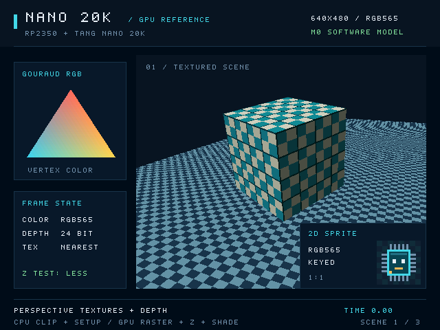

# Nano-20K-GPU

A custom GPU for the RP2350-GP-COMPUTER, built with the Gowin Tang Nano 20K FPGA.

## GPU documentation — start here

The top-level [`GPU_DOCUMENTATION/`](GPU_DOCUMENTATION/) directory contains the
two authoritative guides for the current GPU:

- [GPU architecture](GPU_DOCUMENTATION/GPU_ARCHITECTURE.md): CPU/GPU responsibilities,
  rendering pipeline, memory layout, features, resource use and implementation status.
- [GPU control](GPU_DOCUMENTATION/GPU_CONTROL.md): parallel-bus logical interface,
  exact command/record formats, synchronization, recovery and generic C99 examples.

For assembly, use the [Core2350B ↔ Tang Nano 20K wiring PDF](docs/images/core2350b-tang-nano20k-wiring.pdf)
and [exact GPIO/header table](GPU_DOCUMENTATION/GPU_CONTROL.md#fixed-wiring-layout-core2350b-to-tang-nano-20k).
The current layout reuses all ten VGA GPIOs and adds GP35–GP40 on Core2350B P4,
following the user's revised wiring. GP39 is WREADY and shares the Core LED;
it must be an RP input. The Tang connections match `rtl/board/tang20k_top.sv`
and its CST; the FPGA package-pin allocation is unchanged.
The [MPC-2350 firmware](https://github.com/apc53pro/RP2350-GP-COMPUTER)
now has an initial GPIO bus driver and monochrome GPU terminal. It uploads a
font texture and uses GPU copies; PIO/DMA optimization, NARM GPU integration
and physical electrical qualification remain future work.

Both guides must be updated and pushed with every architecture or control change.
A documentation check in CI enforces accompanying edits; examples are checked
with `make gpu-docs-test`. Existing `docs/` files remain supporting specifications
and historical measurements.

## Project overview

The feature baseline is 640×480 RGB565 video through the HDMI connector,
hardware triangle rasterization, perspective-correct textures, two color
framebuffers, at least 24-bit depth, shading, and 2D drawing. The RP2350 performs
triangle setup initially and communicates over an 8-bit parallel bus. A rendering
rate of one pixel per core cycle is the design target. The modeled warm-cache
textured path now meets that cadence in controlled resident-tile tests;
complete-system throughput and FPGA timing are qualified separately.

Video-only DVI-compatible signaling at approximately 60 Hz is confirmed sufficient.

The first software reference renderer is implemented. It uses CPU triangle
setup, 32×32 tile-local rendering, RGB565 color, D24 depth, perspective-correct
textures, shading, and 2D drawing. SDL2 displays the result; a separate headless
build produces deterministic images and raw color/depth dumps.



## Tang Nano 20K programming image

The hardware-3921 target is `rtl/board/tang20k_top.sv`, with exact QN88
constraints, SDRAM pads and the physical host bus. It runs a **50.4 MHz GPU
core/SDRAM clock**, with **25.2 MHz HDMI pixels and 126 MHz DDR serialization**;
the GPU's rendered output drives HDMI. The MPC-2350 firmware's terminal runs on
it (user-reported, 2026-11-07). The GPIO firmware uses 2 us minimum bus phases.

The image is built with **Gowin EDA** by `make tang20k`. The open-source flow's
image failed the host address latch on the board, and `AGENTS.md` records this
exception and the gate it cannot meet. The
[source-matched board report](docs/hardware/tang20k-board.json) verifies every
package pin and meets every required clock: the core reaches 51.13 MHz Fmax
against 50.4 MHz. The only negative-slack paths are listed reset-release paths.
It uses **16,062/20,736 logic (Gowin count)**, **6,750 registers**,
**46/46 BSRAM** and 53% DSP.

The matching image is **7,264,137 bytes**, SHA-256
`55ebdfbdc7a834480d90b9dadda4f7604c106bec52ed8981039e8a39e0c4d170`.
Its [structural file check](docs/hardware/tang20k-bitstream-check.json) and
[functional evidence](docs/hardware/tang20k-functional.json) accompany the
board report. External electrical margins remain unqualified.

Check the image, then load it with the official Gowin Programmer's
`programmer_cli`. Operation 2 is SRAM; operation 9 is external flash:

```bash
sha256sum -c bitstreams/tangnano20k/SHA256SUMS
programmer_cli --cable-index 1 -d GW2AR-18C -r 2 --fsFile bitstreams/tangnano20k/nano-gpu.fs
```

Read the [first-board instructions](GPU_DOCUMENTATION/GPU_CONTROL.md#programming-and-first-board-bring-up)
for reset release and host isolation **before connecting the RP2350 signals**.
Old VGA firmware conflicts with this bus. There is no command player or built-in
scene. PIO/DMA and NARM GPU integration remain separate work.

## Build and run

Requires a C++17 GCC/Clang compiler with `__int128`, make, pkg-config, and Python 3
for the tests. See the [setup guide](docs/development.md) for platform details.
On Windows, use **MSYS2 UCRT64**, update it with `pacman -Syu`, and then run the
commands below. The installer provides the native compiler, SDL2, pkg-config,
Python, and make. [Full Windows setup](docs/development.md#windows-with-msys2).
MSYS2 is a separate installation from Git Bash; both can display `UCRT64`, but
Git Bash does not include MSYS2's package manager.

```bash
./scripts/setup-sdl2.sh
make -j4
make test
./build/nano-gpu-ref
```

The Windows executable is `./build/nano-gpu-ref.exe`; keep using the UCRT64 shell
so SDL2 and compiler runtime DLLs are available on PATH.

Without SDL or a desktop:

```bash
make -j4 headless test
./build/nano-gpu-ref-headless --headless --verify --output build/frame.ppm
```

Choose `--scene perspective` or `--scene overdraw` for additional workloads.
The [renderer guide](docs/software-reference.md) describes controls, frame dumps,
verification modes, and the C++ API.

The FPGA block backend renders the same scenes through modeled hardware blocks
using the verified Gowin primitive configurations:

```bash
./build/nano-gpu-ref --hardware-profile
./build/nano-gpu-ref --scene showcase --mode blocks --verify
```

Use the `.exe` executable in MSYS2 or the headless executable with `--headless`
on a server. The backend supports all five shading modes, perspective textures,
D24, 2D drawing, keyed sprites, and ordered copies. This older C++ block
model's selected pipeline uses 46 signed 18×18 multiplier equivalents and 14 native
BSRAM banks: three tile attachments, one texture cache, six fragment-context
banks, and four reciprocal-seed ROM banks. Perspective reconstruction shares a
reciprocal between U and V and corrects the result to exact signed Q16 rounding.
A bounded 64-context pipeline overlaps fragments; cache hits and RGB modulation
have initiation interval one. The [hardware
profile](docs/hardware/gowin-profile.md) and [block interfaces](docs/hardware/block-interfaces.md)
record the source revisions, selected modes, ports, and simulation limits.

The complete system simulation adds the 8-bit host bus, bounded command FIFOs,
packet decoding, SDRAM initialization/refresh/arbitration, fetched primitive
records, and independent scanout with a bounded display FIFO:

```bash
./build/nano-gpu-ref --scene showcase --mode system --verify
```

All uploads, record fetches, texture misses, and framebuffer transfers in this
mode use the same timed SDRAM controller. SDL displays the pixels actually
consumed by scanout, including underflow fallback. HDMI/TMDS signaling is outside
scope. The [system model guide](docs/hardware/system-model.md) separates verified
device facts from configurable timing assumptions and explains the counters.
The system model includes the pipelined rendering datapath. Sustained cache-hit
throughput and complete-pass throughput are measured separately; SDRAM misses,
record fetching and tile transfers still introduce waits.

The system backend now reuses resident textures, prefetches the next primitive,
and overlaps word-streamed tile writeback with rendering through two existing
physical bank sets. Reproduce cold and steady measurements with:

```bash
make system-benchmark
```

This verifies all four scenes against the canonical renderer and checks the
recorded cycle baseline. At the assumed 100.8 MHz core and 25.2 MHz host clocks,
the frozen showcase's steady upload/render submission takes 32.4 ms, compared
with 82.6 ms before these changes. This excludes RP2350 preparation and
presentation waits; the full FPGA clock and fit remain unqualified. The
[measurement details](docs/hardware/system-model.md) distinguish these costs.
The [further optimization review](docs/hardware/optimization-review.md) records
measured experimental improvements and the hardware and protocol work needed
before adopting them.

The GPU now also has a functional SystemVerilog implementation, compiled with
Verilator into a separate simulator. The host transport, command execution,
SDRAM controller, tile renderer, texture cache and scanout execute RTL. C++
supplies the RP2350-side commands, an external SDRAM chip model, the independent
SRR oracle and optional SDL2 presentation; no C++ GPU device backend is linked.

```bash
./scripts/setup-rtl-sim.sh
make rtl-gpu-run
```

On Windows, run these in **MSYS2 UCRT64**. The setup installs the native
Verilator package, Python, compiler and SDL2; cloning or pulling the repository
does not install those tools. First finish `pacman -Syu`, reopening UCRT64 and
running it again if the update requests a terminal restart. `make rtl-gpu` only builds the executable;
`make rtl-gpu-run` also opens the SDL2 window. See the
[Windows RTL setup](docs/development.md#windows-rtl-simulator) for checks and
diagnostics. Linux setup reuses the pinned local OSS CAD Suite. To verify one
frame without opening a window after building:

```bash
./build/nano-gpu-rtl --headless --scene showcase --frames 1 --verify
```

The executable has the `.exe` suffix on Windows.

The command self-test and two frames of all four scenes pass. Complete
RGB565/D24 attachment memory and actual RTL scanout match the independent SRR.
The [current RTL regression](docs/benchmarks/rtl-timing-optimized.json) records
zero scanout underflows and submission-cycle increases of **1.00% to 1.57%**
against the [area baseline](docs/benchmarks/rtl-fit-optimized.json), including
the added transaction, configuration, draw-setup and UV control edges.
This RTL implementation currently uses a
different, more serialized schedule than the optimized C++ system model;
the C++ model's 32.4 ms steady result does not describe the RTL. The
[integrated RTL guide](docs/hardware/rtl-gpu.md) explains build commands,
verification, cycle measurements and the remaining board integration work.

The current RTL uses **46 of 46 native RAM banks** and **25 of 48 18×18
multiplier equivalents**. Coefficients, texture tags, compact fragment contexts
and UV delay payloads use native RAM; command execution reads its owned packet
lease without duplicating the payload prefix. The private exact integer-texel
UV path has 19 enabled-edge latency and initiation interval one; the generic
full-Q16 arithmetic module remains separate at 26 edges. Rendering features
are preserved. The current **`N20K-SYS-0.2`** CPU ABI uses one lossless encoded
upload format for every resource. Literal words belong to that same encoding;
there is no old 0.1 packet path or uncompressed upload fallback. The decoder
shares the existing registers, staging RAM and SDRAM-write engine. Host software
must be rebuilt for 0.2. The [unified-upload regression](docs/benchmarks/rtl-unified-upload.json)
records exact rendering parity, 22.9–41.8% fewer serialized request bytes and
0.4–3.7% more submission cycles in the sampled scenes. This is a bandwidth
improvement, not a demonstrated FPS improvement.

The historical 0.2 logical-core serial probe **placed and routed legally** on the
exact FPGA: **20,577 of 20,736 physical LUT sites (99.23%)**, leaving 159 sites,
and **7,011 DFF resources**, including 48 RAM-reserved slots. The integrated
upload change adds 272 physical LUT sites and eight DFFs; BSRAM and DSP use are
unchanged. Estimated core Fmax is **70.23 MHz**, below the 100.8 MHz target in
nextpnr's model. The host estimate is 120.37 MHz, passing its 25.2 MHz target.
Those counts excluded the complete board wrapper. Use the source-matched
full-board report for board resources and timing; the historical core-only
result does not qualify the board.
Routed Fmax is nextpnr's static timing estimate from modeled cell and route
delays, not a measured physical clock limit. Verilator checks cycle behavior;
external timing margins and physical behavior still need hardware testing.
Native coefficient capture adds one setup clock per nonempty primitive/tile
invocation. Draw validation/clipping adds three setup clocks per valid draw;
cache configuration has two preparation edges, and the private UV path adds one
normalization edge while retaining one-fragment-per-clock throughput. COPY
refetch/clipping uses about 128 clocks and upload staging streams one u32 every
three clocks. Run `make rtl-gpu-pack` for source-matched
resource evidence and `make rtl-gpu-pnr` for the clock-gated physical probe;
the retained historical result returned **2** for the core timing miss;
rebuild to measure changed sources. The
[resource report](docs/hardware/rtl-core-pack.json) and
[physical probe report](docs/hardware/rtl-core-pnr.json), explained in the
[RTL guide](docs/hardware/rtl-gpu.md#physical-resource-result),
distinguish packed counts, physical site use and timing. The older reciprocal/UV
probe's routed result does not establish a clock for this complete core.

The throughput harness tracks fragment acceptance and retirement on each
modeled edge, checks ordering and cancellation, and distinguishes sustained
datapath cadence from complete-pass throughput. It can run without SDL:

```bash
make -j4 throughput
make throughput-test
./build/throughput-bench --workload textured-hit --output build/textured-hit.json
```

System runs report bounded throughput measurements in their JSON. Add
`--trace build/edges.csv` to stream a CSV row for every core edge; the trace is
optional and can be large. The [measurement guide](docs/software-reference.md#fragment-throughput-and-clock-traces)
explains the counters, controlled benchmarks, and trace format. Bulk system
staging in the older C++ system model has explicit native memory ports and
latency, using **39 of 46 BSRAM blocks** in that model's selected map. This is
distinct from the current RTL's 46-bank allocation and measured implementation.

In the older C++ block model's throughput harness, warm textured triangles
accept and commit 1024 consecutive fragments with 41-cycle latency; warm
sprites do the same with 15-cycle latency. The
[measurement guide](docs/hardware/throughput.md) separates those local results
from memory misses and complete-pass costs. The
[RTL qualification report](docs/hardware/rtl-qualification.md) records the
shared-reciprocal prototype separately from the complete GPU.

## Project documentation

- [Requirements](docs/requirements.md): the requested features, confirmed decisions,
  proposed details, and acceptance criteria.
- [Architecture notes](docs/architecture-notes.md): hardware constraints, memory and
  bandwidth budgets, and logical pipeline.
- [Development roadmap](docs/roadmap.md): architecture decisions, feature stages,
  dependencies, and milestone exit criteria.
- [M0 specification](docs/spec/README.md): selected tiled architecture, numeric
  rules, command model, memory layout, and conformance vectors.
- [Software reference renderer](docs/software-reference.md): implementation,
  demos, tests, and output formats.
- [Gowin hardware profile](docs/hardware/gowin-profile.md): exact device resources
  and the modeled multiplier/BSRAM configurations.
- [SRR block interfaces](docs/hardware/block-interfaces.md): clocked rendering
  blocks, arithmetic, texture caching, copies, stalls, and resets.
- [GPU system model](docs/hardware/system-model.md): timed host commands,
  shared SDRAM, scanout, completion, recovery, and provisional simulation ABI.
- [Earlier system-model pipeline diagrams](docs/hardware/pipeline.md): detailed
  system, rendering, and tile/memory views, with scalable figures and a three-page PDF.
- [Throughput validation](docs/hardware/throughput.md): controlled workloads,
  per-cycle fragment tracking, cadence checks, and JSON/CSV reports.
- [Reciprocal arithmetic](docs/hardware/reciprocal-pipeline.md): exact shared-reciprocal
  reconstruction, native partial products, and error bounds.
- [RTL qualification](docs/hardware/rtl-qualification.md): reproducible simulation,
  synthesis, and routing of the arithmetic prototype.
- [Integrated RTL GPU](docs/hardware/rtl-gpu.md): the Verilator command-to-pixel
  simulator, independent SRR comparison, native memories and SDRAM pin model.
- [Selected storage map](docs/hardware/storage-map.md): native BSRAM allocation,
  synchronous ports, register fields, and resource limits.
- [SDL2 development setup](docs/development.md): reusable installer and headless
  RGB565 dependency check.

Current status: the M0 specification, initial canonical renderer, CPU setup
library, conformance tests, demo scenes, and a rendering block backend with
matching color/depth output, a timed C++ GPU system model, and a functional RTL
GPU simulator are available. Independent geometric error analysis and
command-trace capture remain M0 work. The board wrapper and constraints are
implemented; the full-board report records actual implementation results.
A stable firmware ABI, RP2350 driver and measured board performance remain
future milestones. Software frame times do not establish FPGA throughput
or fit.
