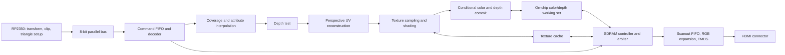

# Initial architecture and feasibility notes

Status: design estimates with tiled rendering selected, 2026-10-23. No synthesis,
timing closure, SDRAM benchmark, or hardware validation has been performed. The
requirements baseline is in [requirements.md](requirements.md); the initial
logical contract is in the [M0 specification](spec/README.md).

## Board resources

Sipeed lists the Tang Nano 20K with 20,736 LUT4s, 15,552 flip-flops, 46 BSRAM
blocks (828 Kbit, approximately 104 KiB), 48 18×18 multiplier resources, two
available PLLs, and 64 Mbit (8 MiB) of 32-bit SDR SDRAM. These limits make a
compact fixed-function design a plausible candidate; they do not establish that
the complete pipeline fits. See the [official board documentation][sipeed].

The [verified hardware profile](hardware/gowin-profile.md) records the exact
primitive modes used by the SRR block backend. The 48 multiplier count denotes
18×18 equivalents, grouped into 24 macros in 12 DSP blocks; wider and 9×9 modes
share those resources. The initial opaque slice selects one signed multiplier
and three SDPB 1024×16 banks for RGB565/D24 tile storage. Its clock counts cover
the selected local datapath; SDRAM arbitration and display timing remain open.

Gowin's GW2AR datasheet identifies the QN88 memory configuration as x32, 64 Mbit
SDR SDRAM and lists a 166 MHz memory clock specification. This is not a proven
board/controller operating point for this project. Other GW2AR packages have
different memory configurations; their DDR bandwidth does not apply here. See
[DS226, sections 1.2 and 2.2.1][gowin].

## Memory capacity

There are 307,200 pixels per frame. Values below assume tightly allocated color
buffers and no additional stride/alignment padding.

| Allocation | Bytes | MiB |
| --- | ---: | ---: |
| One RGB565 color buffer | 614,400 | 0.586 |
| Two RGB565 color buffers | 1,228,800 | 1.172 |
| One packed 24-bit depth buffer | 921,600 | 0.879 |
| Two color buffers plus packed depth | 2,150,400 | 2.051 |
| One depth buffer with 32-bit storage per pixel | 1,228,800 | 1.172 |
| Two color buffers plus depth in 32-bit words | 2,457,600 | 2.344 |

The aligned-depth option leaves 5,931,008 bytes (5.656 MiB) of SDRAM before
textures, command storage, bin lists, alignment, and other allocations. It is the
selected M0 layout because it simplifies depth addressing. Packed
depth saves capacity but adds packing and potentially awkward memory accesses.

Full-resolution color/depth buffers cannot fit in BSRAM. Reserve BSRAM for
scanout FIFOs, texture caching, commands, and color/depth working sets. A logical
32×32 tile with RGB565 color and 32-bit depth storage needs 6 KiB; two such tiles
need 12 KiB before tags, banking, and physical BSRAM allocation overhead.

## Bandwidth, rather than capacity, drives the renderer

Use decimal MB/s for bandwidth and binary MiB for storage. At an illustrative
100 MHz SDRAM clock, x32 SDR supplies at most `4 × 100 MHz = 400 MB/s`. The
listed 166 MHz memory specification would correspond to 664 MB/s raw. Both
figures exclude refresh, activation/precharge, bus turnaround, and wasted beats.
Core and SDRAM clocks need not be equal.

At an approximate 60 Hz refresh:

| Traffic | Ideal payload rate |
| --- | ---: |
| RGB565 scanout: `640 × 480 × 2 × 60` | 36.864 MB/s |
| Separate color clear plus 32-bit depth clear each frame | 110.592 MB/s |
| One screen of passing textured fragments per frame, 32-bit depth storage | 221.184 MB/s |
| Combined illustrative workload above | 368.640 MB/s |

The fragment estimate assumes no useful caching: 4 bytes for a depth read,
4 for its write, 2 for an RGB565 color write, and 2 for a nearest texture fetch
= 12 logical bytes per passing fragment. Packed depth reduces that payload to
10 bytes. These are idealized payload counts; actual x32 transactions can cost
more, while caching and combining adjacent writes can reduce traffic. Overdraw
increases fragment traffic; rejected fragments have a different cost.

At a 100 MHz core and one passing fragment per cycle, that same uncached model
requires 1.2 GB/s (1.0 GB/s with packed depth), before scanout and clears. A single
x32 SDR bus cannot supply it at the illustrative RAM clocks. Even the one-layer
60 fps example leaves little headroom at 100 MHz once real SDRAM overhead is
included. Blending would add destination-color reads.

Scanout's 36.864 MB/s is a whole-frame average; active-video consumption is
higher. A burst-fed line FIFO and bounded arbitration latency are necessary.
Display fetches need guaranteed service while other clients retain forward
progress. Scanout must never wait on rasterizer or texture-cache progress.

## Logical pipeline



This diagram shows functional responsibilities, not finalized stage boundaries.
For opaque draws an early depth test can avoid texture work, but reads and
commits need forwarding or interlocks for fragments targeting the same pixel.
Color-key rejection must occur before the corresponding depth/color commit.
Cache misses and downstream backpressure must stall the pipeline correctly.

Perspective-correct UV reconstruction uses screen-space planes:

```text
q = interpolate(1/w)
s = interpolate(u/w)
t = interpolate(v/w)
u = s / q
v = t / q
```

A pipelined reciprocal followed by multipliers is a candidate for initiation
every cycle. LUT size, refinement stages, operand widths, error, DSP cost, and
achievable clock require evaluation. A multi-cycle divider accepting only one
input every several cycles would limit throughput. Projected depth is
interpolated separately and does not receive the UV division by `q`.

## Selected tiled rendering organization

The project owner selected tiled rendering. The M0 contract uses 32×32 logical
tiles, CPU setup/binning, immutable primitive records, and ordered reference lists
for all 300 tiles. The GPU retains each active tile's color/depth locally, executes
its list in order, then stores resulting attachments in bursts. Full color/depth
buffers remain in SDRAM for preservation across passes. Clear-on-load avoids a
separate external clear cycle where applicable.

CPU binning and record/reference traffic must be measured, especially for
primitives spanning many tiles. Physical banking, resident-tile count, internal
subtiles, and cache sizes are M1 choices; they must preserve the logical results.
Per-tile order, texture upload visibility, and copy/render cache coherence are
specified in M0.

## Host-bus budget

An 8-bit bus accepting one byte per clock transfers at most `f_bus` bytes/s.
For example, 25 MHz gives 25 MB/s before command framing, backpressure, and
PIO/DMA overhead. Streaming complete RGB565 frames at 60 fps would require
36.864 MB/s of payload, so this example cannot serve that use case.

GPU rendering should instead use resident textures and compact drawing commands.
Triangle-setup records can be substantial, so measure their encoded size, CPU
setup cost, and command throughput as well as pixel throughput. Wider data paths
help host traffic but do not widen the FPGA's SDRAM interface.

## Bring-up sequence and feasibility gates

The [development roadmap](roadmap.md) defines the implementation order and exit
criteria. Prototype the selected tiled memory path and perspective-correction
arithmetic early, before freezing the packed drawing-command ABI.
Measure SDRAM service latency and host throughput alongside those decisions.
Then integrate presentation, opaque 3D, textures/shading, and the complete 2D
path, followed by optimization and optional features.

At each gate, record LUT/FF/BSRAM/DSP and clock-resource use plus timing results.
The one-pixel-per-cycle preference and full feature fit remain unproven until
the combined pipeline is synthesized and measured. Later GPU triangle setup,
filtering, fog, or blending depends on the remaining resources.

[sipeed]: https://wiki.sipeed.com/hardware/en/tang/tang-nano-20k/nano-20k.html
[gowin]: https://cdn.gowinsemi.com.cn/DS226E.pdf
