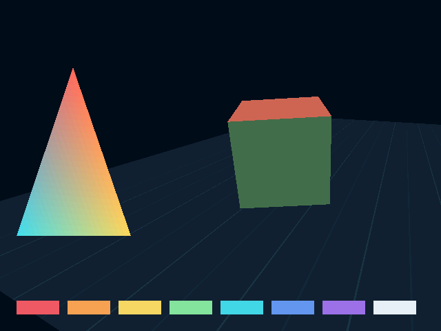
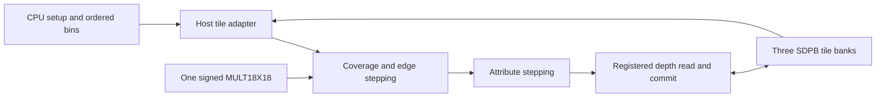

# SRR hardware block interfaces

The first hardware backend implements one opaque tile slice using the selected
[Tang Nano 20K primitive configurations](gowin-profile.md). The existing SRR
remains the functional comparison target. CPU geometry preparation and the
clocked GPU model have separate responsibilities.

## Boundary and implemented scope

CPU code transforms and clips geometry, prepares Q4 edges and signed 64-bit
attribute planes, and bins ordered primitives. The slice consumes prepared
triangles and updates one resident 32×32 color/depth tile. It supports flat and
Gouraud triangles, scissor clipping, D24 comparisons, and independent color/depth
controls. It rejects textures, keying, and other primitive types.

The public interfaces are in
[tile_pipeline.hpp](../../reference/include/nano_gpu/hw/tile_pipeline.hpp).
`render_opaque_pass()` is a host simulation adapter: it bins primitives and feeds
tile load/draw/store operations. It does not model record fetching, SDRAM
arbitration, the parallel transport, or display timing.

The arrows describe data dependencies. Stages and controllers share a clock;
they do not imply unbounded queues or independent memory ports.

## Primitive interfaces

| Block | Input fields | Output and edge behavior |
| --- | --- | --- |
| `Mult18x18` | Signed 18-bit A/B, CE, synchronous reset | Signed 36-bit product after three enabled edges; CE-low holds all registers; reset wins over CE. |
| `Sdp1kx16` write port | Write enable, 10-bit word address, 16-bit data | One full-word write on a rising edge. |
| `Sdp1kx16` read port | Read enable, 10-bit word address, synchronous output reset | Registered 16-bit read result; disabled reads retain the previous output. |

The C++ containers are wider where necessary to carry values through the host
language. Their accepted numeric ranges and the primitive's physical port widths
define the hardware interface. Out-of-width captured operands and enabled
addresses are rejected before state changes. Model exceptions diagnose illegal
requests; they do not represent synthesized exception hardware.

`output_known()` describes whether a primitive output has been established. It
is not a transaction-valid signal: a disabled read or CE can retain a known old
value. Controllers must track which request each registered result belongs to.

## Tile interface

| Operation | Accepted data and ownership | Selected schedule |
| --- | --- | --- |
| `reset()` | Cancels pending drawing; preserves tile RAM | One reset edge; counters restart and include that edge |
| `load(TileImage)` | Ready tile; 1024 RGB565 words and 1024 D24 values | 1024 parallel bank-write edges |
| `clear(color, depth)` | Ready tile; RGB565 and D24 constants | 1024 parallel bank-write edges |
| `begin(Triangle, origin)` | Ready tile; prepared record and visible tile origin aligned to 32 pixels | One command-latch edge, then setup and rasterization |
| `tick(enable)` | One common clock; command remains owned while busy | Advances one edge; `enable=false` freezes the datapath and memory requests |
| `store()` | Ready tile; no pending draw | 1024 bank-read requests plus one output-drain edge |

These are the slice controller's chosen schedules, not fixed cycle counts
mandated by the device datasheet. No operation uses a free array fill or a hidden
read port. A clear is a sequence of writes. D24 values occupy depth-low16 and
depth-high8 banks; upper bits in the high bank remain zero.

The prepared triangle is copied at command acceptance, so later host changes
cannot alter an active draw. A command must finish before another command or a
load/store operation uses the same tile. This serial command boundary also
orders same-pixel effects across primitives.

## Datapath and arithmetic

| Item | Selected representation |
| --- | --- |
| Coverage coordinates | Q4 screen coordinates; pixel centers at `(16x+8,16y+8)` |
| Edge values | Signed 32-bit, with top-left inclusion bits |
| Attribute seeds/steps | Signed 64-bit, using M0 fixed-plane formats |
| Fragment address | 10-bit tile word index |
| Depth | 24 meaningful unsigned bits |
| Color | RGB565; Gouraud channels converted from Q16 with M0 rounding |

The shared 18×18 multiplier initializes three edge equations using six products.
The controller accounts for operand capture, multiplier pipeline, and result
capture instead of treating those products as free host calculations. Attribute
seeds move from the immutable triangle anchor to the tile's first sample through
clocked additions. Steady rasterization uses edge and attribute increments.

For a nonempty draw, the chosen setup schedule is one command-latch edge plus
24 edges for the six serialized products, followed by `delta_y + delta_x`
attribute-offset edges. Those deltas measure the first tile sample from the
triangle's immutable plane anchor. One drain edge follows the candidate walk.
Disabled edges add to elapsed cycles without advancing this schedule.

Coverage and interpolation advance together. A disabled model edge retains the
current sample and every pending result. The depth path associates a registered
read with its fragment before comparing and conditionally committing color and
depth. Simultaneous cross-port reads and writes of the same BSRAM word are
forbidden. Where a pending commit aliases a new depth read, forwarding must
suppress the conflicting physical read and supply the committed depth value.

The current command interface drains each triangle, and a triangle visits each
sample at most once. Consequently the defensive forwarding path is not reached
by current legal draws; same-pixel tests exercise drained primitive ordering.
Direct fragment-stream tests are needed before relying on forwarding in a
future controller that overlaps primitive commands.

The model uses bounded input ranges and explicit register widths. A future wider
multiply, reciprocal, cache, or queue must have a defined implementation and
resource allocation before being admitted to the hardware backend.

## Measurements and further blocks

`TileStatistics` counts clock edges, disabled edges, setup work, candidate
positions, covered fragments, depth rejects, writes, forwarding, and local memory
words transferred. A candidate position is not necessarily a covered or committed
pixel. Frame statistics expose the selected slice's clock counts separately from
host software timings.

The counts exclude SDRAM latency/refresh/turnaround, scanout contention, command
record traffic, bus backpressure, and clock-domain crossings. They therefore do
not establish system frame rate, an FPGA clock, or sustained one-pixel-per-cycle
performance. Synthesis must still determine LUT/FF use, primitive packing,
routing, and timing.

The next interfaces to model are record fetch/scheduling, texture requests and
responses, perspective reconstruction, bounded FIFOs, SDRAM clients/arbitration,
and scanout. The packed host ABI remains provisional. Before treating selected
primitives as vendor-library equivalents, run identical edge sequences against
Gowin simulation primitives or generated IP wrappers.
