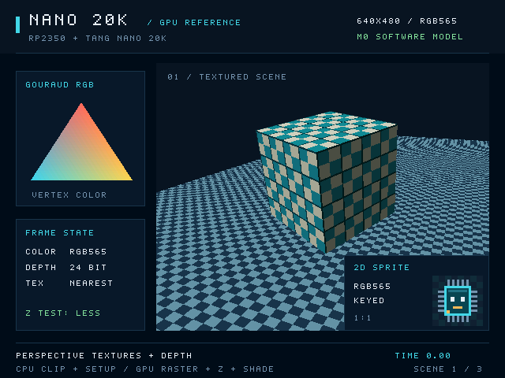
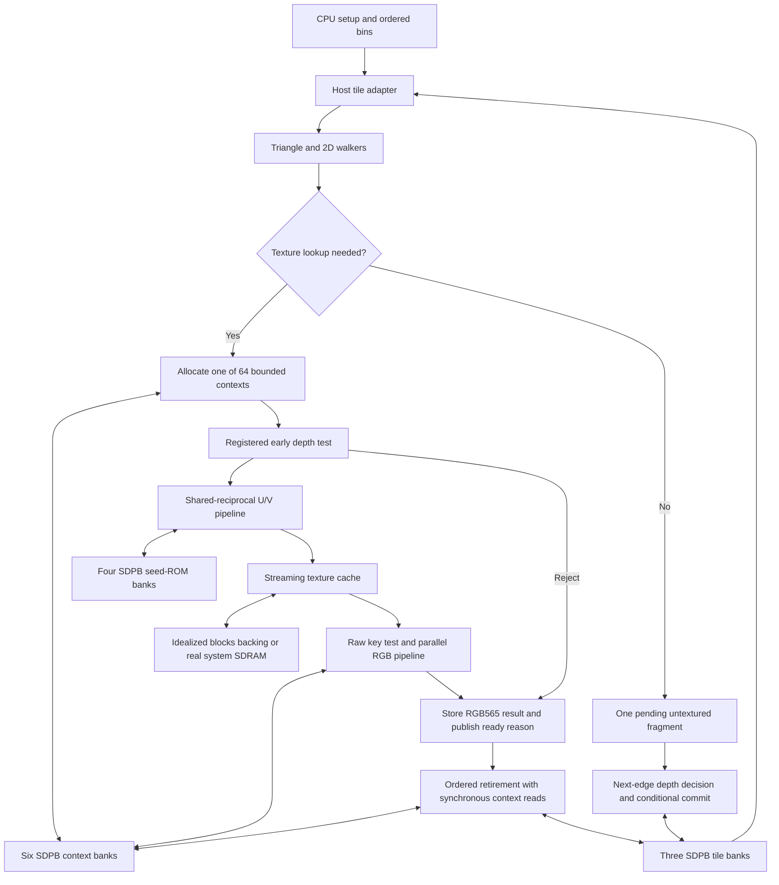

# SRR hardware block interfaces

The `N20K-HW-RENDER-0.3` backend models the initial SRR drawing feature set with
selected [Tang Nano 20K primitive configurations](gowin-profile.md). Canonical
SRR remains the comparison target. CPU preparation and the clocked GPU model
have separate responsibilities.

## Boundary and implemented scope

CPU code transforms and clips geometry, prepares Q4 edges and signed 64-bit
attribute planes, and bins ordered primitives. The backend consumes those
records and renders one resident 32×32 RGB565/D24 tile. It supports all five
shading modes, perspective-correct nearest textures, clamp/repeat addressing,
raw color-key rejection, rectangles/pixels, global integer lines, and sprites.
Font-atlas text uses ordinary sprite records. Explicit copies preserve depth.

Use the same original scene and time when comparing output:

```sh
./build/nano-gpu-ref-headless --headless --scene showcase --time 0 --step 0 --mode blocks --verify --dump-prefix build/hardware-showcase
```

Append `.exe` to the executable on Windows. The separate opaque scene remains a
focused workload, not evidence that a different scene matches the showcase.



The public tile interface is in
[tile_pipeline.hpp](../../reference/include/nano_gpu/hw/tile_pipeline.hpp).
`OpaqueTile` retains its original class name for source compatibility, but now
accepts general `Primitive` records. `render_pass()` is the host simulation
adapter: it bins primitives and feeds tile load/draw/store operations. It does
not model command-record fetching, SDRAM arbitration, the parallel transport,
or display timing.



The textured pipeline retains at most 64 fragments. Untextured draws keep the
existing one-pending-fragment fast path, with next-edge depth compare/commit and
same-address forwarding. Stages overlap on cache
hits; backpressure, a miss or a full context ring can stop new candidates.
Retirement is ordered even when a younger rejected fragment becomes ready
before an older textured fragment. Device port limits apply on every edge.

## Primitive interfaces

| Block | Input fields | Output and edge behavior |
| --- | --- | --- |
| `Mult18x18` | Signed 18-bit A/B, CE, synchronous reset | Signed 36-bit product after three enabled edges; CE-low holds all registers; reset wins over CE. |
| `Sdp1kx16` write port | Write enable, 10-bit word address, 16-bit data | One full-word write on a rising edge. |
| `Sdp1kx16` read port | Read enable, 10-bit word address, synchronous output reset | Registered 16-bit read result; disabled reads retain the previous output. |
| `PerspectivePipeline` | Signed64 U/V, q in `[2^29,2^37]`, six-bit context tag, valid, CE/reset | Both signed Q16 results after 26 enabled edges; initiation interval one; exact rounding and explicit error flags. |
| `PerspectiveDivider` oracle | Signed64 attribute and q, start, CE/reset | Retained standalone exact serial arithmetic reference; outside selected GPU resources. |
| `TextureUnit` streaming | Immutable binding, integer texel X/Y, push/ready, output/pop, CE/reset | One RGB565 output; seven-edge hit pipeline, initiation interval one, at most eight reservations and one outstanding miss. |
| `Walker2D` | Rectangle, line, or sprite; tile origin; CE | One current sample and source coordinates; incremental state advances only when enabled. |

The C++ containers carry values through the host language; accepted numeric
ranges define the hardware widths. Model exceptions diagnose illegal requests
and do not represent synthesized exception hardware. Native primitive options
outside the selected configurations remain unmodeled.

`output_known()` states whether a primitive output has been established; it is
not a transaction-valid signal. Controllers associate registered memory results
with pending fragments. The reciprocal pipeline output-valid and streaming texture output-valid signals
similarly require an accepted request and registered completion before consumption.

## Tile operations and ownership

| Operation | Accepted data and ownership | Selected schedule |
| --- | --- | --- |
| `reset()` | Cancels pending drawing; preserves memory contents | Synchronous controller/output reset; counters restart |
| `load(TileImage)` | Ready tile; 1024 RGB565 words and 1024 D24 values | 1024 parallel tile-bank write edges |
| `clear(color, depth)` | Ready tile; RGB565 and D24 constants | 1024 parallel tile-bank write edges |
| `begin(Primitive, origin)` | Ready tile; immutable prepared record and a visible 32-pixel-aligned tile origin | Command capture followed by the selected walker and fragment schedule |
| `tick(enable)` | One common clock while the command owns the tile | Advances state; `enable=false` holds requests and every dependent stage |
| `store()` | Ready tile; no pending draw | 1024 tile-bank read requests plus one output-drain edge |

The triangle overload of `begin()` remains available. Active records are copied
at acceptance so later host edits cannot change a draw. Commands drain before
another primitive or transfer reuses the tile. Same-pixel ordering across
primitives follows that command boundary.

Tile color, depth-low16, and depth-high8 occupy three separate SDPB instances;
the high-depth bank's unused bits remain zero. A clear is a write sweep, never a
free RAM-array reset. One further BSRAM holds texture-cache data; six context banks and four seed-ROM
banks bring the renderer total to fourteen. Spare capacity does not create extra
ports, and same-address cross-port read/write is forbidden.

These transfer counts describe local ports. They are not SDRAM throughput: the
host adapter supplies and collects tile words without a complete memory-bus
model.

The separate system profile uses the [selected storage map](storage-map.md):
39 native banks account for the rendering banks, client slots, reader/row
staging, host link and display FIFO. The standalone adapter uses the same
fourteen-bank rendering allocation without adding system memory channels.

## Walkers and arithmetic

| Item | Selected representation |
| --- | --- |
| Triangle coordinates | Q4 screen coordinates; pixel centers `(16x+8,16y+8)` |
| Edge values | Signed 32-bit plus top-left inclusion bits |
| Attribute seeds/steps | Signed 64-bit `z,r,g,b,q,U,V` planes in M0 formats |
| Fragment address | 10-bit tile word index |
| Depth | 24 meaningful unsigned bits |
| Texture coordinates | Signed 32-bit Q16 before nearest sampling |
| Color | RGB565 with exact channel rounding/modulation |

Triangle setup initializes edge equations using six operations on the shared
18×18 multiplier. Attribute seeds move from the immutable plane anchor through
clocked additions; steady coverage and interpolation use incremental state.
There is no uncharged general-purpose wide multiply in this datapath.

For a nonempty triangle, setup takes one command-capture edge, 24 edges for six
serialized edge products, and `delta_y + delta_x` attribute-offset edges. Flat
and Gouraud triangles then retain the candidate-per-enabled-edge path with one
final drain edge. Rectangle/sprite capture uses one edge; a line also pays for
its complete global walk, including points discarded for the current tile.
Textured fragments enter bounded contexts and allow the walker to continue
until pipeline backpressure or context capacity prevents another acceptance.

The 2D walker generates rectangles and sprites over the clipped sample window.
It preserves the original sprite origin when deriving source coordinates. Lines
use a bounded Bresenham state machine that starts from the canonical original
endpoints and traverses the global line before tile/scissor filtering. Restarting
at a clipped endpoint would change tie behavior and is not permitted.

Perspective reconstruction evaluates `RNE((attribute * 2^26) / q)` for both
coordinates through one shared-reciprocal pipeline. The fixed seed ROM,
refinement, native 18x18 partial products and two bounded quotient corrections
produce the exact canonical signed Q16 result. The pipeline has **26 enabled
edges** of unit latency, accepts one U/V pair per enabled edge, and retains a
six-bit context tag. A parent captures its established output on a following
common edge. There is no host division, floating point, `__int128`, or assumed
wide hardware multiplier in the modeled execution path. See the
[arithmetic proof and implementation](reciprocal-pipeline.md).

Three registered native 18x18 multipliers process R, G and B in parallel.
For each channel product `p`, the exact rounded divide-by-255 rule remains
`t=p+128; result=(t+(t>>8))>>8`. Three unit edges plus a following parent capture
are pipeline latency, not a four-cycle initiation interval. The setup multiplier
is a separate instance, so it does not contend with modulation.

## Fragment contexts, depth and retirement

For textured draws, six native context banks hold 64 entries: three for tile address/D24, two for
RGB888 factor, and one for RGB565 result. Registers hold ready flags, two-bit
retirement reasons, and ring head/tail/count. Context reads are synchronous;
the controller captures established outputs before advancing their next edge.
A result write and its ready update share an edge. The retirement scheduler
reads only ready flags established by an earlier edge.
One ordered retirement can overlap a new candidate acceptance.

Depth is read at acceptance and compared on the following edge, before UV work.
The supported walkers visit an address at most once within a primitive, and
primitives drain before the next begins. Thus an older in-flight fragment
cannot change that address before its early depth decision. Depth is not retested
at retirement; overlapping primitives in a future design would require an
explicit forwarding/retest policy. Projected D24 interpolation remains separate
from perspective U/V reconstruction.

Raw RGB565 key rejection occurs before modulation and both attachment writes.
A keyed depth-only draw must sample; an unkeyed depth-only textured triangle can
skip texture work. Sprites use integer source coordinates and bypass perspective.
Sprites and texture replacement use factor 255 through the same RGB pipeline,
preserving raw RGB565 without bypassing its latency.
Commit, depth rejection and key rejection publish ready reasons;
ordered retirement applies independent color/depth write enables. No fragment
becomes two rendered pixels merely because it writes both attachments.

## Texture cache and backing interface

The [texture unit](../../reference/include/nano_gpu/hw/texture.hpp) retains one
1024x16 SDPB cache: 64 direct-mapped lines of 16 RGB565 texels. The selected
streaming mode has at most eight stage/input/output reservations. Two native
signed 18x18 multipliers calculate `y * pitch + x`: the pitch is split into a
positive low17 limb and a bounded high limb. Registered address, tag, native
read and output-capture stages yield **seven enabled edges** for a hit, with
initiation interval one. The enclosing controller captures the old output on a
following edge. `push()` and `pop()` reserve at most one transfer per edge;
backpressured output is retained.

A miss freezes younger address/DSP state while older cache-read results drain.
Refill uses the same native write port, then the held miss replays before any
younger request. Same-index replacement cannot overwrite an older registered
read result. The `blocks` backing adapter waits four edges and supplies sixteen
words, one per edge. In `system` mode the miss uses the real owned Texture
SDRAM slot, synchronous32-bit reads and a single word hold split into two cache
writes. Short final lines pad unused cache words without extra SDRAM reads.

Binding a different texture invalidates tags; rebinding the same immutable
texture may retain them. Bind, invalidate and copy scratch access require a
fully drained pipeline. Reset cancels local work, preserves RAM words and static
pipeline selection, and cannot discard an owned external response.

The old `start()/result()` texture interface retains its serial 14-edge hit and
34-edge idealized miss schedule as a standalone oracle. The GPU selects streaming
mode; oracle schedules are not the selected pipeline's throughput.

## Ordered copies

`Renderer::copy_rect()` and `copy_image()` accept a hardware rendering mode.
The copy engine buffers one complete clipped source row through a selected
SDPB 1024×16 bank before writing that destination row. Horizontal overlap is
protected by the row buffer; vertical overlap selects row direction. Depth is
unchanged. The buffer reuses the texture-cache allocation while rasterization
is idle, adding no bank beyond the selected fourteen-bank renderer.

For width `W`, a row uses `W` buffer-write edges and `W` read edges plus one
output-drain edge: `2W+1` modeled local clocks. Source and destination accesses
are functional memory adapters; SDRAM service costs remain outside this count.
A synchronous buffer-output reset adds one edge before a nonempty copy.

## Measurements and remaining interfaces

Statistics separate candidates, covered fragments, depth/key rejects, texture
samples, and committed writes. Block counters include local clocks, stalls,
setup work, perspective-pipeline activity, texture work, cache hits/misses and refill
words. Stage-work counters describe activity within an overlapping pipeline; adding
them does not reconstruct elapsed time. Following controller capture edges
still contribute to total tile clocks.
Disabled edges increment total clocks and stalls without advancing unit work.
Hardware-copy clocks/words describe the most recent explicit copy and are
separate from the last render-pass counters.
A candidate position is not a committed pixel.

Current counts exclude full SDRAM latency/refresh/turnaround, scanout contention,
command-record traffic, transport backpressure, and clock-domain crossings.
The controlled throughput harness checks initiation intervals and consecutive
retirements under stated cache conditions. Local cadence does not establish
system frame rate or achievable FPGA clocks. The serial divider remains an
independent exact arithmetic oracle.

The separate [`system` mode](system-model.md) now connects this slice to record
fetch/scheduling, shared timed SDRAM arbitration, a bounded 8-bit host link, and
independent scanout. The `blocks` adapter above retains its local-only scope.
The packed host ABI is provisional. Vendor-library comparison, synthesis,
primitive packing, routing, timing closure, and board validation remain required.
