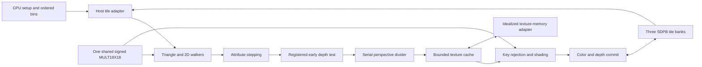

# SRR hardware block interfaces

The `N20K-HW-RENDER-0.2` backend models the initial SRR drawing feature set with
selected [Tang Nano 20K primitive configurations](gowin-profile.md). Canonical
SRR remains the comparison target. CPU preparation and the clocked GPU model
have separate responsibilities.

## Boundary and implemented scope

CPU code transforms and clips geometry, prepares Q4 edges and signed 64-bit
attribute planes, and bins ordered primitives. The backend consumes those
records and renders one resident 32×32 RGB565/D24 tile. It supports all five
shading modes, perspective-correct nearest textures, clamp/repeat addressing,
raw color-key rejection, rectangles/pixels, global integer lines, and sprites.
Font-atlas text uses ordinary sprite records. Explicit copies preserve depth.

Use the same original scene and time when comparing output:

```sh
./build/nano-gpu-ref-headless --headless --scene showcase --time 0 --step 0 --mode blocks --verify --dump-prefix build/hardware-showcase
```

Append `.exe` to the executable on Windows. The separate opaque scene remains a
focused workload, not evidence that a different scene matches the showcase.


The public tile interface is in
[tile_pipeline.hpp](../../reference/include/nano_gpu/hw/tile_pipeline.hpp).
`OpaqueTile` retains its original class name for source compatibility, but now
accepts general `Primitive` records. `render_pass()` is the host simulation
adapter: it bins primitives and feeds tile load/draw/store operations. It does
not model command-record fetching, SDRAM arbitration, the parallel transport,
or display timing.



The arrows describe dependencies, not unbounded queues. A single texture request
and a bounded fragment context retain state during serialized work. Device
port limits apply at every simulated memory edge.

## Primitive interfaces

| Block | Input fields | Output and edge behavior |
| --- | --- | --- |
| `Mult18x18` | Signed 18-bit A/B, CE, synchronous reset | Signed 36-bit product after three enabled edges; CE-low holds all registers; reset wins over CE. |
| `Sdp1kx16` write port | Write enable, 10-bit word address, 16-bit data | One full-word write on a rising edge. |
| `Sdp1kx16` read port | Read enable, 10-bit word address, synchronous output reset | Registered 16-bit read result; disabled reads retain the previous output. |
| `PerspectiveDivider` | Signed 64-bit attribute, reciprocal in `[2^29,2^37]`, start, CE, reset | One signed Q16 result with nearest-even rounding and explicit overflow detection. |
| `TextureUnit` | Immutable texture binding, addressed integer texel X/Y, start, CE, reset | One RGB565 texel; bounded direct-mapped cache and one outstanding request. |
| `Walker2D` | Rectangle, line, or sprite; tile origin; CE | One current sample and source coordinates; incremental state advances only when enabled. |

The C++ containers carry values through the host language; accepted numeric
ranges define the hardware widths. Model exceptions diagnose illegal requests
and do not represent synthesized exception hardware. Native primitive options
outside the selected configurations remain unmodeled.

`output_known()` states whether a primitive output has been established; it is
not a transaction-valid signal. Controllers associate registered memory results
with pending fragments. Divider and texture `result_valid()` similarly require
an accepted request to complete before consumption.

## Tile operations and ownership

| Operation | Accepted data and ownership | Selected schedule |
| --- | --- | --- |
| `reset()` | Cancels pending drawing; preserves memory contents | Synchronous controller/output reset; counters restart |
| `load(TileImage)` | Ready tile; 1024 RGB565 words and 1024 D24 values | 1024 parallel tile-bank write edges |
| `clear(color, depth)` | Ready tile; RGB565 and D24 constants | 1024 parallel tile-bank write edges |
| `begin(Primitive, origin)` | Ready tile; immutable prepared record and a visible 32-pixel-aligned tile origin | Command capture followed by the selected walker and fragment schedule |
| `tick(enable)` | One common clock while the command owns the tile | Advances state; `enable=false` holds requests and every dependent stage |
| `store()` | Ready tile; no pending draw | 1024 tile-bank read requests plus one output-drain edge |

The triangle overload of `begin()` remains available. Active records are copied
at acceptance so later host edits cannot change a draw. Commands drain before
another primitive or transfer reuses the tile. Same-pixel ordering across
primitives follows that command boundary.

Tile color, depth-low16, and depth-high8 occupy three separate SDPB instances;
the high-depth bank's unused bits remain zero. A clear is a write sweep, never a
free RAM-array reset. The fourth BSRAM holds texture-cache data. Spare capacity
does not create extra ports, and same-address cross-port read/write is forbidden.

These transfer counts describe local ports. They are not SDRAM throughput: the
host adapter supplies and collects tile words without a complete memory-bus
model.

## Walkers and arithmetic

| Item | Selected representation |
| --- | --- |
| Triangle coordinates | Q4 screen coordinates; pixel centers `(16x+8,16y+8)` |
| Edge values | Signed 32-bit plus top-left inclusion bits |
| Attribute seeds/steps | Signed 64-bit `z,r,g,b,q,U,V` planes in M0 formats |
| Fragment address | 10-bit tile word index |
| Depth | 24 meaningful unsigned bits |
| Texture coordinates | Signed 32-bit Q16 before nearest sampling |
| Color | RGB565 with exact channel rounding/modulation |

Triangle setup initializes edge equations using six operations on the shared
18×18 multiplier. Attribute seeds move from the immutable plane anchor through
clocked additions; steady coverage and interpolation use incremental state.
There is no uncharged general-purpose wide multiply in this datapath.

For a nonempty triangle, setup takes one command-capture edge, 24 edges for six
serialized edge products, and `delta_y + delta_x` attribute-offset edges. Flat
and Gouraud triangles then retain the candidate-per-enabled-edge path with one
final drain edge. Rectangle/sprite capture uses one edge; a line also pays for
its complete global walk, including points discarded for the current tile.
Textured fragments pause the walker while their retained context completes.

The 2D walker generates rectangles and sprites over the clipped sample window.
It preserves the original sprite origin when deriving source coordinates. Lines
use a bounded Bresenham state machine that starts from the canonical original
endpoints and traverses the global line before tile/scissor filtering. Restarting
at a clipped endpoint would change tie behavior and is not permitted.

Perspective reconstruction evaluates `RNE((attribute × 2^26) / q)` using the
[serial divider](../../reference/include/nano_gpu/hw/perspective.hpp). It has a
90-bit logical numerator, a 38-bit restoring remainder/divisor datapath, a
32-bit quotient plus overflow detection, and no host division, floating point,
or `__int128` in the modeled arithmetic. One operand-capture edge, 90 bit edges,
and one rounding edge give 92 enabled edges per coordinate. U and V share this
unit, so this baseline is serialized. The tile controller captures each result
on the following common clock edge, through `PerspectiveUCapture` and
`PerspectiveVCapture` states. U and V therefore use 184 active divider edges
plus two controller capture edges. Consumers never read a result newly changed
on that same common edge.

Texture modulation multiplies each expanded RGB888 texel channel by its flat
or interpolated color channel through the same signed 18×18 primitive. All
operands fit its positive input range. The exact rounded divide-by-255 result
uses bounded shift/add logic after the product, with no additional hard divider.
For product `p`, it uses `t=p+128` followed by `(t+(t>>8))>>8`. Three channels
take three serialized launch/wait/capture sequences, four edges each.

## Texture cache and backing interface

The [texture unit](../../reference/include/nano_gpu/hw/texture.hpp) has one
1024×16 SDPB bank, 64 direct-mapped lines of 16 words, bounded tag/valid registers,
and one outstanding request. The caller supplies integer texel coordinates
after mathematical Q16 floor and clamp/repeat addressing.

The selected request schedule includes operand capture, ten clocked shift/add
steps for `y × pitch + x`, tag lookup, synchronous cache read, and result capture.
On a miss, the idealized backing adapter waits four edges and supplies a 16-word
line, one word per edge, through the cache write port. These waits are chosen
simulation costs rather than Gowin primitive or SDRAM timing specifications.
Including request capture, a hit uses 14 enabled edges and a miss uses 34. A
texture binding costs one control edge, overlapped with primitive acceptance
by the tile controller. The tile controller then uses a separate
`TextureCapture` edge to latch the registered result, adding one tile clock
per sampled texel to these unit latencies.

A changed texture binding invalidates all tags. Rebinding the same immutable
image may reuse lines; explicit invalidation handles updates. Reset cancels the
request and invalidates controller/tag state while retaining the RAM array.
Tag comparison never supplies a hidden asynchronous data read.

Early depth rejection precedes perspective work and texture lookup. A raw texel
matching the color key rejects the fragment before modulation and before either
attachment changes. A depth-only keyed draw still performs the lookup. Passing
fragments conditionally commit color and depth using the independent write
controls. A disabled model edge retains all pending work.
Sprites use their integer source coordinates and bypass perspective division.
Untextured records bypass both texture stages. A textured record with color
writes disabled can skip sampling only when no color key affects depth commit.

## Ordered copies

`Renderer::copy_rect()` and `copy_image()` accept a hardware rendering mode.
The copy engine buffers one complete clipped source row through a selected
SDPB 1024×16 bank before writing that destination row. Horizontal overlap is
protected by the row buffer; vertical overlap selects row direction. Depth is
unchanged. The buffer reuses the texture-cache allocation while rasterization
is idle, keeping the peak resource count at four BSRAM blocks.

For width `W`, a row uses `W` buffer-write edges and `W` read edges plus one
output-drain edge: `2W+1` modeled local clocks. Source and destination accesses
are functional memory adapters; SDRAM service costs remain outside this count.
A synchronous buffer-output reset adds one edge before a nonempty copy.

## Measurements and remaining interfaces

Statistics separate candidates, covered fragments, depth/key rejects, texture
samples, and committed writes. Block counters include local clocks, stalls,
setup work, serial perspective work, texture work, cache hits/misses and refill
words. Perspective and texture work counters count active unit/request edges;
the following controller capture edges count only toward total tile clocks.
Disabled edges increment total clocks and stalls without advancing unit work.
Hardware-copy clocks/words describe the most recent explicit copy and are
separate from the last render-pass counters.
A candidate position is not a committed pixel.

Current counts exclude full SDRAM latency/refresh/turnaround, scanout contention,
command-record traffic, transport backpressure, and clock-domain crossings.
They do not establish system frame rate, achievable FPGA clocks, or sustained
one-pixel-per-cycle throughput. The serial divider is an exact functional
baseline whose performance can later be improved under the same output contract.

The remaining hardware interfaces are record fetch/scheduling, shared SDRAM
clients and arbitration, bounded host FIFOs, and scanout. The packed host ABI is
provisional. Vendor-library comparison, synthesis, primitive packing, routing,
timing closure, and board validation remain required.
