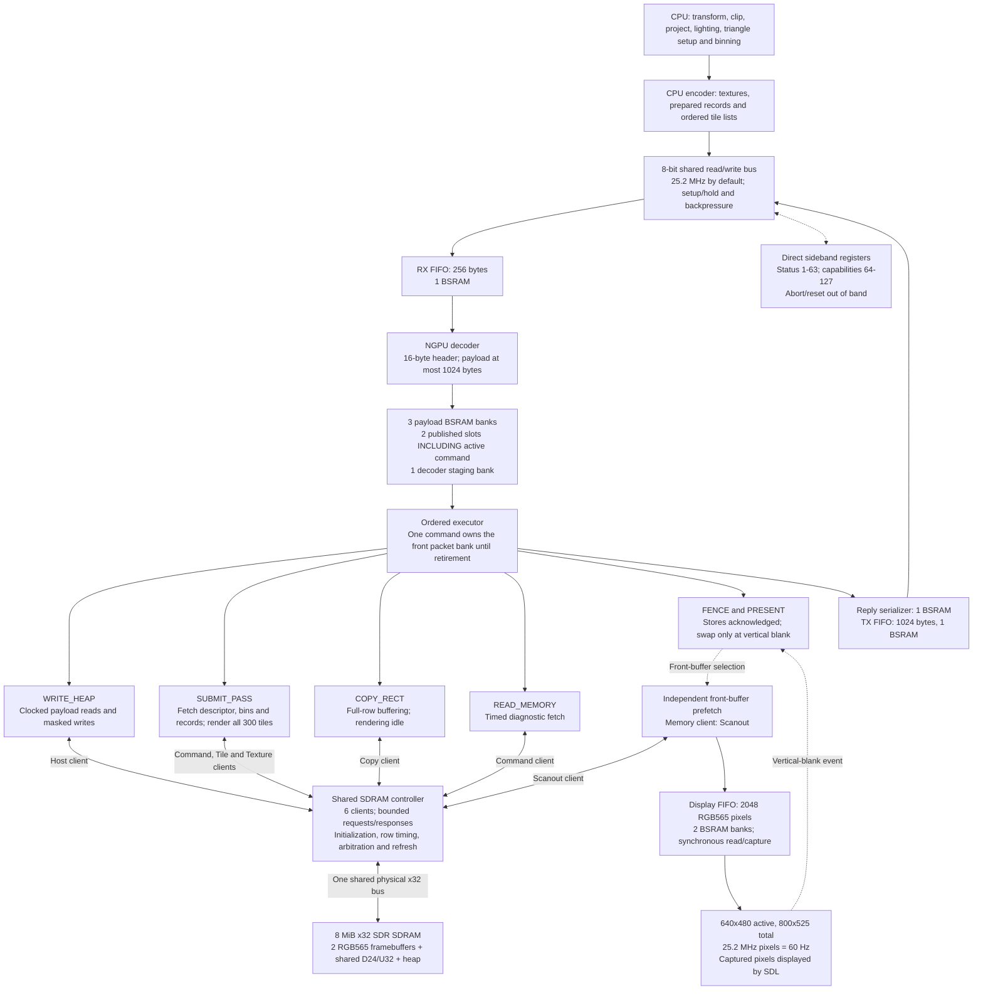
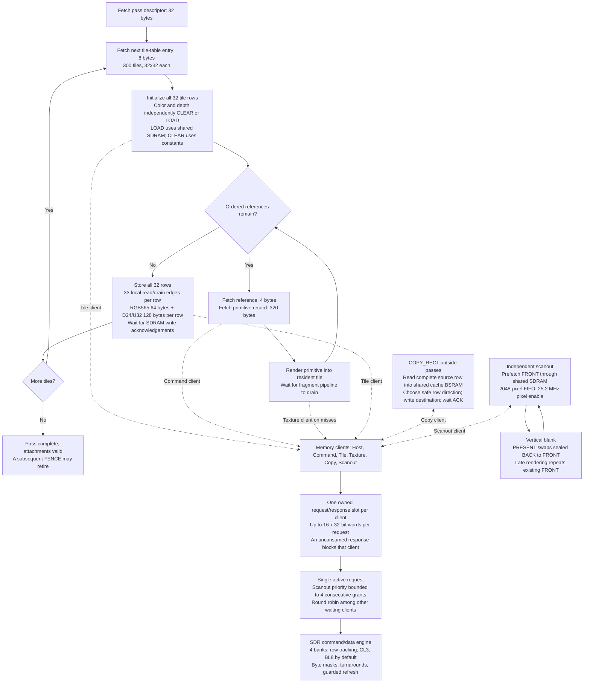

# Current GPU pipeline

Implementation snapshot: `44f0c8f`, system profile `N20K-SYS-0.1`, rendering
profile `N20K-HW-RENDER-0.2`. These diagrams describe the current software
hardware model. The textured path is a serialized state machine with one held
fragment; the arrows do not imply a fully overlapped one-pixel-per-cycle pipeline.
`--mode system` executes the full system shown here. `--mode blocks` runs the
rendering datapath through its standalone host adapter.

[Download the three-page PDF](../images/current-gpu-pipeline.pdf), or open the
scalable diagrams individually:

- [Complete system](../images/current-system.svg)
- [Rendering datapath](../images/current-renderer.svg)
- [Tile scheduling, shared memory and scanout](../images/current-tile-memory.svg)

## System and command delivery



The executor branches are mutually exclusive. Scanout and host reception keep
advancing while a rendering command is busy. Command fetch, tile DMA and texture
requests are different clients of one memory controller, not private memory
channels. Status and capability registers remain accessible when command queues
are blocked. A complete packet publishes a bank selector; it is not a free
1024-byte parallel copy. The active command retains its slot until retirement.

CPU preparation is outside modeled GPU time. Host-image pixels enter GPU storage
only through bus uploads; fetched image handles contain metadata without host
pixel backing. Captured framebuffer/display images are observers, not memory
ports available to the GPU. HDMI/TMDS signaling is outside scope.

## Rendering datapath

```mermaid
flowchart TB
    IN["Fetched immutable primitive + state + tile origin"]
    TYPE{"Primitive type"}
    TRI["Triangle: evaluate CPU-prepared edges<br/>6 shared-DSP products, 24 setup edges<br/>Attribute anchor walk: delta Y + delta X edges"]
    GRID["Rect/pixel: clipped grid<br/>Line: global Bresenham, then tile/scissor filter<br/>Sprite: clipped grid + integer source X/Y"]
    WALK["Coverage and sample generation<br/>Triangle: signed 32-bit edges; 64-bit z/R/G/B/q/U/V accumulators"]
    NEED{"Texture lookup needed?"}
    FAST["Untextured fast path<br/>Form pending fragment; issue optional depth read<br/>Advance walker immediately"]
    FASTCOMMIT["Following edge: depth compare + conditional RGB565/D24 commit<br/>Overlaps evaluation of the next candidate"]
    HOLD["Hold ONE fragment and STOP walker"]
    Z{"Optional early D24 test"}
    SPR{"Sprite?"}
    U["U reconstruction<br/>92 divider edges + 1 parent capture"]
    V["V reconstruction<br/>92 divider edges + 1 parent capture<br/>Same serial divider reused"]
    UV["Signed Q16 floor<br/>Clamp or power-of-two repeat"]
    ADDR["Texture address generation<br/>10 shift/add edges for Y times pitch plus X"]
    TAG{"64-line direct-mapped cache<br/>16 RGB565 texels per line"}
    MISS["Texture SDRAM request<br/>Wait for real arbitration/refresh/response<br/>Refill 16 texels through the cache write port"]
    TEX["Synchronous cache read<br/>Unit capture, then separate parent capture"]
    KEY{"Raw RGB565 color key matches?"}
    MOD{"Triangle texture modulation enabled?"}
    SHADE["3 RGB channels through shared 18x18 DSP<br/>12 edges; exact rounded divide by 255"]
    COMMIT["Conditional RGB565 and D24 commit<br/>Independent write enables; 1 edge"]
    NEXT["Advance walker; step attributes<br/>Drain before accepting the next primitive"]
    DSP["ONE signed 18x18 multiplier<br/>36-bit result; 3 enabled-edge latency<br/>4th edge captures the result"]
    TILE["Three SDPB 1024x16 tile banks<br/>RGB565 / depth low16 / depth high8"]
    IN --> TYPE
    TYPE -->|"Triangle"| TRI --> WALK
    TYPE -->|"2D"| GRID --> WALK
    WALK -->|"Covered candidate"| NEED
    WALK -->|"Outside coverage"| NEXT
    NEED -->|"No"| FAST --> FASTCOMMIT
    FAST -.->|"Next candidate can overlap retirement"| WALK
    NEED -->|"Yes"| HOLD --> Z
    Z -->|"Reject"| NEXT
    Z -->|"Pass or test disabled"| SPR
    SPR -->|"No: textured triangle"| U --> V --> UV --> ADDR
    SPR -->|"Yes: integer coordinates"| ADDR
    ADDR --> TAG
    TAG -->|"Hit"| TEX
    TAG -->|"Miss"| MISS --> TEX
    TEX --> KEY
    KEY -->|"Yes: neither attachment changes"| NEXT
    KEY -->|"No or key disabled"| MOD
    MOD -->|"Yes"| SHADE --> COMMIT
    MOD -->|"No: replacement or sprite"| COMMIT
    COMMIT --> NEXT --> WALK
    DSP -.->|"Shared during initialization"| TRI
    DSP -.->|"Shared during modulation"| SHADE
    TILE -.->|"Depth read"| Z
    TILE -.->|"Depth read"| FAST
    FASTCOMMIT -->|"Enabled writes"| TILE
    COMMIT -->|"Enabled writes"| TILE
```



The texture-needed decision is true for a textured triangle or sprite when
color writes are enabled **or** a color key affects visibility. A keyed
depth-only draw must still sample; an unkeyed textured triangle with color
writes disabled bypasses texture work. Sprites use raw texture replacement and
bypass both perspective division and modulation. Rectangles and lines are flat
and unkeyed. Font-atlas text uses the sprite path.

Projected depth is stepped independently and does not pass through either UV
division. Key rejection compares the raw texel before modulation and before
both attachment writes. The fast path has one pending fragment and includes
same-address depth forwarding. The textured path retains one fragment until
rejection or commit, so it does not accept another textured candidate each cycle.

| Operation | Current enabled-edge schedule |
| --- | --- |
| Primitive capture | 1; texture binding overlaps this edge |
| Triangle edge initialization | 6 products x 4 edges = 24 |
| Attribute anchor adjustment | Delta Y + delta X parallel-adder edges |
| Running walker | 1 candidate edge; lines also walk globally rejected points |
| Untextured fragment retirement | Following edge; overlaps next candidate |
| Textured early depth | Optional registered read/compare before texture work |
| U followed by V reconstruction | 184 divider-work edges + 2 parent captures |
| Cache hit | 14 texture-unit edges + 1 parent capture |
| Cache miss in `system` mode | Variable request/service wait + clocked 16-texel refill and read/captures |
| Cache miss in standalone `blocks` mode | 34 texture-unit edges + 1 parent capture; fixed adapter timing |
| RGB modulation | 3 channels x 4 edges = 12 |
| Passing textured fragment commit | 1 |
| Nonempty primitive drain | 1 |

## Tile scheduling, copies and shared memory



There is one resident tile and one ordered pass/command stream. Tile loads,
drawing, primitive fetches and tile stores follow the sequence above; current
execution does not overlap next-record fetch or tile DMA with drawing. Color
and depth are stored for every tile, including tiles with no primitives. A
prepared record is stored once in SDRAM but fetched again for each tile-list
reference; there is no separate primitive-record cache in this implementation. A
32-pixel row uses one 64-byte color transaction and two 64-byte depth transactions
for stores; LOAD performs only the attachment reads requested by the pass.

The memory controller has one physical x32 SDR bus. Native aligned BL8 transfers
carry 32 bytes; one client request can require several native bursts. Default
CAS latency is 3. Refresh commands must stay within 1575 core cycles / 15.625 us
at the selected clock; guard time may make them occur earlier. Row timing,
read/write turnarounds and refresh temporarily withhold service from all clients.

Copies use the same texture-cache BSRAM as a full-row buffer while rendering is
idle; they do not allocate a fifth renderer bank. Horizontal overlap is protected
by buffering the complete row, and vertical overlap selects the safe row order.
Depth is unchanged. Rendering invalidates/rebinds texture state as required.

Scanout consumes the front buffer while rendering writes the back buffer. It
does not wait for a draw to finish. If its FIFO underflows, the model blanks the
remainder of that frame and resynchronizes at vertical blank. Scanout timing
continues during boot while pixels stay black until memory is ready and primed.

## Clocks, memory map and resources

Default core/SDRAM clock: **100.8 MHz**. Host transfers and pixel consumption
use core-clock-derived enables at **25.2 MHz**. Active video is 640x480;
800x525 total timing yields **60 Hz**. These clocks and SDRAM timing values are
configurable model assumptions, not measured FPGA operating points or CDC proof.

| SDRAM range | Purpose |
| --- | --- |
| `0x000000` to `0x095FFF` | Physical color 0: RGB565, 614400 bytes |
| `0x096000` to `0x12BFFF` | Physical color 1: RGB565, 614400 bytes |
| `0x12C000` to `0x257FFF` | Shared depth: D24 in U32, 1228800 bytes |
| `0x258000` to `0x7FFFFF` | Textures, primitive records, lists and descriptors |

| Selected physical resource | Count |
| --- | ---: |
| Tile RGB565 / depth low16 / depth high8 BSRAM | 3 |
| Texture cache / shared copy-row BSRAM | 1 |
| Scanout FIFO BSRAM | 2 |
| RX / TX / three packet-payload BSRAM | 5 |
| Reply-serializer BSRAM | 1 |
| Total selected SDPB 1024x16 instances | **12 of 46 available** |
| Shared signed 18x18 multiplier equivalents | **1 of 48 available** |
| Serial perspective divider | 1 LUT/register implementation |

This table is not a whole-system fit claim. Bounded record, request/response,
row, status and arithmetic state also requires storage/logic; its final physical
mapping and latency qualification remain open. Wide geometric validation is an
untimed simulation assertion of the CPU-prepared-record contract. See
[the full system model](system-model.md), [block interfaces](block-interfaces.md),
and [verified device resources](gowin-profile.md) for those limits.

## Source and diagram maintenance

Rendering is implemented in
[hw_tile_pipeline.cpp](../../reference/src/hw_tile_pipeline.cpp) and
[hw_texture.cpp](../../reference/src/hw_texture.cpp). System sequencing is in
[hw_system.cpp](../../reference/src/hw_system.cpp); host, memory, copy and scanout
are in the corresponding `hw_host_link`, `hw_sdram`, `hw_system_copy` and
`hw_scanout` sources.

The scalable figures are generated from
[current-system.dot](../diagrams/current-system.dot),
[current-renderer.dot](../diagrams/current-renderer.dot), and
[current-tile-memory.dot](../diagrams/current-tile-memory.dot). Graphviz is needed
only to regenerate these documentation figures, not to build the SRR.
Poppler's `pdfunite` combines the individual PDFs into the three-page export:

```sh
mkdir -p build/pipeline
for name in current-system current-renderer current-tile-memory; do
    dot -Tsvg "docs/diagrams/$name.dot" -o "docs/images/$name.svg"
    dot -Tpdf "docs/diagrams/$name.dot" -o "build/pipeline/$name.pdf"
done
pdfunite build/pipeline/current-system.pdf build/pipeline/current-renderer.pdf build/pipeline/current-tile-memory.pdf docs/images/current-gpu-pipeline.pdf
```
