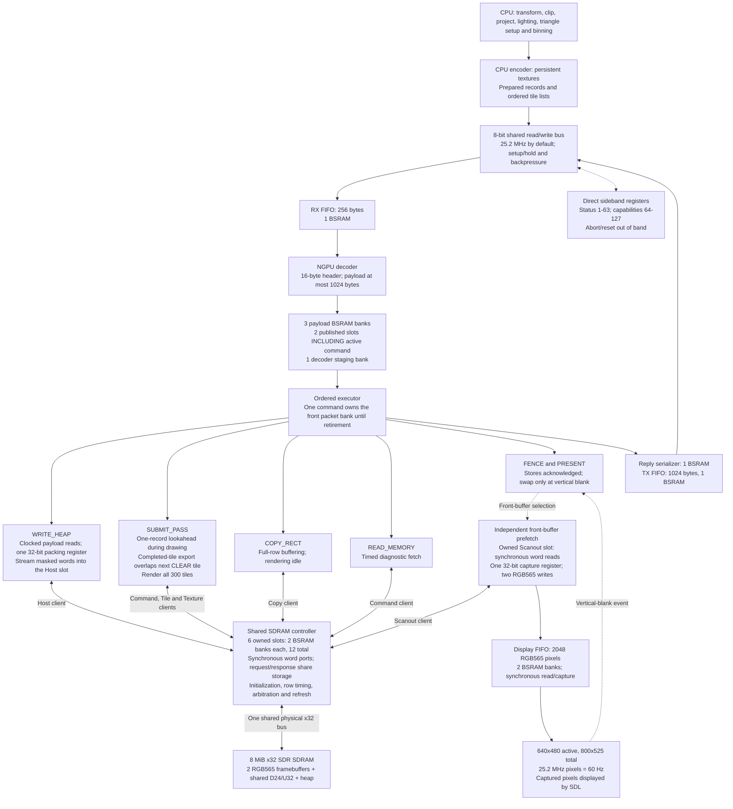
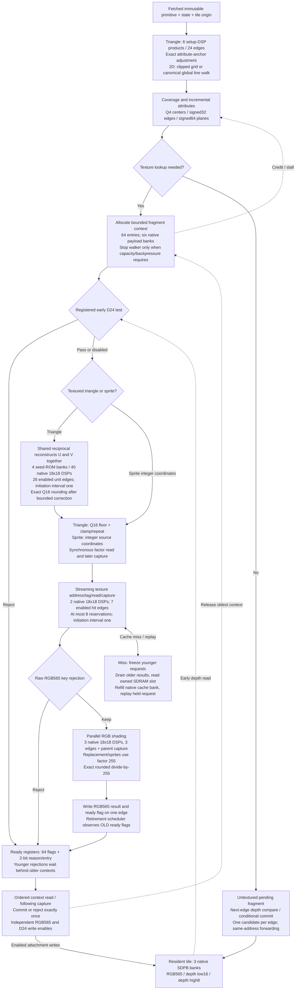
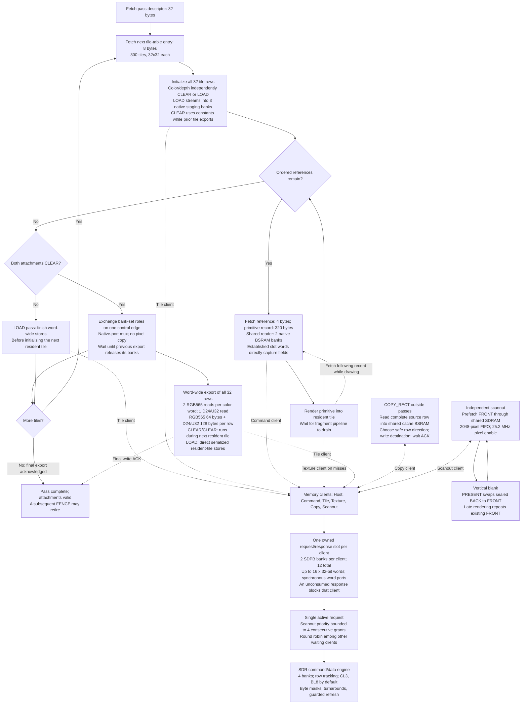

# Historical C++ GPU-model pipeline

These diagrams describe the earlier C++ model, including overlapping export,
and the 0.1 protocol snapshot. They are not the current RTL pipeline. Current
RTL architecture and sole encoded 0.2 uploads are documented in
[GPU_ARCHITECTURE.md](../../GPU_DOCUMENTATION/GPU_ARCHITECTURE.md) and
[GPU_CONTROL.md](../../GPU_DOCUMENTATION/GPU_CONTROL.md).

Implementation snapshot: **shared-reciprocal fragments, geometry lookahead and
overlapped completed-tile export**.
System profile `N20K-SYS-0.1`, rendering profile `N20K-HW-RENDER-0.3`, storage
profile `N20K-STORAGE-0.3`. These diagrams describe the selected software
hardware model: up to 64 retained fragments, ordered retirement, and streaming
UV, cache-hit and shading stages. Initiation interval and latency are distinct;
cache misses, output pressure and a full context ring can stop acceptance.
`--mode system` executes the complete system. `--mode blocks` runs the same
rendering datapath through its standalone host adapter.

[Download the three-page PDF](../images/current-gpu-pipeline.pdf), or open the
scalable diagrams individually:

- [Complete system](../images/current-system.svg)
- [Rendering datapath](../images/current-renderer.svg)
- [Tile scheduling, shared memory and scanout](../images/current-tile-memory.svg)

## System and command delivery



The executor branches are mutually exclusive. Scanout and host reception keep
advancing while a rendering command is busy. Command fetch, tile DMA and texture
requests are different clients of one memory controller, not private memory
channels. Status and capability registers remain accessible when command queues
are blocked. A complete packet publishes a bank selector; it is not a free
1024-byte parallel copy. The active command retains its slot until retirement.

Each SDRAM client has a pair of native x16 banks forming one 16-word x32 slot.
Write requests fill it through one word port before publication. Read responses
remain owned while the consumer drains synchronous word reads. The system
execution paths do not use the host-only whole-array request/response adapters.
A shared two-bank reader stores fetched records and readback data. Established
controller-slot words also populate at most 320 bytes of decoded-field
registers, removing the former separate decode-read pass. One-record lookahead
reuses this reader while the tile owns its current captured primitive.

The CPU `HostPassCompiler` retains unchanged textures in a persistent heap
prefix and reuses its transient record/bin tail after a successful fence.
Exact CPU snapshots detect changed pixels. This host resource cache adds no
FPGA memory. Heap writes still execute in order after earlier passes; next-frame
upload/render overlap is deferred until an explicit safe resource-lease or
independent upload-arena contract exists.

CPU preparation is outside modeled GPU time. Host-image pixels enter GPU storage
only through bus uploads; fetched image handles contain metadata without host
pixel backing. Captured framebuffer/display images are observers, not memory
ports available to the GPU. HDMI/TMDS signaling is outside scope.

## Rendering datapath



Perspective reconstruction shares one reciprocal between U and V and corrects
the quotient to the canonical signed Q16 result. Its 26-edge latency does not
prevent a new U/V pair every enabled edge. Every wide multiplication is built
from registered native 18x18 partial products. See the
[arithmetic design and proof](reciprocal-pipeline.md).

The texture-needed decision remains true for textured triangles or sprites when
color writes are enabled **or** a color key affects visibility. Keyed depth-only
draws still sample. Sprites use integer coordinates and bypass perspective.
Sprites and texture replacement use factor 255 through the same RGB stages,
preserving the raw RGB565 value without bypassing their latency.
Flat/Gouraud untextured records bypass texture work. Projected depth
is independently interpolated and never passes through the UV arithmetic.

Depth reads at acceptance compare on the following edge before perspective or
sampling. Within one supported primitive each walker visits a pixel at most
once, and primitives drain before the next starts. No older retained fragment
can therefore invalidate that early decision; retirement does not retest depth.
Future primitive overlap would require a separate depth-hazard policy.

Only textured fragments allocate the 64-entry ring. Untextured draws retain
the one-pending-fragment fast path and its one-edge retirement latency.
Six context banks store commit address/depth (three), RGB factor (two) and
RGB565 result (one). Their synchronous ports prevent an implicit parallel
context-array access. A result write and its ready flag update share an edge;
the retirement scheduler uses only ready flags established by an earlier edge.
The ordered ring preserves fragment order even when younger depth/key
rejections complete first. One retirement can overlap one new acceptance.

A cache miss retains the first missing request, freezes younger address/DSP
stages, and lets older results drain. The same native cache bank receives refill
writes; the next synchronous slot read is issued while the current word's low
half enters the cache, and its established output is captured after the high
half. The miss replays only after its line is valid. A full output register
propagates backpressure. Global clock-enable stalls preserve every dependent
stage while the system's SDRAM and independent scanout continue as scheduled.

| Operation | Selected enabled-edge schedule |
| --- | --- |
| Primitive capture | 1; texture binding overlaps this edge |
| Triangle edge initialization | 6 setup products x 4 edges = 24 |
| Attribute anchor adjustment | Delta Y + delta X parallel-adder edges |
| Walker | At most 1 candidate per edge; rejected box/line samples are not fragments |
| Early D24 | Native read at acceptance; comparison on following edge |
| Shared U/V reconstruction | 26 unit edges + following parent capture; initiation interval one |
| Factor handoff | Synchronous two-bank RGB888 read, following capture before texture push |
| Streaming cache hit | 7 unit edges + following parent capture; initiation interval one |
| Cache miss, `system` | Variable SDRAM acceptance/service and native slot/refill costs; younger requests held |
| Cache miss, `blocks` | Four backing-wait edges plus16 native cache writes, replay and registered read/capture |
| Parallel RGB modulation | 3 unit edges + following parent capture; initiation interval one |
| Context retirement | Synchronous metadata/result read, following capture; ordered initiation interval one |
| Primitive completion | Wait for every retained fragment and pending native operation to drain |

The retained standalone serial arithmetic/texture oracles are not the selected
GPU path. The old U-then-V divider took 186 edges including parent captures;
the serial texture oracle still has14-edge hits and 34-edge idealized misses.
These reference schedules must not be used as current GPU throughput figures.

## Tile scheduling, copies and shared memory



There is one resident rendering tile and one ordered pass/command stream. A
one-record lookahead fetches the next reference and record while the current
draw runs; each draw still drains before the next primitive is captured. For
CLEAR/CLEAR passes, the existing three staging banks retain a completed tile
while its writeback overlaps the next resident tile's initialization, record
fetch and rendering. One control edge exchanges the two sets' native-port
roles; it does not copy pixel contents. Roles cannot exchange again until the
export finishes,
and pass completion waits for the last export acknowledgement. Loading either
attachment uses serialized load/draw/store to preserve staging and client-slot
ownership. Color and depth are stored for every tile, including empty bins. A
prepared record is stored once in SDRAM but fetched again for each tile-list
reference; there is no separate primitive-record cache in this implementation. A
32-pixel row uses one 64-byte color transaction and two 64-byte depth transactions
for stores; LOAD performs only the attachment reads requested by the pass.

The three staging-role banks use all 1024 addresses for a completed CLEAR tile;
LOAD-row staging uses their first 32 addresses. Attachment LOAD results are
unpacked over clocked writes. Initializing a loaded resident tile uses one
row-read prime edge and 32 subsequent capture/write edges per row; CLEAR selects
constants at the tile write inputs. CLEAR/CLEAR completion exchanges the bank
roles through a selector, avoiding the former tile-to-staging pixel copy. The
tile exporter consumes complete 32-bit
words: two synchronous RGB565 pixel reads form a color word, and a parallel
depth-low/high read forms one D24/U32 word. A 32-bit hold and 16-bit color half
preserve the native read latency and bounded backpressure. Host uploads retain
byte packing through their packet-bank source. No parallel row serialization
array, duplicate sixteen-word writer payload or additional BSRAM is present.

The memory controller has one physical x32 SDR bus. Native aligned BL8 transfers
carry 32 bytes; one client request can require several native bursts. Default
CAS latency is 3. Refresh commands must stay within 1575 core cycles / 15.625 us
at the selected clock; guard time may make them occur earlier. Row timing,
read/write turnarounds and refresh temporarily withhold service from all clients.

Copies use the same texture-cache BSRAM as a full-row buffer while rendering is
idle; they add no bank beyond the selected fourteen-bank renderer. Horizontal overlap is protected
by buffering the complete row, and vertical overlap selects the safe row order.
Depth is unchanged. Rendering invalidates/rebinds texture state as required.
The Copy engine drains source-slot words into the shared cache row bank through
a single 32-bit hold, and fills destination-slot words through a separate
32-bit assembly register and four-bit mask. Slot ownership is retained until
required source words or destination acknowledgements have been consumed.

Scanout consumes the front buffer while rendering writes the back buffer. It
does not wait for a draw to finish. Responses remain in the native Scanout
slot while synchronous reads feed one 32-bit capture register, then two
16-bit FIFO writes. There is no extra 16-word response array. Stale requests
and staged native reads are safely drained on a swap. If its FIFO underflows,
the model blanks the remainder of that frame and resynchronizes at vertical blank. Scanout timing
continues during boot while pixels stay black until memory is ready and primed.

## Clocks, memory map and resources

Default core/SDRAM clock: **100.8 MHz**. Host transfers and pixel consumption
use core-clock-derived enables at **25.2 MHz**. Active video is 640x480;
800x525 total timing yields **60 Hz**. These clocks and SDRAM timing values are
configurable model assumptions, not measured FPGA operating points or CDC proof.

| SDRAM range | Purpose |
| --- | --- |
| `0x000000` to `0x095FFF` | Physical color 0: RGB565, 614400 bytes |
| `0x096000` to `0x12BFFF` | Physical color 1: RGB565, 614400 bytes |
| `0x12C000` to `0x257FFF` | Shared depth: D24 in U32, 1228800 bytes |
| `0x258000` to `0x7FFFFF` | Textures, primitive records, lists and descriptors |

| Selected physical resource | Count |
| --- | ---: |
| Tile RGB565 / depth low16 / depth high8 BSRAM | 3 |
| Texture cache / shared copy-row BSRAM | 1 |
| Scanout FIFO BSRAM | 2 |
| RX / TX / three packet-payload BSRAM | 5 |
| Reply-serializer BSRAM | 1 |
| Six shared request/response SDRAM slots, x32 pairs | 12 |
| Shared record/readback reader, x32 pair | 2 |
| Tile-row RGB565 / depth low16 / depth high8 staging | 3 |
| Fragment commit/factor/result context memories | 6 |
| Reciprocal seed base/gradient ROM | 4 |
| Total selected SDPB 1024x16 instances | **39 of 46 available** |
| Setup / perspective / texture-address / RGB DSP equivalents | 1 / 40 / 2 / 3 |
| Total native 18x18 multiplier equivalents | **46 of 48 available** |
| Retained fragment contexts | 64 |
| Serial perspective divider in selected GPU path | 0 |

All bulk staging now has a selected native-memory mapping and clocked ports;
small decoded fields, masks, status and arithmetic state remain explicitly
bounded registers or logic ROM. The [storage map](storage-map.md) records their
allocation and ownership. **39 banks and 46 DSP equivalents are not a whole-system fit or achieved-clock
claim**: register/logic use, synthesis, placement, routing and timing remain to
be qualified. Wide geometric validation is an untimed simulation assertion of
the CPU-prepared-record contract. See [the full system model](system-model.md),
[block interfaces](block-interfaces.md), and [verified device resources](gowin-profile.md).
The [RTL qualification report](rtl-qualification.md) separately records the
shared-reciprocal prototype's measured resource and timing results; it does not
qualify the complete GPU.

## Per-cycle throughput observation

The optional host-only observer records a separate acceptance token and
retirement token on each edge. Retirement distinguishes commit, depth rejection,
key rejection and reset cancellation; one fragment can write both attachments
without becoming two rendered pixels. Events include walker-controller phase, enable/stall state, pixel identity
and in-flight counts. The phase field is not an exclusive utilization report
for the concurrently active arithmetic/cache/shading stages. Local observers cover
every tile edge, while the system observer supplies every common core-clock
timestamp, including command, DMA and idle edges without tile advancement.
Reset can cancel all retained tokens atomically on one edge; CSV keeps those
IDs in a bounded batch field instead of inventing extra physical clocks.

The [throughput harness](throughput.md) checks token conservation and measures
consecutive acceptance/retirement runs, initiation intervals and fragment latency.
Its CSV/JSON reports are simulation observations and create no GPU memory ports
or storage. Controlled warm-cache workloads measure consecutive acceptance and commit
runs separately from cold-cache and stalled cases. A cache-hit cadence result
does not guarantee the same rate across memory misses or complete passes.
Whole-pass throughput uses `last_pass_cycles`, including fetching, tile DMA
and memory waits, rather than only the local tile-clock count.

## Source and diagram maintenance

Rendering is implemented in
[hw_tile_pipeline.cpp](../../reference/src/hw_tile_pipeline.cpp) and
[hw_texture.cpp](../../reference/src/hw_texture.cpp). System sequencing is in
[hw_system.cpp](../../reference/src/hw_system.cpp); host, memory, copy and scanout
are in the corresponding `hw_host_link`, `hw_sdram`, `hw_system_copy` and
`hw_scanout` sources.

The scalable figures are generated from
[current-system.dot](../diagrams/current-system.dot),
[current-renderer.dot](../diagrams/current-renderer.dot), and
[current-tile-memory.dot](../diagrams/current-tile-memory.dot). Graphviz is needed
only to regenerate these documentation figures, not to build the SRR.
Poppler's `pdfunite` combines the individual PDFs into the three-page export:

```sh
mkdir -p build/pipeline
for name in current-system current-renderer current-tile-memory; do
    dot -Tsvg "docs/diagrams/$name.dot" -o "docs/images/$name.svg"
    dot -Tpdf "docs/diagrams/$name.dot" -o "build/pipeline/$name.pdf"
done
pdfunite build/pipeline/current-system.pdf build/pipeline/current-renderer.pdf build/pipeline/current-tile-memory.pdf docs/images/current-gpu-pipeline.pdf
```
