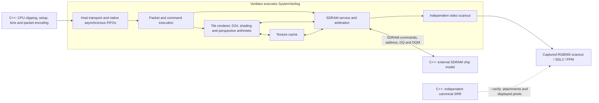

# Integrated RTL GPU

The authoritative project guides are now
[GPU_ARCHITECTURE.md](../../GPU_DOCUMENTATION/GPU_ARCHITECTURE.md) and
[GPU_CONTROL.md](../../GPU_DOCUMENTATION/GPU_CONTROL.md). This page provides
additional simulator, regression and qualification details.

The functional GPU core is implemented in SystemVerilog under
[`rtl/gpu`](../../rtl/gpu). Verilator compiles this RTL into
`build/nano-gpu-rtl`, a command-to-pixel simulator with optional SDL2 output.
The existing SRR remains an independent software oracle. Its C++ hardware-block
and timed-system implementations are not linked into the RTL executable.

This is functional RTL simulation and a synthesis entry point for the
**GW2AR-LV18QN88C8/I7**. The production board clock/reset wrapper, HDMI/DVI
serialization integration, pin constraints and complete placed-and-routed
fit/timing qualification remain separate work.

## Device and testbench boundaries



The C++ host performs the tasks intended for the RP2350: scene preparation,
triangle setup, ordered binning, resource serialization, bus transfers and
reply handling. GPU storage can change only through RTL memory interfaces.
The external chip model responds to the controller's physical SDRAM commands
and data pins; it does not accept device-side C++ memory requests. Testbench
inspection of memory is used only to check results.

The core implements all eight provisional simulation opcodes:
`GET_CAPS`, `GET_STATUS`, `WRITE_HEAP`, `SUBMIT_PASS`, `COPY_RECT`, `FENCE`,
`PRESENT` and `READ_MEMORY`. The rendering path includes triangles, rectangles,
lines, keyed sprites, the five shading modes, perspective-correct nearest
textures, RGB565 attachments and D24 depth. The command-to-memory path includes
packet buffering, fetched descriptors/records/bin lists, attachment transfers,
copies, SDRAM initialization/refresh/arbitration and independent scanout.
These are implemented paths; scene comparisons do not by themselves constitute
exhaustive coverage of every command, malformed packet or recovery sequence.

Native synchronous RAM wrappers preserve registered read latency and bind to
Gowin `SDPB` primitives in synthesis. The reciprocal arithmetic uses the
existing native multiplier/ROM implementation. The device's native primitive
parameters and memory-port contracts apply in both simulation and synthesis.
See [the module interfaces](../../rtl/gpu/interfaces.md) for ports, handshakes
and the physical SDRAM boundary.

The RTL host transport has a distinct `host_clk` domain and native asynchronous
FIFOs. The present full-scene testbench drives that clock at one quarter of the
core frequency. That test schedule does not characterize all asynchronous
clock relationships, electrical setup/hold margins, or an RP2350 PIO program.
The logical host ports also do not finalize the board's shared-data-bus pad
mapping or pin assignments.

### Current native implementation

The CPU byte ABI remains `N20K-SYS-0.1`; all command/record fields, capabilities,
numeric behavior and rendering modes are unchanged. Internal storage and
arithmetic have been restructured to reduce mapped LUT use:

- Seven seed/X-step/Y-step plane triplets use 14 native **512×32 SDPB** banks.
  Registered reads anticipate accepted pixel/row steps and hold on stalls.
  Seed capture adds one setup clock per nonempty primitive/tile invocation;
  sustained fragment acceptance and retirement retain initiation interval one.
- Texture tags use one native bank beside the existing texel bank. Forwarding
  the just-refilled tag preserves hit latency and avoids a same-address RAM
  read/write collision. SDRAM write masks use another synchronous bank beside
  the two payload banks.
- Offset/raster/row stepping shares one adder per edge or plane. The executor
  decodes full raw command words through one 32-bit accumulator, retaining no
  56-byte payload-prefix copy. COPY refetches 14 parameter words from its owned
  packet lease and clips X then Y through one signed 33-bit interval/datapath.
  That phase uses about 128 setup clocks for a nonempty copy. Validated viewport,
  address and transfer values use bounded retained widths; full raw-field
  validation and overflow checks remain ahead of narrowing.
- The fragment path uses the **exact integer-texel UV pipeline**, with
  **19 enabled-edge latency**, initiation interval one and **19 native 18×18
  multiplier equivalents**. A coarse reciprocal seed plus exact residual
  corrections returns exactly the high integer bits consumed after canonical
  signed-Q16 rounding, including its overflow boundaries. Eight native delay
  RAMs replace long-lived payload registers. The generic full-Q16 module
  remains available at 26 edges, but is not the GPU's fragment path.
- Fragment contexts use three native banks: 34-bit address/depth metadata in
  one 512×36 `SDPX9B`, a 24-bit factor in one 512×32 `SDPB`, and a 16-bit result
  bank. The distinct retirement and factor-read schedules keep separate ports.
- Three logical 1,024-byte packet leases occupy two physical 2,048×8 banks.
  Full raw header words are validated before retaining small fields. The
  executor uses the immutable queue head's opcode/sequence/length directly.
  Upload masks occupy words 32..47 of the existing upload bank; synchronous
  mask/data staging streams one u32 every three core clocks.
- Ordered queries serialize immutable capabilities directly. Status replies
  retain changing counters and flags while foreground execution holds other
  fields stable, preserving the same coherent reply without a duplicate
  512-bit state bank. Sideband status reads use the acknowledged, held core
  bank without a duplicate host-domain copy. Reset and ready/rejection bookkeeping use explicit
  per-slot state rather than wide dynamic write networks.

The total is **46 native RAM banks** (44 `SDPB`, two `SDPX9B`) and **25 native
18×18 multiplier equivalents**: 19 UV, two address, three shade and one edge.
The physical primitive modes and native
latencies are modeled in simulation; these reductions do not replace hardware
storage with simulator-only state.

### Control timing and recovery

The executor registers foreground quiescence before entering recovery or the
drained fault state. An abort first waits for renderer idle; quiescence then
blocks every new foreground memory command, including texture-cache refills.
Accepted payload/response traffic still drains, while scanout remains active.
The pending-transaction test occurs on a later edge and includes any command
accepted on the edge that establishes quiescence. The recovery-state decision
therefore has no combinational dependency on the SDRAM arbiter's current `cmd_ready`.
Quiescence stays asserted through the renderer reset and the host flush
acknowledgement before idle resumes. This adds recovery control edges without
adding clocks to ordinary rendering or changing the CPU byte ABI.

The SDRAM arbiter uses parallel masked/wrapped foreground request selection
and a one-hot grant. `cmd_ready` uses that grant directly; binary owner encoding
only selects the payload and retained transaction. Bounded scanout preference
and foreground round-robin order are preserved, with no added arbitration
cycle. Exhaustive grant equivalence and SDRAM-pin simulation tests cover the
selection, selected invalid metadata, refresh and runtime reset behavior.

SDRAM extent validation also uses the bounded request size. For an aligned
1–16-word request, an 8 MiB overrun is possible only from its final 64-byte
line. A six-bit word-offset-plus-count sum replaces the 24-bit byte-end adder;
raw alignment/count rejection and an extent ending exactly at 8 MiB are
preserved. Transaction acceptance first captures owner, address, count and
direction; `CHECK_REQUEST` validates them on the next edge before write payload
collection or SDRAM scheduling. This adds one startup clock per accepted
transaction and delays invalid done/error by one edge internally, preserving
ready/valid acceptance and ordered client completion.

Record data has a separate one-word boundary between the SDRAM read port and
tile header/coefficient decoding: 32 data bits, a seven-bit index and valid.
It accepts one word per clock across a burst. The existing record-completion
gap drains the final word before draw launch, without another fetch state.
Abort, fault, quiescence and renderer reset cancel/suppress a queued word so
it cannot appear in a later draw or epoch.

The fragment-to-cache coordinate handoff has a main register and one spill
register, each owning coordinates, context tag and RGB factor together.
Upstream readiness depends on registered spill occupancy, cutting the cache's
combinational ready path back to rasterizer step enables. A full spill can
delay upstream restart by one edge after backpressure clears, while buffered
requests remain consecutive at the output. The elastic handoff itself adds no
warm output stage and preserves one-fragment-per-clock cadence. The tile selects
signed 16-bit coordinate retention within its validated domain; the generic module keeps a
32-bit default. Prepared-record encoding is unchanged; the private UV
pipeline's latency is 19 enabled edges.

Fragment input readiness uses retained-stage downstream capacity without the
current depth comparison. Depth rejection still consumes its sample; while
the downstream path is blocked, this conservative capacity rule can delay a
replacement by one edge. Warm passing and rejecting streams still accept and
retire at one per clock. The tradeoff cuts depth-RAM comparison from the
rasterizer's input-ready path and is included in complete-frame measurements.

The private UV pipeline captures its 21-bit `q >> 17` rounding epsilon and
38-bit `q - epsilon` positive threshold alongside the final corrected residual.
Signed round candidates and compact overflow predicates are prepared in
parallel so the final remainder comparison only selects the result. Exact
signed-Q16-derived texel coordinates and overflow boundaries remain unchanged,
with 19 enabled edges and initiation interval one; the separate
26-edge generic UV pipeline is unchanged.

The extra private UV edge splits mantissa/round-predicate capture from rounded
normalization and exponent adjustment. The input attribute limit is prepared
as `q + 32`, then compared as `(q + 32) << 5`, exactly the prior `q*32 + 1024`
bound. Both changes preserve coordinate values and flags. The native delay
rings gain delay positions without adding RAM or multipliers.

The rasterizer uses five-bit remaining-column/row counts for validated
non-line spans of 1–32 candidates. Row reload and coefficient lookahead use
these retained counts, including stalls, instead of widened `x+1`/`x+2`
comparisons in the same clock as the 64-bit plane adders. Raw bounds clipping
and validation remain full width; line stepping is unchanged.

The seven plane and three edge adders capture overflow in separate sticky
flags only when their sums are consumed. The combined public fault, busy and
attachment suppression change on the same overflow edge as before. Pending
pixel cancellation is preserved, and an unused final-sample sum cannot cause
a fault. The controller's private failed state follows one edge later, with
no additional raster/setup/drain cycles from overflow handling.

Draw setup itself is staged: `START` captures viewport-clipped intervals and
raw validity information, `CLIP_SCISSOR` intersects the scissor and checks sprite
extent, `CLIP_TILE` rejects invalid records before side effects and intersects
the tile, then `PREPARE` initializes offsets, source coordinates and remaining
counts. Reusing interval registers adds three setup clocks per valid draw,
including valid empty/configuration draws. Invalid structural records can fault
two setup edges later. Full-width raw sprite spans remain validated, and no
texture configuration or attachment access occurs before that validation.
`CONFIG` uses a registered empty-window decision; an empty draw with a present
texture descriptor still configures and validates it before draining.

Cache configuration similarly has two preparation edges before its final
`cfg_valid && cfg_ready` handshake. It first retains allocation extent and
field/overflow checks, then computes the allocation end in word units. Only
the final successful handshake activates fields or invalidates tags for a
changed storage layout. Withdrawing an unaccepted configuration leaves active
fields and tags unchanged; explicit flush still invalidates tags. The seven-edge
hit pipeline, warm initiation interval and refill schedule are unchanged.

## Build and run

Follow the [development setup](../development.md#integrated-rtl-simulator).
On Windows, use **MSYS2 UCRT64**:

```bash
pacman -Syu
# If a terminal restart is requested, reopen UCRT64 and run pacman -Syu again.
./scripts/setup-rtl-sim.sh
make rtl-gpu-run
```

The setup installs Verilator, Python, native C++ tools and SDL2, then checks
them. Pulling the repository does not install dependencies. `make rtl-gpu`
only compiles the executable; `make rtl-gpu-run` also opens its SDL2 window.
The Windows executable is `build/nano-gpu-rtl.exe`. See
[Windows setup and diagnostics](../development.md#windows-rtl-simulator).
If GCC runtime conflicts persist after a full MSYS2 upgrade, that guide also
covers the explicit `gcc-libs`/`cc-libs` compatibility-package migration.

On Linux x86_64:

```bash
./scripts/setup-rtl-tools.sh
make rtl-gpu
./build/nano-gpu-rtl --headless --scene showcase --verify --stats build/rtl-showcase.json
```

For SDL2 output, install SDL2 before building, then run:

```bash
./scripts/setup-sdl2.sh
make rtl-gpu
./build/nano-gpu-rtl --scene showcase --verify
```

The first build can take several minutes while Verilator and the C++ compiler
run. Build progress and periodic activity messages appear in the terminal,
and the full output is written to `build/rtl-gpu/verilator-build.log`. Use the
builder's `--verbose` option to stream every compiler message. Check tools
without installing or building the GPU with `./scripts/setup-rtl-sim.sh --check`;
that check compiles and runs a small RTL/C++/SDL2 smoke test.

The builder detects SDL2 with pkg-config and falls back to a headless executable
if unavailable. To select that build explicitly, use
`python3 scripts/gpu-rtl.py --headless-only`.

The executable supports:

| Option | Effect |
| --- | --- |
| `--headless` | Run without SDL2; defaults to one frame. |
| `--scene showcase\|perspective\|overdraw\|opaque` | Select the host-generated workload. |
| `--verify` | Compare all attachments and every complete scanout frame after the first PRESENT with the independent SRR. |
| `--self-test` | Run the headless command, copy, attachment LOAD, scanout and recovery checks. |
| `--frames N` | Limit rendered frames; windowed runs otherwise continue. |
| `--time S`, `--step S` | Select deterministic animation time and its increment. |
| `--stats FILE.json` | Save RTL cycle counts, verification state and the displayed color hash. |
| `--output FILE.ppm` | Save the last complete displayed frame. |
| `--trace FILE.vcd` | Trace RTL signals; complete-frame traces can be large. |
| `--scanout-log FILE.csv` | Record every complete scanout frame, including black or mismatched frames, with cycle, phase and color hash. |

For a frozen two-frame differential check:

```bash
./build/nano-gpu-rtl --headless --scene showcase --frames 2 --time 0 --step 0 --verify
```

`make rtl-gpu-test` runs the command self-test followed by all four scenes,
with two verified frames per scene starting at time 1.25 seconds. Its
`build/rtl-gpu-tests/results.json` records the simulator executable's SHA-256,
per-case logs and scene statistics; a failed run removes any previous passing
summary. `make rtl-block-test` runs the separate native RAM/video, asynchronous
host, tile-renderer, physical SDRAM controller and texture-cache unit checks.
`make rtl-gpu-synth` builds the simulator and synthesizes the same functional
RTL top with `synth_gowin -family gw2a`.

[`scripts/gpu-rtl.py`](../../scripts/gpu-rtl.py) accepts `--build-dir PATH`,
`--output PATH`, `--headless-only`, `--require-sdl`, `--check`, `--verbose`,
`--synth`, and `--run` followed by simulator arguments. `--check` validates the
toolchain with a small compiled simulation; `--require-sdl` makes missing SDL2
an error instead of producing a headless-only executable. The default build
directory is `build/rtl-gpu`; its generated files
include `verilator-build.log`, `build-report.json`, and, when requested,
`gpu-synth.json` and `gpu-synthesis.log`. The build report records tool versions,
source SHA-256 fingerprints, whether SDL2 was enabled and synthesis cell counts
when available. The script rejects inputs changed during its build.

## Verification and cycle evidence

With `--verify`, the testbench renders the same prepared pass through the
canonical monolithic SRR. It compares every pixel of **both** RGB565
framebuffers and the complete D24 buffer with external SDRAM contents. After
presentation, it also checks every complete frame captured from the RTL's actual
scanout pixels, including during the next upload and rendering pass. The expected
front changes after the PRESENT reply in vertical blank. Frames are published
at the final active pixel, avoiding the nine-bit Y counter's wrap during blank.
SDL2 and PPM output use those captured pixels, including any
scanout failure, rather than reading a framebuffer directly for display.

The command self-test exercises all eight opcodes, a 512-byte unaligned
readback, masked heap writes, overlapping framebuffer copies, clipped copies
from a pitched non-power-of-two image, and color/depth LOAD. It also cancels
partial and malformed packets and an active pass, checks epoch restart and
attachment validity, and confirms that recovery preserves every front-buffer
pixel. Separate native-block tests cover RAM collisions, independent host
clocks, physical SDRAM timing and runtime reset during all eight WRITE beats.
The command test also checks 44 unaligned/short upload patterns, more than
512 KiB of sustained uploads while a nonblack front remains visible, and abort
after an upload reaches the physical SDRAM WRITE pins.

The focused [core recovery/record regression](../../scripts/rtl-core-recovery-check.py)
exercises the complete core and SDRAM service: eight cases and 1,611 checks
cover a transaction accepted on the quiescence edge,
write payload draining while quiet, abort waiting for renderer idle and
quiescence through host flush acknowledgement. It also checks all 80 pipelined
record words, inserted bubbles, final-word ordering before launch, cancellation
on abort/fault/reset and a fresh record after epoch recovery. The
[memory regression](../../scripts/rtl-memory-check.py) also compares 15,360
arbiter selections against the previous selection rule, covering all request
masks, foreground cursors, scanout streaks and acceptance eligibility, including
invalid selected metadata. Its SDRAM-pin and cache tests remain separate from
real-board validation.

The registered transaction-validation test adds 43 cases and 4,054 assertions
for valid/invalid acceptance, retained ownership, range validation, refresh and
reset behavior across `CHECK_REQUEST`.

The memory regression adds 8,192 extent cases against an independent full
byte-end calculation, covering final-line boundaries, alignment and every
raw word count. The bounded check relies on the request's proven maximum of
64 bytes, so an overrun can begin only in SDRAM's final 64-byte line.

Sixteen cache-configuration cases check the staged range/field validation,
final handshake, cancellation retaining the old configuration/tags and explicit
flush invalidation. The request/refill regression still verifies 1,024
consecutive warm outputs and cancellation without returning a stale request.

The coordinate-buffer test checks 1,088 ordered requests and commits for each
of the 16-bit and 32-bit configurations, including signed endpoints, factor/
tag ownership, alternating/burst/random backpressure and reset with a full
spill slot. Between-edge ready toggles verify that input readiness is isolated
from current cache readiness. Warm tests still accept and retire 1,024
consecutive fragments. The extra UV edge adds one triangle-tail edge; the
three draw-setup edges affect tile invocation latency, preserving the sustained
one-fragment-per-clock cadence.

Eighteen depth-capacity cases, nine per coordinate width, exercise conservative
input readiness, blocked rejection and simultaneous replacement. They preserve
passing/rejecting warm initiation interval one and ordered output.

Raster timing tests compare the remaining-count flags to the previous
full-width coordinate formulas on every raster edge. They cover all 32
clipped widths, coefficient lookahead stalls and 44 overflow/final-sample
cases: each plane/edge addition path, both overflow signs and X/Y steps,
previous-pixel preservation, current-pixel cancellation, and unused final
sums. The unchanged warm tests continue to prove 1,024 consecutive accepts
and commits.

The staged setup regression adds 1,478 draw-validation/clipping checkpoints
alongside the raw-word mutation tests. Four empty-window configuration cases
include `INT32_MIN` bounds, held configuration acceptance and cache rejection;
they complete or fault as appropriate without pixel requests or attachment
writes before validation.

An earlier scanout bug caused most of a displayed frame to turn black during
the next upload. The scanout client offered refills too late to benefit from
arbitration priority, and uploads reserved the service before fetching their
payload. Queued display refills and a native 64-byte upload staging bank fix
the starvation. The contested scanout regression fails the old RTL and checks
consecutive frames, including simultaneous completion, acceptance and swap.
The integration suite now requires zero scanout underflows and saves per-frame
CSV logs, so a later correct frame cannot hide an earlier blackout.

The current RTL passes the command/recovery self-test and two
rendered frames of each scene, starting at time 1.25 seconds with a 1/60-second
step. Every attachment and every completed scanout after the first PRESENT
agrees with the canonical SRR:

| Scene | Second-frame cycles through FENCE | Change from area baseline | Nominal ms at 100.8 MHz | Verified scanout frames | Underflows |
| --- | ---: | ---: | ---: | ---: | ---: |
| Showcase | 8,468,144 | +92,168 (+1.10%) | 84.01 | 8 | 0 |
| Perspective | 7,538,752 | +116,748 (+1.57%) | 74.79 | 7 | 0 |
| Overdraw | 9,821,420 | +97,116 (+1.00%) | 97.43 | 8 | 0 |
| Opaque | 9,872,404 | +98,408 (+1.01%) | 97.94 | 8 | 0 |

The [current timing-optimization regression](../benchmarks/rtl-timing-optimized.json)
records executable/source hashes, all five integration results and comparison
against the [area baseline](../benchmarks/rtl-fit-optimized.json). The self-test
also passes 29 additional COPY oracle cases and 17 descriptor/LOAD fault cases. Across these scenes the
submission-cycle increase ranges from 1.00% to 1.57%, including the added
transaction-validation edge, configuration/setup stages and private UV edge.

The historical [continuous-scanout baseline](../benchmarks/rtl-scanout-fixed.json)
retains the reproducible pre-fix blackout failure, tool versions and earlier
hashes/cycles. The older [initial baseline](../benchmarks/rtl-initial.json) checked
selected post-PRESENT frames and did not catch the intermediate blackout.

The current RTL still uploads textures on every frame, serializes tile
transfers, and performs LOAD and COPY as individual
pixel transactions. The older C++ model's resident-texture cache, primitive
prefetch and overlapping tile writeback have not been ported to this RTL.

These counts belong to the current integrated RTL serialized schedule, with
continuous scanout maintained. Dividing the showcase submission count by
an **assumed** 100.8 MHz gives approximately 84.01 ms;
100.8 MHz is not an achieved whole-GPU clock, and this result does not establish
30 FPS. The source-matched route below estimates 68.88 MHz in the core domain,
so these nominal milliseconds are not achieved FPGA frame times. Further RTL
optimization needs its own measured baseline and must
preserve the independent oracle comparisons.

`core_cycles` includes reset/boot and final display observation;
`last_submission_cycles` covers sending the last compiled pass through its
fence response. `wall_seconds_excluding_boot` is PC execution time and also
includes any enabled software oracle work. None of these reports includes
measured RP2350 preparation time or proves board performance. The simulator's
`color_fnv1a64` is a 16-digit hexadecimal hash of the captured RGB565 pixels.

## Physical resource result

The current functional logical-core serial probe **places and routes legally**
on the Tang Nano 20K's exact FPGA, but **fails its core-clock target**. The
physical implementation targets **GW2AR-LV18QN88C8/I7**, using the
**GW2A-18C** database. It wraps the complete logical GPU in
[`gpu_probe.sv`](../../rtl/gpu_probe.sv), a nine-pin serial probe that keeps
external inputs controllable and output cones observable. It does not replace
any GPU function or supply the production board wrapper.

The source-matched [resource report](rtl-core-pack.json) and
[physical implementation report](rtl-core-pnr.json) distinguish:

| Resource | Used | Available |
| --- | ---: | ---: |
| Routed occupied physical LUT sites | **20,305** | **20,736** |
| DFF resources, including serial probe and RAM-reserved slots | 7,003 | 15,552 |
| ALU functions, already included in packed LUT sites | 5,494 | 15,552 |
| Native 18×18 multipliers | 25 | 48 |
| Native BSRAM blocks | 46 | 46 |
| Packed LUT sites before flip-flop input placement | 17,134 | 20,736 |
| Necessary minimum physical LUT sites | 20,104 | 20,736 |

ALUs and eight `RAM16SDP4` cells are already represented in the packed logic
total. Gowin flip-flops require an input LUT; some can pair with an existing
LUT/ALU. Of 6,955 active flip-flops, at most 3,985 have that pairing, requiring
at least **2,970 additional input LUTs**. The resulting **20,104 physical-site
lower bound** is a necessary capacity check, not legal-placement proof or a
measurement of remaining physical sites. DFF capacity also includes 48
RAM-blocked flip-flop slots. All 46 native RAM banks are allocated. The serial probe adds at most
198 registers plus its small checksum/control logic and excludes the production
board wrapper.

Reproduce synthesis and exact-part packing with:

```bash
make rtl-gpu-pack
make rtl-gpu-pnr
```

[`scripts/rtl-core-pack.py`](../../scripts/rtl-core-pack.py) writes full evidence
and logs under `build/rtl-core-pack` and the compact versioned report at
`docs/hardware/rtl-core-pack.json`. Source hashes bind the result to its RTL,
probe, constraints and build scripts. The helper returns status **2** for an
over-capacity resource result, including a failed flip-flop input LUT lower
bound. The selected flow uses `synth_gowin -nowidelut` to avoid wide-LUT
placement restrictions, with current inputs unchanged during the measured run.

The final mapping's legal route occupies **20,305 physical LUT sites**,
or **97.92%**, leaving 431 sites in the probe. This is the union of 14,779
explicit LUT sites (including 32 RAM-storage sites), 5,494 ALU sites and 32
further RAM-reserved sites. The earlier 19,775-site packed inventory failed
placement because its additional required flip-flop input LUTs pushed physical
demand beyond capacity; packed counts alone were insufficient.

The source-matched route applies independent core/host constraints:

The reported Fmax is a **static timing estimate under nextpnr's device delay
model**, not a measured silicon maximum. Verilator's functional cycle simulation
does not model these propagation times. The separate implementation flow maps
cells and routes, then estimates their delays and register timing requirements.
Real hardware may differ; final board qualification requires Gowin timing
analysis with the final constraints and hardware testing.

| Domain | Requested target | Reported constraint | Estimated routed Fmax | Result |
| --- | ---: | ---: | ---: | --- |
| Core | 100.8 MHz | 100.80645 MHz | **68.88001 MHz** | **FAIL** |
| Host | 25.2 MHz | 25.20034 MHz | 118.27321 MHz | PASS |

Reported constraints reflect 1 ps period precision: 9.920 ns core and
39.682 ns host. The core's **14.518 ns critical path** passes from clipped-window
bounds through raster-advancement control to interpolation-register enables.
The previous area-optimized route estimated 48.26255 MHz; estimated Fmax improves
by 42.7%, with warm fragment initiation interval one preserved. Further clock
optimization is paused by user choice at this candidate for production board
integration and measurements. The nominal simulation profile remains 100.8 MHz;
this work has not programmed an FPGA or selected the production PLL settings.

The physical runner
[`scripts/rtl-core-pnr.py`](../../scripts/rtl-core-pnr.py) retains source/artifact
hashes and constraints in [rtl-core-pnr.json](rtl-core-pnr.json).
`make rtl-gpu-pnr` enables `--require-timing` and **returns status 2 for the
current core-clock miss despite successful legal routing**.

Packed totals alone do not establish placement, routing or a whole-GPU clock;
the physical-trial evidence is reported separately. The simulator intentionally reports
`whole_gpu_fit_qualified=false`: a capacity pass for the logical-core probe is
not qualification of the final board. Full-device placement, routing and timing
must include the production wrapper and must stay within the remaining
physical resources while preserving command, attachment and actual-scanout
conformance. A routed serial probe remains narrower evidence than a production
board top, so its report always leaves `whole_gpu_fit_qualified=false`.

The complete board still needs clock/reset generation, SDRAM clock/pad timing,
video encoding/serialization integration, the agreed RP2350 bus pads and final
pin constraints. Complete synthesis, placement, routing and timing must cover
that final top, followed by board validation. The standard video serializer
does not need a new GPU rendering proof, but its wrapper and clocks still need
to be included in physical implementation.

The older [reciprocal/UV qualification](rtl-qualification.md) remains evidence
for its arithmetic probe only. Its routed frequency, LUT/FF count and probe
constraints cannot be attributed to the new full functional core. Likewise,
the C++ [storage map](storage-map.md) is an allocation budget rather than a
measured complete-RTL resource report.
