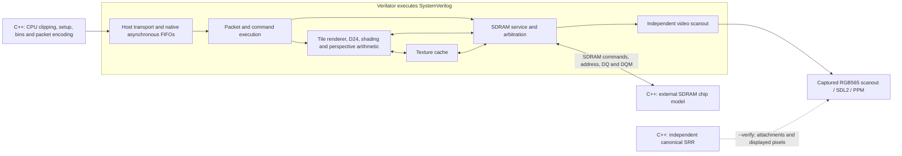

# Integrated RTL GPU

The authoritative project guides are now
[GPU_ARCHITECTURE.md](../../GPU_DOCUMENTATION/GPU_ARCHITECTURE.md) and
[GPU_CONTROL.md](../../GPU_DOCUMENTATION/GPU_CONTROL.md). This page provides
additional simulator, regression and qualification details.

The functional GPU core is implemented in SystemVerilog under
[`rtl/gpu`](../../rtl/gpu). Verilator compiles this RTL into
`build/nano-gpu-rtl`, a command-to-pixel simulator with optional SDL2 output.
The existing SRR remains an independent software oracle. Its C++ hardware-block
and timed-system implementations are not linked into the RTL executable.

This is functional RTL simulation and a synthesis entry point for the
**GW2AR-LV18QN88C8/I7**. The production board clock/reset wrapper, HDMI/DVI
serialization integration, pin constraints and complete placed-and-routed
fit/timing qualification remain separate work.

## Device and testbench boundaries



The C++ host performs the tasks intended for the RP2350: scene preparation,
triangle setup, ordered binning, resource serialization, bus transfers and
reply handling. GPU storage can change only through RTL memory interfaces.
The external chip model responds to the controller's physical SDRAM commands
and data pins; it does not accept device-side C++ memory requests. Testbench
inspection of memory is used only to check results.

The core implements all eight provisional simulation opcodes:
`GET_CAPS`, `GET_STATUS`, `WRITE_HEAP`, `SUBMIT_PASS`, `COPY_RECT`, `FENCE`,
`PRESENT` and `READ_MEMORY`. The rendering path includes triangles, rectangles,
lines, keyed sprites, the five shading modes, perspective-correct nearest
textures, RGB565 attachments and D24 depth. The command-to-memory path includes
packet buffering, fetched descriptors/records/bin lists, attachment transfers,
copies, SDRAM initialization/refresh/arbitration and independent scanout.
These are implemented paths; scene comparisons do not by themselves constitute
exhaustive coverage of every command, malformed packet or recovery sequence.

Native synchronous RAM wrappers preserve registered read latency and bind to
Gowin `SDPB` primitives in synthesis. The reciprocal arithmetic uses the
existing native multiplier/ROM implementation. The device's native primitive
parameters and memory-port contracts apply in both simulation and synthesis.
See [the module interfaces](../../rtl/gpu/interfaces.md) for ports, handshakes
and the physical SDRAM boundary.

The RTL host transport has a distinct `host_clk` domain and native asynchronous
FIFOs. The present full-scene testbench drives that clock at one quarter of the
core frequency. That test schedule does not characterize all asynchronous
clock relationships, electrical setup/hold margins, or an RP2350 PIO program.
The logical host ports also do not finalize the board's shared-data-bus pad
mapping or pin assignments.

## Build and run

Follow the [development setup](../development.md#integrated-rtl-simulator).
On Windows, use **MSYS2 UCRT64**:

```bash
pacman -Syu
# If a terminal restart is requested, reopen UCRT64 and run pacman -Syu again.
./scripts/setup-rtl-sim.sh
make rtl-gpu-run
```

The setup installs Verilator, Python, native C++ tools and SDL2, then checks
them. Pulling the repository does not install dependencies. `make rtl-gpu`
only compiles the executable; `make rtl-gpu-run` also opens its SDL2 window.
The Windows executable is `build/nano-gpu-rtl.exe`. See
[Windows setup and diagnostics](../development.md#windows-rtl-simulator).
If GCC runtime conflicts persist after a full MSYS2 upgrade, that guide also
covers the explicit `gcc-libs`/`cc-libs` compatibility-package migration.

On Linux x86_64:

```bash
./scripts/setup-rtl-tools.sh
make rtl-gpu
./build/nano-gpu-rtl --headless --scene showcase --verify --stats build/rtl-showcase.json
```

For SDL2 output, install SDL2 before building, then run:

```bash
./scripts/setup-sdl2.sh
make rtl-gpu
./build/nano-gpu-rtl --scene showcase --verify
```

The first build can take several minutes while Verilator and the C++ compiler
run. Build progress and periodic activity messages appear in the terminal,
and the full output is written to `build/rtl-gpu/verilator-build.log`. Use the
builder's `--verbose` option to stream every compiler message. Check tools
without installing or building the GPU with `./scripts/setup-rtl-sim.sh --check`;
that check compiles and runs a small RTL/C++/SDL2 smoke test.

The builder detects SDL2 with pkg-config and falls back to a headless executable
if unavailable. To select that build explicitly, use
`python3 scripts/gpu-rtl.py --headless-only`.

The executable supports:

| Option | Effect |
| --- | --- |
| `--headless` | Run without SDL2; defaults to one frame. |
| `--scene showcase\|perspective\|overdraw\|opaque` | Select the host-generated workload. |
| `--verify` | Compare all attachments and every complete scanout frame after the first PRESENT with the independent SRR. |
| `--self-test` | Run the headless command, copy, attachment LOAD, scanout and recovery checks. |
| `--frames N` | Limit rendered frames; windowed runs otherwise continue. |
| `--time S`, `--step S` | Select deterministic animation time and its increment. |
| `--stats FILE.json` | Save RTL cycle counts, verification state and the displayed color hash. |
| `--output FILE.ppm` | Save the last complete displayed frame. |
| `--trace FILE.vcd` | Trace RTL signals; complete-frame traces can be large. |
| `--scanout-log FILE.csv` | Record every complete scanout frame, including black or mismatched frames, with cycle, phase and color hash. |

For a frozen two-frame differential check:

```bash
./build/nano-gpu-rtl --headless --scene showcase --frames 2 --time 0 --step 0 --verify
```

`make rtl-gpu-test` runs the command self-test followed by all four scenes,
with two verified frames per scene starting at time 1.25 seconds. Its
`build/rtl-gpu-tests/results.json` records the simulator executable's SHA-256,
per-case logs and scene statistics; a failed run removes any previous passing
summary. `make rtl-block-test` runs the separate native RAM/video, asynchronous
host, tile-renderer, physical SDRAM controller and texture-cache unit checks.
`make rtl-gpu-synth` builds the simulator and synthesizes the same functional
RTL top with `synth_gowin -family gw2a`.

[`scripts/gpu-rtl.py`](../../scripts/gpu-rtl.py) accepts `--build-dir PATH`,
`--output PATH`, `--headless-only`, `--require-sdl`, `--check`, `--verbose`,
`--synth`, and `--run` followed by simulator arguments. `--check` validates the
toolchain with a small compiled simulation; `--require-sdl` makes missing SDL2
an error instead of producing a headless-only executable. The default build
directory is `build/rtl-gpu`; its generated files
include `verilator-build.log`, `build-report.json`, and, when requested,
`gpu-synth.json` and `gpu-synthesis.log`. The build report records tool versions,
source SHA-256 fingerprints, whether SDL2 was enabled and synthesis cell counts
when available. The script rejects inputs changed during its build.

## Verification and cycle evidence

With `--verify`, the testbench renders the same prepared pass through the
canonical monolithic SRR. It compares every pixel of **both** RGB565
framebuffers and the complete D24 buffer with external SDRAM contents. After
presentation, it also checks every complete frame captured from the RTL's actual
scanout pixels, including during the next upload and rendering pass. The expected
front changes after the PRESENT reply in vertical blank. Frames are published
at the final active pixel, avoiding the nine-bit Y counter's wrap during blank.
SDL2 and PPM output use those captured pixels, including any
scanout failure, rather than reading a framebuffer directly for display.

The command self-test exercises all eight opcodes, a 512-byte unaligned
readback, masked heap writes, overlapping framebuffer copies, clipped copies
from a pitched non-power-of-two image, and color/depth LOAD. It also cancels
partial and malformed packets and an active pass, checks epoch restart and
attachment validity, and confirms that recovery preserves every front-buffer
pixel. Separate native-block tests cover RAM collisions, independent host
clocks, physical SDRAM timing and runtime reset during all eight WRITE beats.
The command test also checks 44 unaligned/short upload patterns, more than
512 KiB of sustained uploads while a nonblack front remains visible, and abort
after an upload reaches the physical SDRAM WRITE pins.

An earlier scanout bug caused most of a displayed frame to turn black during
the next upload. The scanout client offered refills too late to benefit from
arbitration priority, and uploads reserved the service before fetching their
payload. Queued display refills and a native 64-byte upload staging bank fix
the starvation. The contested scanout regression fails the old RTL and checks
consecutive frames, including simultaneous completion, acceptance and swap.
The integration suite now requires zero scanout underflows and saves per-frame
CSV logs, so a later correct frame cannot hide an earlier blackout.

The complete regression passes two rendered frames of each scene, starting at
time 1.25 seconds with a 1/60-second step. Every attachment and every completed
scanout after the first PRESENT agrees with the canonical SRR:

| Scene | Second-frame cycles through FENCE | Verified scanout frames | Underflows |
| --- | ---: | ---: | ---: |
| Showcase | 8,352,676 | 7 | 0 |
| Perspective | 7,401,180 | 7 | 0 |
| Overdraw | 9,709,072 | 8 | 0 |
| Opaque | 9,756,096 | 8 | 0 |

The [continuous-scanout baseline](../benchmarks/rtl-scanout-fixed.json) includes
the reproducible pre-fix failure, source hashes, tool versions and current
verified hashes/cycles. The older [initial baseline](../benchmarks/rtl-initial.json)
checked selected post-PRESENT frames and did not catch the intermediate blackout.

These are the initial RTL schedule's counts. It uploads textures on every
frame, serializes tile transfers, and performs LOAD and COPY as individual
pixel transactions. The older C++ model's resident-texture cache, primitive
prefetch and overlapping tile writeback have not been ported to this RTL.

These counts belong to the integrated RTL implementation's serialized schedule,
with continuous scanout maintained. Dividing the showcase submission count by
an **assumed** 100.8 MHz gives approximately 82.9 ms;
100.8 MHz is not an achieved whole-GPU clock, and this result does not establish
30 FPS. Further RTL optimization needs its own measured baseline and must
preserve the independent oracle comparisons.

`core_cycles` includes reset/boot and final display observation;
`last_submission_cycles` covers sending the last compiled pass through its
fence response. `wall_seconds_excluding_boot` is PC execution time and also
includes any enabled software oracle work. None of these reports includes
measured RP2350 preparation time or proves board performance. The simulator's
`color_fnv1a64` is a 16-digit hexadecimal hash of the captured RGB565 pixels.

## Physical resource result: current core does not fit

The initial functional RTL core **exceeds the Tang Nano 20K's LUT capacity**.
An exact-part packing check targets **GW2AR-LV18QN88C8/I7**, using the
**GW2A-18C** database. It wraps the complete logical GPU in
[`gpu_probe.sv`](../../rtl/gpu_probe.sv), a nine-pin serial probe that keeps
external inputs controllable and output cones observable. It does not replace
any GPU function or supply the production board wrapper.

The source-matched [resource report](rtl-core-pack.json) records:

| Resource | Used | Available |
| --- | ---: | ---: |
| Occupied LUT4 resources | **29,608** | **20,736** |
| DFFs, including the serial probe | 13,991 | 15,552 |
| ALU functions, already included in occupied LUT4 resources | 9,462 | 15,552 |
| Native 18×18 multipliers | 43 | 48 |
| Native BSRAM blocks | 26 | 46 |

The occupied LUT4 count is approximately **143%** of capacity, an excess of
**8,872**. ALU occupancy and distributed RAM are already represented in that
logic total; adding them again would double-count resources. All 43 native
multipliers and 26 native RAM blocks remain present in the packed design.
The upload starvation fix adds one native RAM bank for the bounded staging
buffer; these counts include that fix.
The serial probe adds at most 198 registers plus its small checksum/control
logic. That overhead does not explain the large LUT excess. The resource
failure belongs to the current functional core implementation.

Reproduce synthesis and exact-part packing with:

```bash
make rtl-gpu-pack
```

[`scripts/rtl-core-pack.py`](../../scripts/rtl-core-pack.py) writes full evidence
and logs under `build/rtl-core-pack` and the compact versioned report at
`docs/hardware/rtl-core-pack.json`. Source hashes bind the result to its RTL,
probe, constraints and build scripts. The helper returns status **2** for an
over-capacity resource result. This failure is the expected result for the
current implementation; it must not be treated as a passing fit check.

No placement/routing or whole-GPU clock result follows from this packed
resource inventory. The simulator intentionally reports
`whole_gpu_fit_qualified=false`. The next implementation step is to reduce
measured LUT use while preserving command, attachment and actual-scanout
conformance. Full-device placement, routing and timing follow a successful
capacity check.

The complete board still needs clock/reset generation, SDRAM clock/pad timing,
video encoding/serialization integration, the agreed RP2350 bus pads and final
pin constraints. Complete synthesis, placement, routing and timing must cover
that final top, followed by board validation. The standard video serializer
does not need a new GPU rendering proof, but its wrapper and clocks still need
to be included in physical implementation.

The older [reciprocal/UV qualification](rtl-qualification.md) remains evidence
for its arithmetic probe only. Its routed frequency, LUT/FF count and probe
constraints cannot be attributed to the new full functional core. Likewise,
the C++ [storage map](storage-map.md) is an allocation budget rather than a
measured complete-RTL resource report.
