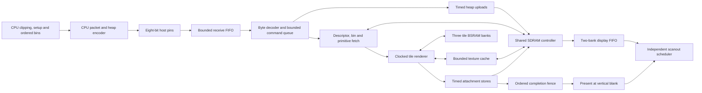

# SRR system model — N20K-SYS-0.1

This page records the earlier C++ system-model architecture and 0.1 protocol
snapshot. Current code uses the sole encoded 0.2 upload format described in
[GPU_CONTROL.md](../../GPU_DOCUMENTATION/GPU_CONTROL.md). These older model
timings and schedules do not qualify the current RTL; use
[GPU_ARCHITECTURE.md](../../GPU_DOCUMENTATION/GPU_ARCHITECTURE.md) for its
implementation and resource evidence.

The `system` mode connects the SRR rendering blocks to an eight-bit host link,
bounded command queues, a physical SDRAM address space and timed memory
controller, and continuously advancing display scanout. It measures contention
and backpressure as they happen. Commands, textures, and prepared records reach
the renderer through these interfaces.

The initial model selects a **100.8 MHz common core/SDRAM clock** and derived
**25.2 MHz host and pixel clocks**. These are configurable design assumptions.
They are not measured FPGA clocks or proof of timing closure. Digital host
setup/hold checks do not establish electrical compatibility, metastability
reliability, PCB signal integrity, or a clock-domain crossing implementation.
HDMI/TMDS encoding, serialization, and electrical signaling are outside the
requested model; scanout timing and memory consumption are included.

The [current pipeline diagrams](pipeline.md) show the system, rendering paths,
tile scheduler and memory relationships at this implementation revision.

The implementation boundary is documented by
[system.hpp](../../reference/include/nano_gpu/hw/system.hpp),
[host_link.hpp](../../reference/include/nano_gpu/hw/host_link.hpp),
[sdram.hpp](../../reference/include/nano_gpu/hw/sdram.hpp),
[scanout.hpp](../../reference/include/nano_gpu/hw/scanout.hpp), and the provisional
[protocol.hpp](../../reference/include/nano_gpu/hw/protocol.hpp).

## Complete submission path



The CPU still owns transforms, clipping, projection, triangle setup and binning,
as selected in M0. `compile_pass()` produces a standalone serialized program;
the stateful CPU `HostPassCompiler` used by `SystemModel::render()` retains
textures in a persistent heap prefix and uploads only new or changed image
contents. Its records, bins, table and descriptor use a transient heap tail,
reused only after the matching successful fence. Exact CPU pixel snapshots
detect mutation through an `Image` alias; they are host memory, not FPGA
storage. The cache resets after recovery or external heap writes, and can
compact resident textures after older work completes when space is needed.
The first frame still uploads all textures. The convenience driver owns its
request-sequence allocator and resource-cache lifetime; callers must not mix
arbitrary queued raw packets with a convenience render. Raw traffic uses its
own ordered submission/recovery discipline instead. `SystemModel` convenience methods act
as CPU drivers: their byte streams cross the same host-pin interface available
to a manual testbench. The CPU's preparation time is separate from simulated
GPU cycles.

Prepared-record validation still invokes CPU coefficient/bounds/plane checks,
including wide host arithmetic, as simulation assertions. Those checks are not
clocked GPU validation units and their work is not charged as GPU arithmetic.
M0 assigns prepared-coefficient consistency to the CPU; a physical GPU needs
bounded structural, address and state validation. The model does not establish
the area or latency of a synthesized equivalent to every C++ assertion, nor
the RP2350's transform/setup/binning execution time.

GPU-side pass execution fetches the descriptor, all 300 tile-table entries,
ordered lists, and referenced primitive records from SDRAM. A record contains
an image address, dimensions and pitch; it supplies no host pixel pointer.
Texture cache misses issue requests to the shared SDRAM controller. Tile loads,
stores, copies, uploads and scanout compete through that controller.
Fetched image objects contain metadata only: their host pixel-access methods
throw. They cannot supply an accidental alternate texture data path.

One-record lookahead overlaps Command-client fetches with the current draw.
The tile owns its captured primitive while the shared reader fetches the next
reference and record into its existing field registers. Ordered primitive
capture still waits for the previous draw to drain. Reader words are captured
into those fields as synchronous controller-slot outputs arrive; no separate
serial decode-read pass or additional record bank is required.

For passes clearing both attachments, one control edge exchanges the roles of
the resident and existing staging bank sets. Native-port muxes redirect access;
no full-tile pixel copy occurs. Word-wide SDRAM export of the completed set
overlaps initialization, record fetch and rendering in the other set. Another
role exchange waits for export completion, and the final acknowledgement gates pass completion. Passes loading
either attachment retain serialized load/draw/store because those operations
share the staging banks and Tile memory-client slot. Texture refills issue the
next synchronous slot read while consuming the current word's low half; each
cache write still transfers only one RGB565 word per native edge.

Heap uploads remain ordered commands: they cannot execute inside an earlier
pass. True next-frame upload/render overlap needs an explicit resource-lease or
independent upload-arena contract and separate completion bookkeeping. The
implemented overlaps are geometry prefetch and completed-tile writeback;
host reception and packet parsing continue independently within their queues.

Diagnostic attachment snapshots and the captured display image are host-side
observers. `inspect_word()`, `color()`, `depth()` and similar inspection APIs
are not additional GPU memory ports and do not provide data to rendering or
scanout. Diagnostic validity bookkeeping also does not represent memory
physically present in the FPGA.

## Host link and bounded queues

The selected interface has one shared eight-bit data bus, write-valid/read
controls, a seven-bit register selector, and out-of-band abort/reset controls.
There are no final physical pin assignments. At most one byte transfers on a
selected edge of the derived host clock; reads and writes cannot occur together.
Default host edges occur every four core cycles, with transfer phase 3 and
one core cycle each of required setup and hold.

Register 0 accepts request bytes and returns reply bytes. Registers 1–63 provide
sideband status even while command execution is busy. Reading register 1
atomically captures the 64-byte status snapshot used by subsequent status reads.
Its high bits report fault, receive-FIFO full, command-FIFO full and reply
availability. Sideband status can therefore overtake the ordered command stream;
it does not imply that queued rendering has finished.
Registers 64–127 expose the immutable 64-byte capability bank, with addresses
64 plus the capability-data offsets documented below. It remains readable
during execution and faults and does not depend on queued request/reply traffic.

| Storage or behavior | Selected bound |
| --- | --- |
| Receive FIFO | 256 bytes; stress settings can reduce it |
| Complete command queue | Two commands; stress settings can reduce it |
| Packet storage | Three banks: two queued and one decoder-owned |
| Maximum request payload | 1024 bytes |
| Reply-byte FIFO | 1024 bytes; stress settings can reduce it |
| Decoder consumption | At most one previously accepted byte per core edge |

Packet publication changes ownership of a completed packet bank. It does not
copy an entire packet through an unmodeled combinational memory path. A new bus
byte cannot be decoded and executed on the same edge on which it is accepted.
The executor leases the current packet bank until command retirement and reads
its payload through a synchronous memory port. RX, TX and the three packet
banks each occupy a selected SDPB 1024×16 instance. Bytes occupy only the low
eight bits; unused bits and addresses do not create extra ports.

The host must retain a backpressured byte while write-valid remains asserted.
Setup, hold, illegal direction and changed waiting-byte violations produce
transport faults. A full FIFO cannot accept a byte by relying on a slot that
will only be freed later on that edge. Accepted bytes are retained; full queues
propagate backpressure toward the host.

This models a selected synchronous digital protocol. The derived-clock
relationship is explicit. It does not model asynchronous clock drift or prove
that a later asynchronous implementation has safe data/control crossings.

## Provisional packet and memory ABI

`N20K-SYS-0.1` is a simulation ABI. It supplies concrete bytes for testing the
system and is not a released RP2350 driver ABI. All multibyte integers are
little-endian. Heap structures are four-byte aligned. The CPU program builder
emits aligned uploads; raw `WRITE_HEAP` and `READ_MEMORY` addresses are
byte-granular, and their SDRAM adapters form masked/aligned transactions.

| Header byte offset | Field |
| --- | --- |
| 0 | Four magic bytes `4E 47 50 55` (`NGPU`) |
| 4 | Protocol major `0` |
| 5 | Protocol minor `1` |
| 6 | `u16` opcode |
| 8 | `u32` payload byte length, excluding the 16-byte header |
| 12 | Nonzero `u32` request sequence |

Sequences increase strictly within an epoch. Wrong magic, version, opcode,
length or sequence stops normal parsing. The parser does not search arbitrary
upload payloads for a new magic string. Recovery establishes a fresh boundary
after old host traffic has been quiesced and issued memory operations drained.
A partial packet never executes.

| Opcode | Value | Request payload |
| --- | ---: | --- |
| `GET_CAPS` | 1 | Empty payload |
| `GET_STATUS` | 2 | Empty payload |
| `WRITE_HEAP` | 3 | `u32 byteAddress`, `u32 dataLength`, then aligned data bytes |
| `SUBMIT_PASS` | 4 | `u32 passDescriptorAddress` |
| `COPY_RECT` | 5 | 56-byte framebuffer/image copy record |
| `FENCE` | 6 | `u32 hostToken` |
| `PRESENT` | 7 | `u32 physicalColorBuffer`, `u32 hostToken` |
| `READ_MEMORY` | 8 | `u32 byteAddress`, `u32 byteLength`, `u32 hostToken` |

The maximum `WRITE_HEAP` data portion is 1016 bytes. Larger CPU uploads are
split into ordered packets. Uploads cannot write the reserved attachments.
Memory capacity and command traffic are charged even when the same resource
would have been a shared pointer in the standalone `blocks` mode.

A pass descriptor is 32 bytes. The tile table contains 300 eight-byte
`{listAddress, count}` entries. Each nonempty list contains ordered 32-bit
primitive-record addresses; an empty list has address zero. A primitive record
is 320 bytes, with type/version, render state, scissor/bounds, optional image
descriptor, and the kind-specific prepared geometry. Triangle records contain
snapped Q4 vertices, three edge equations, and the seven signed 64-bit attribute
planes. Unused fields and reserved bits must be zero. The byte offsets are
specified in [protocol.hpp](../../reference/include/nano_gpu/hw/protocol.hpp).

The selected limits are 16,384 CPU primitive records and 1,048,576 references
per pass, subject to the aggregate SDRAM heap capacity. Limits do not allocate
that much on-chip storage: the execution engine fetches bounded pieces while
advancing its current tile/list/record state.

The `COPY_RECT` payload contains source kind, source and target physical buffer
IDs, source and destination coordinates, dimensions, an optional heap-image
descriptor `{base,width,height,pitch}`, and reserved zero. Copies preserve
shared depth. Their row buffer protects horizontal overlap, and row direction
preserves vertical overlap snapshot semantics.

### Replies, capabilities and sideband status

`GET_CAPS`, `GET_STATUS`, `FENCE`, `PRESENT` and `READ_MEMORY` return replies.
`WRITE_HEAP`, `SUBMIT_PASS` and `COPY_RECT` retire without a success reply;
an ordered following fence observes their completion. Reply headers retain
the request magic, protocol version and sequence, and set opcode bit 15.
The reply payload begins with three `u32` fields: epoch, status, host token.
Successful replies have status zero. Fence/presentation/readback return their
request token; capability/status queries use token zero. Faults are sticky
status conditions rather than fabricated successful completion replies.
The reply serializer writes one byte per core edge into its own SDPB 1024×16
bank, then reads the bank synchronously through separate request/capture
states before producing host TX bytes. The bounded construction view draws
from established reader registers and status fields; it supplies no alternate
device memory or output port.

`READ_MEMORY` accepts a nonzero length of at most 512 bytes anywhere inside
SDRAM. After the common 12-byte reply prefix, its data consists of `u32`
address, `u32` length, and the requested bytes. The ordered read executes after
earlier command stores; it does not inspect dirty local tiles through a hidden
port. Capability and status replies instead append their 64-byte snapshots.

Capability-data offsets below are relative to the data following the reply
prefix, not the beginning of the complete reply packet:

| Offset | Type | Capability field |
| --- | --- | --- |
| 0 / 1 / 2 / 3 | Four `u8` values | Protocol major/minor, host data bits, tile size |
| 4 / 8 | Two `u32` values | Total SDRAM bytes, heap base |
| 12 / 16 / 20 | Three `u32` values | Maximum payload bytes, primitive-record bytes, pass-reference limit |
| 24 / 28 / 32 | Three `u32` values | Core frequency in Hz, host divider, pixel divider |
| 36 / 40 / 44 | Three `u32` values | RX capacity, command-queue capacity, TX capacity |
| 48 / 52 / 56 | Three `u32` values | Scanout FIFO pixels, display width, display height |
| 60 | `u32` | Implemented opcode mask: bits 0–7 correspond to opcodes 1–8 |

The status reply's 64-byte data uses the same base layout as sideband status
registers. Reading sideband register 1 additionally decorates bits 4–7 of its
flags with live host-link conditions before latching the snapshot:

| Offset | Type | Status field |
| --- | --- | --- |
| 0 | `u8` | Reserved zero |
| 1 | `u8` | Bit 0 ready; bit 1 executor busy; bit 2 present target sealed; bit 3 system fault |
| 2 / 6 / 10 | Three `u32` values | Epoch, last retired sequence, completed fence token |
| 14 | `u8` | Front physical color-buffer ID |
| 15 | `u8` | Valid color 0, color 1 and shared depth in bits 0, 1 and 2 |
| 16 / 24 | Two `u64` values | Core cycles, scanout underflow events |
| 32 / 36 | Two `u32` values | System fault code, completed presentation token |
| 40 / 48 | Two `u64` values | Refresh-late cycles, uninitialized-read words |
| 56 | `u8` | Host-link fault code |
| 57–63 | Bytes | Reserved zero |

The sideband flags are bit 7 host fault, bit 6 RX full, bit 5 command queue
full and bit 4 reply bytes available. Packet `GET_STATUS` is ordered with other
commands; sideband register reads remain accessible during a long pass or a
presentation wait. A query can describe state preceding its own retirement.

## Physical SDRAM map

The model has one 8 MiB address space. The layout follows M0:

| Range or allocation | Base | Size |
| --- | ---: | ---: |
| RGB565 color buffer 0 | `0x000000` | 614,400 bytes |
| RGB565 color buffer 1 | `0x096000` | 614,400 bytes |
| D24 stored in 32-bit words | `0x12C000` | 1,228,800 bytes |
| Heap for images, descriptors, lists and records | `0x258000` | 5,931,008 bytes |
| End of memory, exclusive | `0x800000` | — |

Images consume their pitch times height, including row padding. Descriptor
extent checks reject accesses outside the heap. The CPU program builder
allocates resources into this finite address space; it cannot create unlimited
independent host images and treat them as resident GPU memory.

For a byte address, bits 1:0 select the byte within a 32-bit word. The selected
word-address mapping is `[row(11), bank(2), column(8)]`: eight column bits first,
then two bank bits, then eleven row bits. Mapping is a controller choice within
the verified four-bank device geometry. Sequential memory traffic reaches the
next bank after 256 words; allocation placement therefore changes row-hit and
bank behavior.

## SDRAM timing and arbitration

The device geometry, supported burst modes and refresh requirement are verified
against [DS226-2.7E](https://cdn.gowinsemi.com.cn/DS226E.pdf), §2.2.1, printed
pp.5–6. The device has four banks, each 2048 rows by 256 columns by 32 bits;
supports CAS latency 2 or 3 and burst lengths 1/2/4/8/full-page; and requires
4096 refreshes per 64 ms. Its listed 166 MHz memory clock is not an achieved
board/controller operating point.

[IPUG279-1.4E](https://www.gowinsemi.com/upload/database_doc/2057/document/6820d99fcc4d1.pdf),
2025-05-09, §§5.4 and 5.8, describes the startup sequence: at least 100 µs with
stable clock/power, PRECHARGE, two AUTO REFRESH operations, then mode-register
programming and the required waits. Section 6.2 describes controller/SDRAM clock
phase adjustment for physical setup and hold requirements.

| Model parameter | Default | Evidence or status |
| --- | ---: | --- |
| Common core/SDRAM frequency | 100.8 MHz | Project choice; configurable, at most the documented 166 MHz |
| Power-up waiting time | 100 µs, rounded up | Controller guide initialization requirement |
| Refresh command interval | At most 15.625 µs | Derived from the device's 4096/64 ms requirement |
| CAS latency | 3 cycles | Supported device mode; CL2 is configurable |
| Native burst mode | Sequential BL8 | Supported device mode, selected controller policy |
| tRP / tRCD / tWR / tMRD | 3 cycles each | Provisional controller choices matching external-IP GUI examples |
| tRFC | 9 cycles | Provisional controller choice matching the external-IP GUI example |
| tRAS / tRC | 6 / 9 cycles | Provisional controller choices |
| Read-to-write / write-to-read turnaround | 2 / 2 cycles | Provisional controller choices |

The GUI examples in IPUG279 §4.2 describe external-controller configuration.
They are not the embedded QN88 memory die's timing specification. Gowin's
public GW2AR reference design targets an older LQ144 device and distributes
encrypted controller IP; it does not establish exact QN88 timing minima.
Calibration against the selected generated controller, a vendor memory model
and board measurements remains necessary. Longer configured waits and lower
clocks can be used for sensitivity tests; increasing frequency alone does not
prove that the chosen timing values remain physically valid.

Each client has one bounded request/response slot. Requests contain 1–16
32-bit words, byte-write enables, a byte address, and a transaction tag. A
pair of SDPB 1024x16 banks implements each slot's 32-bit payload. Write
requests fill that memory one word per edge before queue publication. Read
responses reuse the same banks and are drained through synchronous word reads;
the consumer releases ownership only after draining. An unread response also
applies backpressure. Clients are scanout, host, command fetch, tile transfer,
texture fetch, and copy. Memory responses established on one edge are sampled
by consumers on a later edge. The native write engine prefetches payload words
through the slot's read port before their physical SDRAM DQ beats.

Requests expand into aligned native BL8 transactions. Short or unaligned
requests still incur the complete physical burst; DQM masks padding writes,
and padding reads are discarded. Physical read/write beat counters therefore
differ from useful client-byte counters. Open rows, ACTIVATE, PRECHARGE,
CAS waits, write recovery, direction changes and a single shared data bus all
affect completion time.

Scanout receives priority for at most four consecutive selections when other
clients are waiting. The remaining clients use round-robin arbitration. A
selected request completes before another request owns the bus. The controller
reserves a conservative worst-case request, bank-closure and refresh-entry
window before each refresh deadline. It can refresh early; it cannot postpone
retention indefinitely because a client keeps submitting traffic. At the
default clock the maximum interval is 1575 core cycles. Counters expose late
refresh cycles and the longest observed command-to-command gap.

SDRAM is not initialized to zero for free. Unwritten bytes expose deterministic
`0xCD` poison in diagnostic simulation, and useful reads of incompletely
initialized words increment a counter. The per-byte initialization bookkeeping
is a testbench aid. The GPU's attachment initialization is explicit memory
traffic and contributes to boot time before valid scanout is enabled.

## Scanout, ownership and presentation

Scanout advances on every derived pixel tick independently of renderer progress.
The default timing is 640 visible pixels, 16 front-porch pixels, 96 sync pixels
and 48 back-porch pixels; vertically it uses 480 visible lines, 10 front-porch
lines, two sync lines and 33 back-porch lines. This gives 800 × 525 pixel periods
and exactly 60 Hz at 25.2 MHz, with negative horizontal and vertical sync.
The nominal industry timing is listed in
[VESA DMT 1.0 revision 13](https://glenwing.github.io/docs/VESA-DMT-1.13.pdf),
2013-02-08, printed p.21; the border intervals are folded into the porches here.
Its nominal 25.175 MHz corresponds to approximately 59.94 Hz; 25.2 MHz is this
model's selected clock.

Display reads come through the same timed SDRAM controller. Scanout drains its
owned response slot through synchronous 32-bit reads and one word-hold register,
then writes the two RGB565 halves on separate edges into two SDPB 1024x16 FIFO
banks. Their combined default capacity is 2048 pixels; a smaller configured
FIFO limit provides a contention stress case without claiming a different
physical bank allocation. A synchronous FIFO result crosses a separate capture
edge before pixel consumption. No sixteen-word FF response array is allocated.

Display timing continues during initialization or missing memory service.
Startup output is black until valid attachments and a vertical-blank boundary
permit scanout activation. An underflow blanks the rest of the current frame
and resynchronizes at vertical blank. This prevents stale FIFO data from
shifting all subsequent pixels. Startup black pixels and post-activation
underflow pixels have separate counters.

The front buffer remains read-only to rendering and copies. A PRESENT seals
its initialized target and completes at an eligible vertical blank, after prior
ordered work and memory writes have completed. The old front then becomes
available as the back buffer. Scanout handles stale responses around a swap
without displaying words from the previous front in the new frame. Shared
depth is preserved across presentation rather than swapped with color.

The convenience `vertical_blank()` method waits for the device's presentation
completion and then a complete scanout observation of that front. SDL displays
the captured FIFO output, including any simulated underflow blanking. The
observation interval is reported separately from pass and submission time.

## Faults and recovery

Transport faults stop packet parsing. Payload, address, record, ownership and
invalid-contents faults stop normal system execution and remain observable
through status. The model never treats a malformed command as successfully
rendered work. Request sequences and host tokens are interpreted within the
current nonzero epoch.

Abort/reset controls are out of band. Abort recovery requires a quiescent host
and drains already issued memory work before starting a fresh epoch. Queued
and partial transport packets and stale replies are discarded. This is
necessary because
changing an epoch alone cannot distinguish late old bus bytes from a new packet.
Attachment validity and front preservation follow whether operations completed
or failed; a later LOAD or PRESENT must not assume that an interrupted target
contains a complete frame. Hard reset restarts the model and initialization
traffic; it makes no front-buffer or heap-preservation promise. It is distinct
from an abort that drains issued operations while retaining the valid front.
Sequence exhaustion and epoch wrap are errors rather than silent reuse of old
completion identities. CPU-side encoding errors can throw before bytes are
sent; device-side faults remain visible through the modeled status interface.
C++ exceptions diagnose model or contract errors and are not synthesized
exception machinery.

## Measurements and limits

Statistics separate the following costs:

| Counters | Meaning |
| --- | --- |
| Core, boot, last pass and last submission cycles | Elapsed common-clock work over explicitly reported intervals |
| Uploaded bytes and fetched record/bin bytes | Actual data delivered or fetched through modeled interfaces |
| Prefetched records and record-prefetch overlap/wait cycles | Completed lookahead records, fetch work concurrent with drawing, and exposed waits for the next record |
| Tile-export active/overlap/wait cycles, published pixels and bank exchanges | Background export work, concurrent resident-tile work, exposed staging-reuse waits, and completed tiles published through bank-role selection |
| Host receive/transmit bytes, queue high-water marks and backpressure | Host bandwidth and bounded-buffer pressure |
| Per-client memory queue and service time | Waiting before selection versus time owning the memory engine |
| Row hits/misses, ACTIVATE/PRECHARGE and physical beats | Physical transaction behavior and burst overhead |
| Refresh count, busy time, maximum gap and lateness | Memory maintenance and retention-deadline behavior |
| Present wait and scanout observation cycles | Waiting for ownership transfer versus display-image capture |
| Active/displayed/startup-black/underflow pixels | Display progress and failures to meet scanout deadlines |
| Renderer perspective/cache clocks and committed pixels | Existing local datapath costs within the system |

The selected [rendering block pipeline](block-interfaces.md) overlaps fragment
work through a shared-reciprocal UV pipeline, streaming texture cache and three
parallel RGB multipliers. Sixty-four bounded contexts retain ordered work.
System modeling also includes delivery, arbitration and display costs, so local
cache-hit cadence and complete-pass throughput are different measurements. Software frames per second measure how quickly the PC executes
the simulation. Simulated elapsed cycles divided by the configured core clock
estimate the selected model's elapsed device time, subject to its stated
physical timing assumptions.

The default operation timeout is 500 million common-clock cycles. It guards
against a stalled CPU convenience operation; it is not a promise that a command
has a hardware execution-time limit. A helper timeout does not automatically
abort or reset the device. Diagnostic reads and observation captures
are explicit operations or host observations, not bandwidth-free GPU clients.

JSON reports place these system counters under `system`, with nested `sdram`,
`host` and `scanout` objects. Reported configured frequencies describe the
chosen clock ratios. `last_submission_cycles` spans CPU-driver byte delivery
through its fence reply; it may include unfinished boot work on the first call.
`last_pass_cycles` starts at descriptor fetch and ends after the final stores.
`last_present_wait_cycles` starts when PRESENT executes and ends at the swap.
The later complete-frame observation has its own counter.

Use a second fixed-time frame to compare steady-state submissions: the first
call can include boot, and later frames benefit from resident textures. The
earlier 96.5 ms showcase submission included about 13.9 ms of boot; its
boot-free baseline is approximately 82.6 ms, including a 71.4 ms pass, at the
assumed 100.8 MHz clock. It is incorrect to label the entire submission-minus-
pass difference as upload overhead. These are model baselines, not achieved
board clocks or a demonstrated 30 FPS result.

`timing_frames_without_swap` is literally timing frames minus swaps, clamped to
zero. It includes startup and is not an exact count of repeated valid presented
frames. SDL and the S-key screenshot use actual captured scanout output.
`--output`, raw RGB565/depth dumps and attachment hashes observe the completed
front framebuffer. The scanout object's completed-frame hash lets a test
distinguish correct framebuffer contents from a display-service failure.

### Dataflow optimization benchmark

The frozen time-zero showcase uses the same RGB565 and D24 output before and
after dataflow optimization. At the configured 100.8 MHz core/SDRAM and
25.2 MHz host clocks, the boot-free comparison is:

| Steady showcase interval | Before | After |
| --- | ---: | ---: |
| Rendering pass | 71.369 ms | 27.445 ms |
| Uploads through matching fence reply | 82.639 ms | 32.396 ms |
| Host traffic per frame, including replies | 283,576 bytes | 124,256 bytes |

The optimized submission is approximately 2.55 times faster. The submission
interval excludes PRESENT/vblank, diagnostic scanout observation and RP2350
CPU execution. Its nominal rate is about 30.9 submissions per second, with
less than 1 ms of a 33.3 ms budget left for additional sequential work. This
does not establish 30 FPS on the FPGA: complete-device fit and clock timing
remain unqualified. This cycle count requires approximately 98 MHz even for
30 submissions per second before CPU/presentation costs. The convenience
driver's measured frame interval including presentation but excluding
diagnostic scanout observation is 33.33477 ms (about 29.9987 FPS); the small
excess over two display periods includes bus reply handling. The independently routed arithmetic probe reached
89.17 MHz, below its 100.8 MHz target; see
[RTL qualification](rtl-qualification.md).

The reproducible [before](../benchmarks/system-before-dataflow.json) and
[after](../benchmarks/system-after-dataflow.json) reports distinguish cold and
steady traffic, submission time, presentation wait and diagnostic observation.
Run `make system-benchmark` to verify canonical output, compare frozen scenes,
and check for cycle regressions. The underlying
[benchmark script](../../scripts/benchmark-system.py) also accepts a selected
scene and an optional modeled submission target:

```sh
python3 scripts/benchmark-system.py --scenes showcase --verify --require-target --output build/system-showcase-benchmark.json
```

The other boot-free submissions take 26.321 ms for `perspective`, 43.652 ms for
`overdraw`, and 48.284 ms for `opaque`. The latter two still exceed the 33.3 ms
budget. All four reports retain identical before/after attachment hashes and
zero scanout underflows; the benchmark does not imply every workload meets
30 FPS.

## Storage and physical-resource accounting

The selected mapping is **thirty-nine physical BSRAM blocks**:

| Native allocation | BSRAM blocks |
| --- | ---: |
| Resident RGB565/D24 tile | 3 |
| Texture cache / shared copy row | 1 |
| Scanout FIFO | 2 |
| Host RX, TX and three packet payloads | 5 |
| Reply serializer | 1 |
| Six shared request/response payload slots, two x16 banks each | 12 |
| Shared 512-byte record/readback reader, x32 pair | 2 |
| Completed-tile export / LOAD-row color and depth staging | 3 |
| Fragment commit metadata / factor / result contexts | 6 |
| Reciprocal seed base / gradient ROM | 4 |
| **Total selected SDPB 1024x16 instances** | **39 of 46** |

The [explicit storage map](storage-map.md) specifies meaningful capacities,
unused physical capacity, read/write ports, register fields and ownership.
Request and response payloads reuse each client's same physical slot. Clients
fill and drain those slots through clocked word ports; texture, copy and
scanout no longer receive whole response arrays as device registers. The
reader and tile-staging buffers likewise use native synchronous ports. The writer
retains one packing word and byte mask instead of a sixteen-word request array.
Primitive decoding has a separate bounded field-register bank populated
directly from established slot-read outputs while the same words enter reader
RAM; readback streams from reader RAM to the reply serializer. One-record
lookahead reuses that field bank. Full-tile export uses all 1024 addresses of
the existing three staging banks. A role selector exchanges the two three-bank
sets between rendering and completed-tile export without copying their pixels
or adding native memory instances.

Status snapshots, packet header, executor fields, decoded primitive fields,
the 92-byte reply source, byte masks and cache tags deliberately remain bounded
registers. The reply source is distinct from both sideband status snapshots
and the native reply-serializer bank. Immutable capabilities use logic ROM.
The eight optimization counters currently exist in host statistics and JSON,
outside the live GET_STATUS layout. Implementing all eight as hardware
profiling counters would reserve 512 register bits plus readout/control logic;
this optional reserve is not a measured physical allocation. Fixed-width
record-lookahead and tile-export control registers are listed in the storage map.
The CPU resource cache is excluded from device storage. The storage-map
header's 6,404-bit selected register-array subtotal does not include all
scalar/arithmetic registers. It is neither a synthesized FF count nor a lower
bound: equivalent, constant or dead fields may be optimized during RTL mapping.
The selected renderer uses **46 of 48 native 18×18 multiplier equivalents**:
one setup, forty perspective, two texture-address and three RGB units. Its
fourteen native banks are included in the thirty-nine system banks. The serial
divider remains a standalone arithmetic oracle, outside the selected GPU path.

**Selected mapping is not a complete-system resource-fit claim.** Registers
for arithmetic, addresses, outstanding requests, arbitration, live status
counters and control also consume LUTs and FFs. Host diagnostic arrays,
framebuffer images, trace callbacks and scoreboards are observations; they
provide no execution ports or device trace storage. The selected allocation
accounts for native-memory latency, while synthesis, placement, routing,
timing closure and vendor-library comparison remain necessary before claiming
fit or achieved throughput. See the [device profile](gowin-profile.md).

## Run and verify

Build the normal SDL/headless executables and the conformance suites:

```sh
make -j4 all headless test
./build/nano-gpu-ref --scene showcase --mode system
./build/nano-gpu-ref-headless --headless --scene showcase --mode system --time 0 --step 0 --verify --stats build/system-showcase.json
```

Append `.exe` to executable names in MSYS2 UCRT64. `--verify` compares final
attachment results with canonical SRR; scanout-underflow output is observed
separately. Use a fixed scene/time when comparing data or cycle reports.

| System-only option | Default | Experiment |
| --- | ---: | --- |
| `--core-hz HZ` | 100800000 | Change the selected common core/SDRAM clock |
| `--host-divider N` | 4 | Change host byte-transfer cadence; transfer phase is `N-1` |
| `--sdram-trcd N` | 3 | Change ACTIVATE-to-READ/WRITE delay in core cycles |
| `--sdram-trp N` | 3 | Change PRECHARGE delay in core cycles |
| `--sdram-trfc N` | 9 | Change refresh-recovery delay in core cycles |
| `--scanout-fifo N` | 2048 | Select a power-of-two FIFO limit from 64 to 2048 pixels |

The pixel divider remains four. Changing `--core-hz` therefore changes pixel
frequency and display refresh frequency too; it is not an independent core-only
clock experiment. Reports include the resulting frequencies. The CLI raises
tRC when needed to retain `tRC >= tRAS + tRP` after a tRP change. Other
configuration values must also satisfy the controller's legal ranges.
A smaller display FIFO or a slower host link can expose different stalls and
underflow behavior:

```sh
./build/nano-gpu-ref-headless --headless --scene showcase --mode system --host-divider 8 --sdram-trcd 6 --sdram-trfc 12 --scanout-fifo 64 --stats build/system-stress.json
```

Module tests exercise SDRAM command sequences, request bounds, byte masking,
row transitions, refresh pressure, host handshake violations, packet framing,
backpressure, display timing, FIFO capture edges and presentation. End-to-end
tests pass complete serialized programs through the same interfaces; a direct
C++ pass comparison alone cannot establish I/O-model behavior. The system test
sources are
[SDRAM](../../reference/tests/sdram_tests.cpp),
[host link](../../reference/tests/host_link_tests.cpp),
[packed protocol](../../reference/tests/protocol_tests.cpp),
[scanout](../../reference/tests/scanout_tests.cpp),
[copies](../../reference/tests/system_copy_tests.cpp) and
[end-to-end execution](../../reference/tests/system_tests.cpp).

The [M0 command contract](../spec/commands.md) remains the product-level logical
contract. This provisional system ABI and controller policy make feasibility
experiments executable without silently turning model defaults into verified
physical board characteristics.
