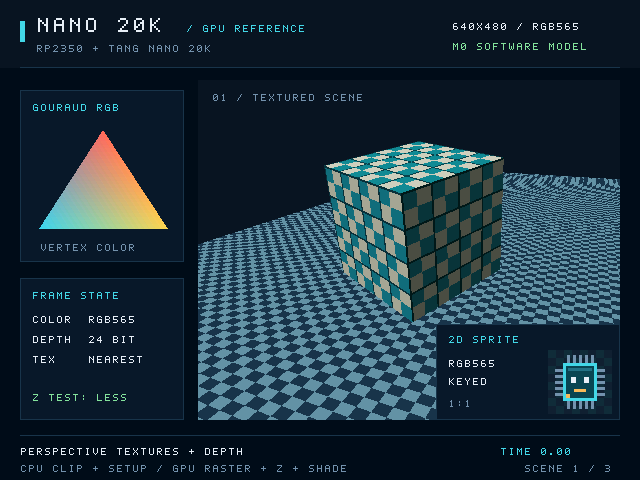

# Software reference renderer (SRR)

The C++17 renderer implements the logical `N20K-M0-0.1` profile on a host computer.
It provides CPU triangle setup, fixed-point rasterization, tile traversal, and
deterministic color/depth dumps for development of the FPGA design. SDL2 displays
the software-rendered RGB565 framebuffer; it does not render the scene itself.



## Build and run

Run commands from the repository root. Headless builds need `make` and GCC or
Clang with C++17 and the `__int128` extension. Tests also need Python 3 to generate
the C++ golden-vector header. Neither headless rendering nor tests require SDL2.
On Windows, use [MSYS2 UCRT64](development.md#windows-with-msys2); MSVC does not
provide the required `__int128` extension. The setup script installs matching
MSYS2 packages, and the Makefile uses `python` there instead of a Windows
`python3` Microsoft Store alias.

```sh
make headless test
./build/nano-gpu-ref-headless --headless --verify --output build/showcase.ppm
```

The headless executable requires `--headless`. With that option, the default is
one frame. The SDL executable also supports `--headless` without initializing SDL.

For an interactive window, install SDL2 development files and `pkg-config`, or
follow the repository's [SDL2 setup instructions](development.md). The Makefile
automatically discovers the default local `.deps/sdl2` installation; a custom SDK
can be selected through `SDL2_PREFIX`.

```sh
make
./build/nano-gpu-ref
```

In MSYS2 UCRT64 the executable is `./build/nano-gpu-ref.exe`; the headless build
is `./build/nano-gpu-ref-headless.exe`. Run them from the same MSYS2 shell so SDL2
and compiler runtime DLLs are on PATH. Build locally on each platform rather than
copying the ignored `build/` or `.deps/` directories between machines.

The resizable window presents a 640×480 logical image. Escape or Q closes it,
Space pauses animation, and S saves `build/screenshot.ppm`. A visible desktop
backend is needed for interactive use; use headless mode on servers. `make run`
builds and starts the SDL executable. Select another compiler with `CXX=clang++`;
build a separate tree with `BUILD_DIR=build/clang` when changing toolchains.

## Demo options

```sh
./build/nano-gpu-ref-headless --help
./build/nano-gpu-ref-headless --headless --scene perspective --frames 4 --time 0 --step 0.0166666666666667 --verify --dump-prefix build/perspective --stats build/perspective-stats.json
```

| Option | Behavior |
| --- | --- |
| `--scene showcase` | Mixed textured 3D, shading, keyed sprites, and bitmap text; the default scene. |
| `--scene perspective` | Perspective-texture demonstration. |
| `--scene overdraw` | Overlapping geometry and depth rejection. |
| `--scene opaque` | Flat/Gouraud geometry for focused coverage, interpolation, and depth tests. |
| `--frames N` | Render 1–1,000,000 frames; the window otherwise runs until closed. |
| `--time SECONDS` | Set initial animation time; default `0`. |
| `--step SECONDS` | Advance animation by this amount per frame; default `1/60`, with `0` freezing it. |
| `--mode tiled` | Traverse 32×32 tiles in normal order; the default. |
| `--mode reverse` | Traverse the same tiles in reverse order, preserving primitive order inside each tile. |
| `--mode monolithic` | Evaluate the frame without tile-local attachments. |
| `--mode blocks` | Run the Gowin block model on the selected scene, including the original showcase. |
| `--mode system` | Send serialized commands over the modeled 8-bit bus and render through shared timed SDRAM while scanout runs independently. |
| `--hardware-profile` | Print verified device resources and the selected modeled configuration, then exit. |
| `--verify` | Compare every frame with canonical traversal modes and require identical color/depth results. |
| `--output FILE.ppm` | Save the last presented frame as binary P6 RGB888. |
| `--dump-prefix PATH` | Save the last frame's raw color, shared depth, and metadata. |
| `--stats FILE.json` | Save timings, counters, and hashes; the same report is also printed to stdout. |

Time and step must be finite and nonnegative. Output directories are created as
needed. Fix scene, time, step, and frame count for repeatable captures. Integer
fragment evaluation is deterministic, but floating-point CPU setup and animated
demo mathematics do not establish byte-identical output across all platforms.

## Buffers, dumps, and measurements

`--dump-prefix build/frame` creates:

| File | Layout |
| --- | --- |
| `frame.rgb565` | Last presented color buffer: 640×480, row-major from the top-left, little-endian RGB565, 1,280 bytes/row, 614,400 bytes total. |
| `frame.depth32` | Shared depth buffer: 640×480 little-endian unsigned 32-bit words, meaningful D24 in bits 0–23, 2,560 bytes/row, 1,228,800 bytes total. |
| `frame.json` | Profile, scene/time, optional hardware-slice profile, dimensions, tile size, formats, pitches, byte order, and color/depth FNV-1a 64-bit hashes. |

Depth is shared between color buffers and is not automatically swapped with
presentation. Dump hashes process bytes in the same little-endian order as the
raw files. The JSON hash strings use hexadecimal notation.

Statistics contain mean host setup/demo-preparation, render-and-bin, and
verification times, plus last-pass tile references, tiles processed, candidate
positions, covered fragments, depth/key rejects, texture samples, and color/depth
writes. These are software measurements and logical counts. The canonical modes
do not model FPGA cycles, memory transactions, scanout contention, or fill rate.
The `blocks` mode additionally reports modeled datapath clocks and texture-cache
events as described below. Their scope excludes complete GPU performance.

## Implemented behavior

- CPU homogeneous clipping against six frustum planes, projection, Q4 subpixel
  snapping, winding normalization, deterministic edge inclusion, and rounded
  attribute-plane setup. Snapped degenerates and empty clipped bounds are culled.
- Stable primitive bins for the 20×15 grid of 32×32 tiles, actual tile-local
  color/depth arrays, independent CLEAR/LOAD operations, and full-depth writeback.
  Alternate tile order and monolithic traversal provide equivalence checks.
- Perspective-correct nearest RGB565 sampling using quantized `u/w`, `v/w`, and
  `1/w` planes. UV reconstruction uses integer division with round-to-nearest-even
  into signed Q16; it is not a simulated hardware reciprocal approximation.
- Flat, Gouraud, texture replacement, flat-modulated texture, and
  Gouraud-modulated texture shading. Clamp/repeat addressing, raw color-key
  rejection before modulation and commit, LESS/LEQUAL/ALWAYS depth functions,
  and independent color-write, depth-test, and depth-write controls.
- Flat rectangles/pixels, reversal-stable integer lines, unscaled keyed sprites,
  clipped image copies, and overlap-safe framebuffer copies. Text in the demo
  uses a font atlas and the existing sprite path.
- Two color buffers and one D24-in-U32 depth buffer. Front-buffer writes
  are rejected. Queued presentation seals the back buffer until an explicit
  `vertical_blank()` call changes ownership. Failed render passes invalidate
  their target color and shared depth; LOAD/presentation require valid contents.

## Public API

Include [nano_gpu/reference.hpp](../reference/include/nano_gpu/reference.hpp).
The public types and operations are synchronous C++ calls:

| Entry point | Purpose |
| --- | --- |
| `Image`, `RenderState` | Create RGB565 resources and select scissor, shading, depth, addressing, and key state. |
| `clip_project_triangle()` | Turn a clip-space triangle into viewport-space triangles. |
| `setup_triangle()` | Produce immutable prepared edges/planes from screen vertices; returns an empty optional when culled. |
| `Pass`, `Primitive` | Submit ordered `Triangle`, `Rect`, `Line`, and `Sprite` records with attachment load/clear settings. |
| `bin_primitives()` | Inspect stable per-tile lists of primitive indices. |
| `Renderer::render()` | Execute a pass using tiled, reversed-tile, monolithic, or hardware-block rendering. |
| `copy_rect()`, `copy_image()` | Perform clipped color copies without changing shared depth. Overlapping framebuffer copies use snapshot semantics; select the hardware mode to use modeled copy storage. |
| `queue_present()`, `vertical_blank()` | Queue and apply a logical front/back swap. |
| `reset()`, `abort()` | Reset to initialized black color/far depth, or cancel queued presentation. Abort does not interrupt synchronous rendering or undo completed work. |
| `front_color()`, `color()`, `depth()`, `statistics()` | Inspect output attachments and the last render pass's counts. |

`overlay_state()` disables depth test/write for 2D overlays. Generic images can
have dimensions 1–1024 with a 4-byte-aligned pitch; texture bindings additionally
require power-of-two dimensions. Keep texture contents immutable while rendering.
Lines require viewport-clipped endpoints; sprite source rectangles must fit their
image. See [demo.cpp](../reference/src/demo.cpp) for complete scene construction.

## Gowin hardware block backend

The independent `blocks` backend implements `N20K-HW-RENDER-0.2`. It models the
selected digital configurations of the Tang Nano 20K's Gowin FPGA and supports
the same initial drawing feature set as canonical SRR. Compare the same scene at
the same animation time:

```sh
./build/nano-gpu-ref --hardware-profile
./build/nano-gpu-ref --scene showcase --mode blocks --verify
./build/nano-gpu-ref-headless --headless --scene showcase --time 0 --step 0 --mode blocks --verify --dump-prefix build/hardware-showcase
```

In Windows UCRT64, append `.exe` to the executable names. `showcase`,
`perspective`, `overdraw`, and `opaque` are all valid with `--mode blocks`.
The opaque scene remains a small test workload; its different composition is
not a substitute for matching the original showcase.

The model includes all five shading modes, perspective-correct nearest textures,
clamp/repeat addressing, raw color-key rejection, D24, pixels/rectangles, lines,
and keyed sprites. Font-atlas text uses the same sprite path as canonical SRR.
It uses one shared signed 18×18 multiplier and four SDPB 1024×16 memories:
three tile banks and one bounded texture cache. No rendering feature silently
falls back to the canonical rasterizer.

Perspective coordinates use an explicit serial restoring divider, with a
90-bit logical numerator and a signed Q16 result rounded to nearest-even. This
matches canonical quantized-plane reconstruction without a hidden host divide.
It is a slow exact baseline, not a throughput claim for a future reciprocal
pipeline. Modulation uses the shared native multiplier and exact byte-rounding
logic. Tile and cache accesses use the modeled memory ports; reset preserves RAM.

`--verify` compares the resulting color and depth with all three canonical
traversal modes. The same prepared pass is supplied to each backend. Hardware
tests also exercise divider arithmetic, cache hits/misses and binding changes,
global line stepping, clock enables, stalls, reset, latency, and memory collisions.
This does not establish equivalence with Gowin's installed simulation library.

Block statistics report modeled datapath clocks, stalls, setup work, perspective
work, texture work, cache hits/misses, and refill words. Unit-work counters
exclude the tile controller's following-edge result captures; total modeled
clocks include those capture edges. The host adapter supplies
records and idealized tile transfers. Cache misses use a selected fixed response
delay and word stream, not a timed SDRAM controller. SDRAM refresh/arbitration,
scanout contention, record fetch, transport, and physical clocks remain outside
these counts. Serial perspective evaluation makes this model slower than the
canonical renderer; software frame rate is not FPGA performance.

The [Gowin profile](hardware/gowin-profile.md) records primary-source revisions,
resource grouping, and selected primitive configurations. The [block interface
contract](hardware/block-interfaces.md) documents ports and the chosen schedules.

## Verification and current limits

For system behavior, select `--mode system`:

```sh
./build/nano-gpu-ref --scene showcase --mode system --verify
./build/nano-gpu-ref-headless --headless --scene showcase --mode system --time 0 --step 0 --verify --stats build/system.json
```

The CPU driver uploads serialized textures, primitive records, and ordered tile
lists through the bus. The GPU fetches them through the SDRAM arbiter; the tile
and texture blocks cannot sample host image pixels. Fences wait for stores,
presentation waits for a real modeled vertical blank, and the SDL view uses
actual display-FIFO output. Framebuffer dumps remain diagnostic memory snapshots.
Both physical color buffers and shared depth are checked by `--verify`.

The report separates host execution time from simulated clock time and includes
per-client memory waits/traffic, refresh deadlines, host backpressure, and display
underflows. Defaults select a 100.8 MHz common core/SDR clock, 25.2 MHz derived
host/pixel clocks, and 60 Hz scanout. These are project timing assumptions. They
are configurable using `--core-hz`, `--host-divider`, `--sdram-trcd`,
`--sdram-trp`, `--sdram-trfc`, and `--scanout-fifo`. Clock changes also change the
derived pixel rate; the report prints the resulting refresh rate.

See the [system model guide](hardware/system-model.md) for exact scope, timing
sources, bounded storage, protocol layouts, and recovery. HDMI/TMDS signaling is
excluded. The serial renderer remains a correctness baseline; adding I/O timing
does not establish one-pixel-per-cycle throughput.

```sh
make test
make sanitize
```

Tests consume [golden vectors](spec/golden-vectors.json) and exercise arithmetic,
shared edges, clipping, depth precision, shading/keying, copies, ownership,
recovery, and generated traversal-equivalence scenes. `make sanitize` runs tests
in a separate AddressSanitizer/UndefinedBehaviorSanitizer build tree.
Canonical traversal modes share setup and fragment logic. The block backend
uses separate rendering arithmetic on the same prepared records. Neither
comparison is an independent geometric oracle.

The canonical and `blocks` implementations use a typed logical API. Their
[binary transport contract](spec/commands.md) remains provisional. They have no global 8 MiB
allocator, aggregate texture/command budget enforcement, complete GPU cycle
model, HDMI timing model, or asynchronous transport/fence implementation.
Individual images are bounded, but separate host allocations are not a physical
GPU memory map. The `system` mode separately executes a provisional packed ABI,
enforces the 8 MiB address space and compiler allocation budget, and models the
host, memory, and scanout behavior described above. Physical pin assignment,
analogue electrical behavior, clock-domain metastability, vendor equivalence,
and complete-system synthesis/timing qualification remain outside its scope.

The setup path rejects unsupported inputs rather than automatically splitting or
refining triangles. Textured setup requires positive W, per-triangle maximum/minimum
W ratio at most 64, and vertex UVs within ±1,024 texels. Plane overflow and invalid
sample reciprocal/UV domains are errors. Some valid geometric inputs can require
caller-side refinement before fitting the numeric profile.

An independent higher-precision geometric model, comprehensive end-to-end
precision qualification, comparison with a future pipelined reciprocal, and
serialized benchmark input/command trace capture remain work to complete. Host output and
timings provide no evidence of FPGA resource fit or one-pixel-per-cycle operation.
