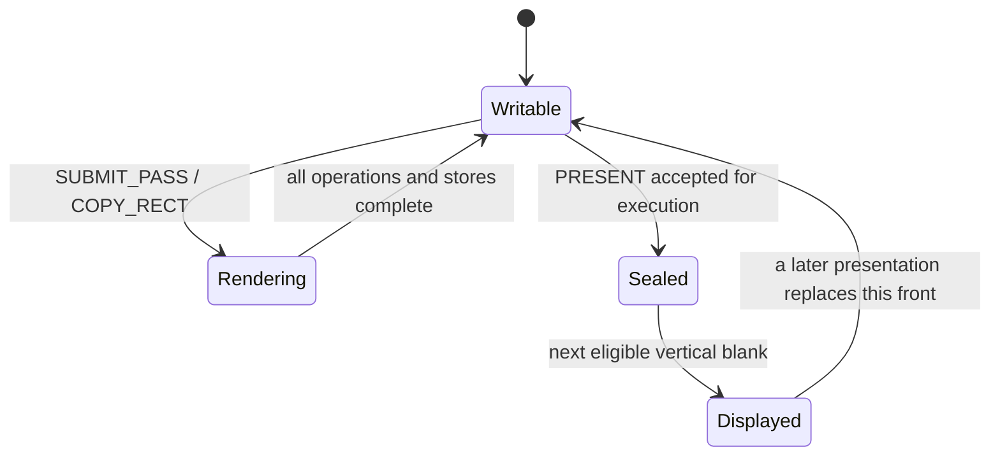

# M0 architecture and memory contract

Profile: [N20K-M0-0.1](README.md). All addresses are byte offsets in the GPU's
8 MiB SDRAM, not RP2350 addresses. Multi-byte data is little-endian.

## Responsibilities

The CPU MUST transform, clip, project, quantize vertices, normalize winding,
prepare edge/attribute equations, and build ordered tile lists. It also supplies
lighting as vertex or constant colors. The CPU does not perform triangle pixel
coverage, texture sampling, or per-fragment depth updates for the hardware path.

The GPU MUST execute the submitted tile lists, retain each active tile's color
and depth locally, rasterize its primitives, and store its final attachments.
Scanout reads only the front color buffer through its own buffering path.
Texture fetch and host traffic cannot make scanout depend on raster progress.

## Display mode

| Timing component | Horizontal, pixel clocks | Vertical, lines |
| --- | ---: | ---: |
| Active | 640 | 480 |
| Front porch | 16 | 10 |
| Sync pulse | 96 | 2 |
| Back porch | 48 | 33 |
| Total | 800 | 525 |

Both sync polarities are active low. The nominal pixel clock is 25.175 MHz,
giving approximately 59.94 Hz. A 25.2 MHz variant giving 60.0 Hz is permitted;
the configured clock MUST be reported. TMDS sends ten bits per channel per
pixel clock. Expand framebuffer RGB565 to RGB888 by the bit-replication rule in
rasterization.md before TMDS encoding. There is no audio or HDMI data-packet
requirement. Actual clock generation, output timing closure, and monitor
compatibility are M1 hardware validation tasks; the renderer core clock is
independent of this display pixel clock.

## Fixed attachment layout

| Region | Base | End, exclusive | Bytes | Row pitch |
| --- | ---: | ---: | ---: | ---: |
| Color 0 | `0x000000` | `0x096000` | 614,400 | 1,280 |
| Color 1 | `0x096000` | `0x12C000` | 614,400 | 1,280 |
| Shared depth | `0x12C000` | `0x258000` | 1,228,800 | 2,560 |
| Host-managed heap | `0x258000` | `0x800000` | 5,931,008 | Resource-specific |

Color pixel address is `color_base + 1280*y + 2*x`. The 16-bit value has red in
bits 15:11, green in 10:5, and blue in 4:0. Depth pixel address is
`0x12C000 + 2560*y + 4*x`; bits 23:0 contain depth and bits 31:24 MUST be zero.
Those spare bits do not implement stencil. All attachment bases are 4 KiB aligned.

Heap resources include textures, primitive records, tile tables/lists, and pass
descriptors. Their extents MUST be valid, non-wrapping, and appropriately aligned.
Metadata and RGB565 texture bases/pitches are at least 4-byte aligned. Resource
allocations MUST NOT overlap one another while simultaneously live. The host
allocator owns liveness/non-overlap correctness; there is no GPU allocation
registry. Hardware enforces address domains, alignment, checked extents, and
attachment ownership. Only ordered heap-write commands may mutate the heap.

## Tile partition and binning

```text
tile_x = floor(pixel_x / 32)       # 0..19
tile_y = floor(pixel_y / 32)       # 0..14
tile_id = 20*tile_y + tile_x       # 0..299
local_index = 32*(pixel_y % 32) + (pixel_x % 32)
```

Tile bounds are half-open: `[32*tile_x, 32*tile_x+32)` by
`[32*tile_y, 32*tile_y+32)`. Every screen pixel belongs to exactly one tile.
There are no partial edge tiles at 640×480. One logical tile needs 2,048 color
bytes and 4,096 depth bytes, totaling 6 KiB before physical banking overhead.

The CPU maintains a logical primitive submission order. Each submission
occurrence MUST appear once in every tile list intersecting its clipped
conservative bounding box. False-positive bins are permitted; omitting a tile
that can contain coverage is not. Repeated submissions of the same record are
distinct occurrences and may appear repeatedly in a list.

A tile table has exactly 300 entries, each logically `{list_address: u32,
reference_count: u32}`: 2,400 bytes before any allocation padding. Lists contain
32-bit primitive-record byte addresses, four bytes per reference. A zero-count
entry uses address zero and performs no list fetch. Metadata packing is
little-endian; detailed record packing is finalized in M1.

The GPU MAY visit tiles in any order but MUST preserve list order within each
tile. Record values, attribute rounding, and line coverage MUST NOT change with
tile visit order, resident-tile count, stalls, or internal subtile partitioning.
No cross-tile observation is permitted during a pass.

## Pass attachment operations

A pass names physical color target 0 or 1; it MUST be the writable non-front
buffer at execution. Color and depth each independently select `LOAD` or `CLEAR`.
These operations apply to the whole attachment, including all empty tiles.

- `LOAD` reads the existing physical attachment values for the tile. It requires
  valid initialized contents.
- `CLEAR` initializes the tile locally to the supplied RGB565 color or 24-bit
  depth value, without requiring an external clear read/write cycle first.
- Each tile executes its list, then its resulting color and depth MUST persist
  in SDRAM by pass completion. Implementations may omit provably redundant
  transfers but must produce the same stored contents.

There is no discard, uninitialized load, or attachment feedback operation in this
profile. A pass may have empty lists everywhere and still clear full attachments.
Partial drawing uses `LOAD` plus appropriate lists/scissors; `CLEAR` is a full
attachment operation rather than a scissored drawing command.

Only one pass executes at a time. A later pass cannot observe partial stores
from a previous pass. All tile/texture fetches must have completed, all issued
stores must have reached the SDRAM visibility point, and the working set must be
retired before a pass completes. No attachment-read command runs inside a pass.
Combine independent 3D and 2D overlay primitives in the same ordered tile lists
when practical. Additional passes can incur attachment load/store traffic and
should be used when their preservation/barrier semantics are needed.

## Resource visibility and copies

Every pass holds a read lease on its descriptors, records, lists, and textures
from execution start through completion. All are immutable during that interval.
Heap writes are serialized commands, so a subsequent queued update executes
after the pass releases its lease. The host need not wait before queuing it;
a fence tells the host when preceding work has actually completed.

Textures MUST reside entirely in the heap. Sampling color/depth attachments or
an alias of the active render target is unsupported. Texture updates invalidate
or refresh affected cache entries before subsequent sampling. There is no host
memory DMA or asynchronous direct SDRAM write channel in this profile.

`COPY_RECT` is an ordered RGB565 operation outside passes. It copies from a
physical color buffer or a bounded heap image to the writable back buffer;
it leaves depth unchanged. Same-buffer overlap has snapshot/memmove semantics:
the result equals reading the complete source rectangle before writing it.
An implementation may use directional row copying instead of a full temporary.
Copies MUST synchronize with and invalidate affected tile/cache state. Sources
and destinations are clipped as specified in the command model.

## Buffer ownership and presentation

On successful initialization, color 0 is front, color 1 is writable back, both
contain black, and shared depth contains `0xFFFFFF`. Until memory and video are
ready, scanout generates black at valid timing without reading uninitialized RAM.



`PRESENT` seals the named back buffer after all earlier work completes and swaps
at vertical blank. Later mutating command execution waits for the swap. The old
front then becomes writable. Status/recovery access remains available while
waiting. Never write the displayed or sealed buffer. If rendering is late,
repeat the existing front frame; tearing is not an acceptable fallback.

Depth is a single shared attachment and is never swapped. After a swap, the new
back contains the previous front image, while depth contains the last rendered
depth values: these are not automatically a matched pair. A new 3D frame normally
clears depth. To preserve the most recent displayed color, copy front to back
first; `LOAD` alone preserves whichever physical buffer was named.

## Faults and recovery

Validate addressing with wider-than-32-bit intermediate arithmetic, including
`base + stride*(height-1) + row_bytes` and `list_address + 4*count`. Never permit
integer wrap to pass range checks. Reserved fields/unsupported states are errors.
Each fetched record MUST pass structural/range/state validation before it changes
pixels. Consistency of CPU-derived geometry/coefficients and binning is a host
setup obligation verified by the reference tools; hardware need not reconstruct
the host allocator or redo triangle setup. The GPU need not
pre-scan every bin before starting; a late error may leave partial back/depth
contents. Pass execution is not transactional.

On execution fault, stop later mutating commands, suppress pending presentation,
drain already-issued memory operations, and retire cached working state. Keep
the valid front displaying; mark a partially written back/depth invalid. Report
the failing command and reason. No failed pass may produce a successful fence.
Recovery MUST reinitialize an invalid attachment before `LOAD`; presentation
requires valid color, independently of depth validity.

An out-of-band soft abort clears queued work after draining issued operations,
preserves the front and unaffected heap bytes, releases leases, and permits
recovery commands. It invalidates back/depth contents if interrupted work may have
changed them. A full `CLEAR`/`CLEAR` pass with empty bins reinitializes both.
The driver MUST stop/quiesce DMA, discard old response assumptions, and complete
the out-of-band abort handshake. The device discards queued/partially received
old packets and input bytes. Only after `ABORT_COMPLETE` establishes a fresh
packet boundary and epoch may the host resume transmission or reuse resources.
Any heap range touched by an interrupted write has unspecified contents and
must be reuploaded before use. Unaffected allocations may be retained.

Hard reset starts a new execution epoch, invalidates outstanding completions and
heap resource assumptions, and reinitializes attachments before declaring ready.
SDRAM preservation is not promised across hard reset. Reset/parser recovery and
status access MUST remain operable even when rendering or parsing is stalled.
